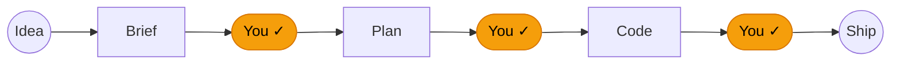

# Harness Goodies

**An opinionated, human-in-the-loop workflow for [Claude Code](https://claude.ai/code).** Turns a rough feature idea into shipped, reviewed, committed code — without you babysitting every step, and without letting Claude ship blind.

Skills and one adversarial review agent. Every piece explained with a worked example in the [interactive handout](https://user538295.github.io/harness-goodies/handout/) (English · [Magyar](https://user538295.github.io/harness-goodies/handout/index-hu.html)).


> `/feature-refinement` → `/plan-maker` → `/implement` — idea to commit in one session. `/implement all <file>` runs the full plan unattended.

---

## The shape of it



Three human gates, everything else automated (simplified default view; see the full handout for the 4-gate detailed pipeline). The full 9-step pipeline lives in the handout: [agentic-workflow-en.html](https://user538295.github.io/harness-goodies/handout/agentic-workflow-en.html) · [agentic-workflow-hu.html](https://user538295.github.io/harness-goodies/handout/agentic-workflow-hu.html).

---

## What it gives you

Each entry links to its handout page with a worked example.

### Ship a feature, start to finish

- [**`/feature-refinement`**](https://user538295.github.io/harness-goodies/handout/skill-feature-refinement.html) — Turn a rough idea into a brief you can hand off. A senior product thinker walks you through the questions you'd otherwise skip.
- [**`/plan-maker`**](https://user538295.github.io/harness-goodies/handout/skill-plan-maker.html) — Stop staring at a ticket wondering where to start. Breaks the brief into the smallest tasks with tests and dependencies.
- [**`/implement`**](https://user538295.github.io/harness-goodies/handout/cmd-implement.html) — One command for the whole plan, four ways to call it. `/implement next <file>` builds just the next task test-first, reviews itself, and commits — one task, one commit — then stops. `/implement all <file>` loops through every remaining task: it spawns a subagent per task whenever the harness exposes a subagent tool — Claude Code (including `claude -p`), OpenCode, omp, Cursor — and falls back to an inline loop only where no such tool exists. `/implement all inline <file>` forces that inline loop. Bare `/implement <file>` does the task if only one remains, otherwise asks next-or-all (headless defaults to next).
- [**`/quick-plan`**](https://user538295.github.io/harness-goodies/handout/skill-quick-plan.html) — No plan yet and too busy for `/plan-maker`. Defines the goal, success criteria, and 4–12 steps inline — one pass, no file written.
- [**`/commit`**](https://user538295.github.io/harness-goodies/handout/skill-commit.html) — Commit time. Reads the staged diff, writes a Conventional Commits message with a why-first body, and commits. Use `/commit message` to draft the text without touching the repo.
- [**`/wrap-up`**](https://user538295.github.io/harness-goodies/handout/skill-wrap-up.html) — Done for the day, not sure anything slipped. Audits commit hygiene, runs tests and devil's advocate, surfaces what's open — mutates nothing until you say yes.

See `skills/implement/SKILL.md` § NEXT mode, "Step 6: Commit" for the one-task-one-commit rule.

### Fix a bug

- [**`/bugfix`**](https://user538295.github.io/harness-goodies/handout/skill-bugfix.html) — You have a bug and need it gone — not just patched. Drives a four-agent pipeline: failing test first, TDD fix, doc update, full review loop, commit.

### Get a second opinion

- [**`/da-review`**](https://user538295.github.io/harness-goodies/handout/cmd-da-review.html) — A second opinion that actually pushes back. One-pass devil's-advocate review, no auto-fixes.
- [**`/iterative-review`**](https://user538295.github.io/harness-goodies/handout/cmd-iterative-review.html) — A review that doesn't stop at finding problems. Reviewers and fix agents loop until clean.
- [**`/aaa`**](https://user538295.github.io/harness-goodies/handout/skill-aaa.html) — When "looks good to me" isn't enough. Benchmarks an idea against world-class and hands you 3–4 concrete upgrade paths.
- [**`/clean-code-review`**](https://user538295.github.io/harness-goodies/handout/skill-clean-code-review.html) — Code done, want the deep read. Runs 132 checks across 7 groups (clarity, smells, SOLID, architecture, tests, safety, DDD) — on local changes, staged/unstaged/untracked, a git range, a pull/merge-request link, or specific files.
- [**`/options`**](https://user538295.github.io/harness-goodies/handout/skill-options.html) — Stuck between approaches. Produces 2–4 genuinely different paths with honest pros/cons, grounded in your actual project files, and a firm recommendation.

Powered by the [`devils-advocate`](https://user538295.github.io/harness-goodies/handout/agentic-workflow-en.html#da) agent — the thing actually doing the attacking. Auto-invoked by both review skills and inside `/implement`.

### Make Claude remember

- [**`/llm-wiki`**](https://user538295.github.io/harness-goodies/handout/skill-llm-wiki.html) — You've done the research, but Claude keeps forgetting it. Captures notes, sources, decisions; future chats search it first → sharper answers, fewer tokens.

### Wrangle docs and skills

- [**`/documentation-standard`**](https://user538295.github.io/harness-goodies/handout/skill-documentation-standard.html) — Docs your team will actually find again. Enforces structure across architecture notes, ADRs, manuals, and dev guides.
- [**`/skill-packager`**](https://user538295.github.io/harness-goodies/handout/skill-skill-packager.html) — Built a Claude Code skill? Make it work in Claude Desktop too. Packages your folder into an upload-ready ZIP.
- [**`/doc-voice`**](https://user538295.github.io/harness-goodies/handout/skill-doc-voice.html) — Docs that read like marketing copy or dry internal prose. Applies a problem-first, proof-led voice to READMEs, handouts, and guides — without touching structure.
- [**`/md-reviewer`**](https://user538295.github.io/harness-goodies/handout/skill-md-reviewer.html) — Terms shift, cross-references rot, contradictions accumulate. Reviews Markdown for consistency, contradictions, and stale links — handles sets of 50+ files.
- [**`/plain-language`**](https://user538295.github.io/harness-goodies/handout/skill-plain-language.html) — Need to explain a technical decision to a non-technical stakeholder. Rewrites it consequence-first, technical detail in parentheses — precise but followable without knowing the codebase.

### Monitor background tasks

- [**`/status-report`**](https://user538295.github.io/harness-goodies/handout/skill-status-report.html) — Kicked off a long task and don't know when it'll finish. Reports status on demand or on a recurring schedule — cancel anytime with `off`.
- [**`/session-log`**](https://user538295.github.io/harness-goodies/handout/skill-session-log.html) — One stable package for Claude Code, Codex, Cursor, OpenCode, and OMP. The host selects its identity explicitly; the package never guesses from paths, processes, or environment variables. Logging and usage stay native to each harness.

Each harness plugin ships the package; nothing else is installed. In Claude Code the plugin's hooks stay idle until `/session-log on`, which takes effect with the next prompt (`on — logging starts with the next prompt`); when logging was already on but no hook of the running session has seen it, `on` reports `on — restart required`. In the other harnesses, restart after `/session-log on` when it reports `on — restart required`; Codex instead reports `on — restart Codex, then choose 'Trust all and continue' on the 'Hooks need review' screen (or approve the session-log hooks in /hooks)`, because Codex runs new `hooks.json` commands only once you trust them; `status` repeats it until a Codex session has run them.

One script bundle handles the progress plumbing — [`scripts-plan`](https://user538295.github.io/harness-goodies/handout/scripts-plan.html) prints the next-task progress header — `/implement` reads it once in NEXT mode, and on every iteration in ALL mode. The [`session-log`](https://user538295.github.io/harness-goodies/handout/skill-session-log.html) skill archives the prompt and response text exposed by each harness as per-project Markdown; the universal package owns activation and migration for all five harnesses. See the [session-log handout](https://user538295.github.io/harness-goodies/handout/skill-session-log.html) for details.

---

## Install · Update


### Claude Code plugin marketplace

```bash
claude plugin marketplace add user538295/harness-goodies
claude plugin install claude-goodies
```

The marketplace plugin bundles the Claude skill, runtime, and native hooks. Its `hooks/hooks.json` always registers the session-log hooks, which do nothing until `/session-log on` creates the enable flag: `on` and `off` only flip that flag, and `status` only reads it together with the runtime marker the hooks of a running session write. This release registers hooks only through the plugin; a copy the cleanup had to keep (see below) still runs older code that can register its own, so move it aside. Older releases registered the hooks in `~/.claude/settings.json` and copied the package to `~/.claude/skills/session-log`, which went stale after plugin updates; `/session-log on`, `repair`, and each Claude Code startup remove those leftovers (and the legacy prompt_log scripts the pre-plugin install copied into `~/.claude/scripts`), and removing them never makes `status` report a restart; `on` still turns logging on when that cleanup fails (and names the failure) or is skipped because another session-log command is running. The copy goes only when its ownership manifest proves every file in it unchanged; otherwise `repair` names it so you can move it aside. A startup repeats that cleanup only when `settings.json`, the session-log package (its location or `VERSION`), or the presence of that copy or those scripts changed since its last attempt; `/session-log repair` runs it on demand and reports what it changed. Restart Claude Code (or start a new session) for plugin changes to load. To update later:

```bash
claude plugin update claude-goodies@user538295
```

### omp plugin marketplace

```bash
omp plugin marketplace add user538295/harness-goodies
omp plugin install omp-goodies@user538295
```

Inside omp the same steps are `/marketplace add user538295/harness-goodies` and `/marketplace install omp-goodies@user538295`. omp reads its own catalog (`.omp-plugin/marketplace.json`) and installs `omp-goodies`: every skill (including `/skill:da-review` and `/skill:iterative-review`) and the `devils-advocate` agent with omp tool names. Run `/reload-plugins` or start a new session to load them. To update later:

```bash
omp plugin marketplace update user538295
omp plugin upgrade omp-goodies@user538295
```

Session logging is opt-in: `/skill:session-log on` links the extension of the package it runs from; restart omp once, after which `/session-log status|on|off|usage|repair` works directly.

Each entrypoint passes its native harness identity explicitly; it never infers a harness from directories or environment variables. `off` never installs an absent adapter.

### Cursor plugin

Cursor reads its own manifests (`.cursor-plugin/plugin.json` and `.cursor-plugin/marketplace.json`) and installs `cursor-goodies`: every skill and the `devils-advocate` agent. The plugin ships no hooks; session logging stays opt-in through `/session-log on`. Install it through one of two marketplace routes.

**Cursor Marketplace.** Once Cursor has reviewed and listed the plugin, open **Customize** in the sidebar, search for `cursor-goodies`, select **Install**, and choose a project or user scope. Cursor reviews every update before publishing it.

**Team marketplace** (Teams and Enterprise plans; on Enterprise only admins can add one):

1. Open **Dashboard → Plugins & MCPs**.
2. In **Team Marketplaces**, click **Add Marketplace**, choose **Import from Repo**, and paste `https://github.com/user538295/harness-goodies`.
3. Add `cursor-goodies` with **Add to Marketplace**.
4. Under **Marketplace Settings**, set **Marketplace Access** and optionally **Enable Auto Refresh** (needs the Cursor GitHub App on the repository), then save.
5. Each developer installs `cursor-goodies` from **Customize**, unless an admin set it to Default On or Required.

To update later, Auto Refresh re-indexes the marketplace after each push; otherwise click **Refresh** on the marketplace.

### Codex plugin

```bash
codex plugin marketplace add user538295/harness-goodies
codex plugin add codex-goodies@user538295
```

Codex reads its own manifests (`.agents/plugins/marketplace.json` and `.codex-plugin/plugin.json`) and installs `codex-goodies`: every skill, namespaced as `codex-goodies:<skill>`. Codex plugins carry no agents, so `devils-advocate` is not included; `da-review` and `iterative-review` fall back to generic subagents that read the persona from the plugin's `agents/devils-advocate.md`. The plugin ships no hooks; session logging stays opt-in through the `session-log` skill's `on` command, which requires this plugin installed from the `user538295` marketplace and adds four commands to `~/.codex/hooks.json`. Each one runs the newest codex-goodies package installed from that marketplace (never another marketplace's) and does nothing once the plugin is removed. Their text names no package path or version, so plugin updates never change it and they stay trusted once you trust them: until a Codex session has run them, `on` and `status` report `on — restart Codex, then choose 'Trust all and continue' on the 'Hooks need review' screen (or approve the session-log hooks in /hooks)`. `on` and `repair` also replace the entries older releases registered by package path (only while the plugin is installed; without it they leave those entries alone and `status` reports `on — codex-goodies plugin not installed`) and remove the package copy those releases seeded into `~/.codex/skills/session-log`. A copy with a changed or foreign file is named, not removed. A copy `~/.codex/hooks.json` still names (or that cannot be read) stays, because Codex sessions started earlier keep running its hook, and a hook whose script is gone blocks their prompts. Restart Codex before the next `on` or `repair`: that run removes the copy, and neither command can tell whether Codex restarted. Start a new session to load it. To update later:

```bash
codex plugin marketplace upgrade user538295
```

Installed `claude-goodies@user538295` in Codex before this plugin existed? Switch with `codex plugin remove claude-goodies@user538295 && codex plugin add codex-goodies@user538295`; that install also registered the Claude Code session-log hooks, which the switch removes.

### OpenCode plugin

```bash
opencode plugin add github:user538295/harness-goodies
```

Requires OpenCode V2. OpenCode installs the `opencode-goodies` package (`package.json` plus `.opencode-plugin/index.js`) into its package cache, adds it to `~/.config/opencode/opencode.json`, and loads it without a restart. The plugin registers every skill and the `devils-advocate` subagent. To update later:

```bash
opencode plugin update
```

Skills and agents with the same names under `~/.config/opencode/skills` and `~/.config/opencode/agents` take precedence over the plugin's copies; remove those copies to use the plugin's versions. Session logging stays opt-in through `/session-log on`.

### Universal session-log package

Each harness plugin above ships the package, so there is nothing to install separately. The skill's `install.sh` runs one command through the package it belongs to, for the identity the host names (Codex is the exception: its hooks run only the codex-goodies plugin-cache package, so Codex `on` fails from a checkout without that plugin installed); from a checkout of this repository:

```bash
bash skills/session-log/install.sh --harness opencode --arguments "on"
```

Earlier releases copied the package into every harness's skill root; Claude Code's `/session-log on`, `repair`, and session start remove that copy (see the Claude Code section above), and so do Codex's `on` and `repair` (see the Codex section above).

The supported identities are exactly `claude`, `codex`, `cursor`, `opencode`, and `omp`. The universal `SKILL.md` requires the current host/model to choose one explicitly; identity is never inferred from directories, processes, or environment variables.

Only default roots are supported: Claude Code `~/.claude`, Codex `~/.codex`, Cursor `~/.cursor`, OpenCode `~/.config/opencode`, and OMP `~/.omp/agent`. OpenCode also reads native data from `~/.local/share/opencode`; relocated config or data roots fail explicitly. Logging remains off until enabled separately in each harness. In Codex, Cursor, OpenCode, and OMP, `status` and `usage` repair a missing or outdated adapter while logging is enabled; Claude Code has no adapter to repair.

OpenCode and OMP keep per-process runtime records alongside the shared runtime pointer. The adapters bound their in-memory session history; after a process restart, the on-disk logs remain the source of recorded prompts and responses.


---

## Why this repo has opinions

Unconstrained AI coding produces verbose, coupled code that accumulates fast and is hard to reverse. Constraints aren't slow — they're the thing that makes the output trustworthy enough to ship.

The repo is developed under the guidelines in its own [`AGENTS.md`](AGENTS.md), which Claude Code, Codex, OpenCode, and omp load at session start. The plugins don't install it — copy it into your own `AGENTS.md` or `~/.claude/CLAUDE.md` if you want the same rules. It encodes three principles:

1. **Think before coding.** Verify and cite every claim, state assumptions, surface tradeoffs, push back when warranted.
2. **Simplicity first.** Minimum code that solves the problem; nothing speculative.
3. **Surgical changes.** Touch only what the task requires, and fix any concrete defect you find along the way.

All three are adapted from [Andrej Karpathy's guidelines](https://github.com/multica-ai/andrej-karpathy-skills/blob/main/skills/karpathy-guidelines/SKILL.md).

And enforces: tests before code (85%+ coverage), warning-free codebase at all times. `skills/implement/SKILL.md` adds the execution-level rule: one commit per plan task, no batching multiple tasks into a single commit.

If that's not your speed, this repo isn't for you. If it is — install in 30 seconds.

## Requirements

- Universal session-log: Claude Code, Codex, Cursor, OpenCode, or OMP.
- macOS or Linux — or Windows via WSL.
- Native Windows is partial: the Claude Code plugin's session-log hooks run under Git Bash (install Git for Windows), exit 0 silently when their script is missing, and need no jq while logging is off. `/session-log on`, `off`, `repair`, and the session-start legacy cleanup need WSL. While older releases' leftovers remain, a startup on native Windows attempts that cleanup once per change to them, to `settings.json`, or to the session-log package (its location or `VERSION`), and the attempt fails silently. Use WSL to log sessions on Windows.
- bash, Python 3, jq, standard POSIX utilities, and `shasum` or `sha256sum`.
- sqlite3 for OpenCode native usage reports.
- Bun for OMP native usage reports.

No MCP servers are required.

---

Full reference, with worked examples for every skill, agent, and script — open the handout:
**[English](https://user538295.github.io/harness-goodies/handout/) · [Magyar](https://user538295.github.io/harness-goodies/handout/index-hu.html)**.
