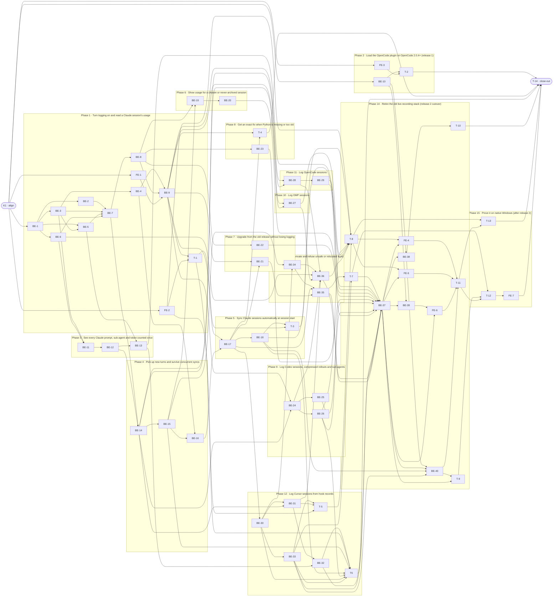

# SLS · Simple Session-log — Task Breakdown

**How to read this file**
- This is the **order view** for [session-log-simple-team-plan.md](./session-log-simple-team-plan.md) — every task is a single-role checkbox in execution order, opening with a dependency graph.
- **Phases are vertical slices**: each delivers a working end-to-end increment, not a horizontal layer. No separate "integrate" phase. Sliced with the **`vertical-slicer` skill** (installed; its verticality test, smells and behaviour-first order were applied). Phase 2 (release 1) needs only K1, so it runs in parallel from day one and ships first.
- Each task carries the **role tag at the end of its title line**, then sub-bullets: **layer · estimate** (decimal hours), **needs · completes**, and a **Tests** block. **needs** = predecessor tasks; **completes** = the scenario `S#` (from the plan) it makes true, or the contract `C#` (from the plan) it realises. A scenario cited by several tasks is made true by their sum.
- **Tests** are tagged by level. **Unit and integration tests belong to the implementing dev** (test-first); **e2e and manual tests are the tester's tasks**. Documentation and checklist tasks and the close-out write no tests.
- Component, file and symbol names come from the Step 2 grounding of the real repo. `session_log.py`, `sessionlog/`, `prices.json`, `hook`, `hook.ps1`, `tests/__init__.py` and `windows-checklist.md` do not exist yet (planned by the plan's Q4); other module names are left to the dev.
- IDs (`K#`/`BE-#`/`FE-#`/`T-#`) are this file's traceability thread; `S#`/`C#`/`Q#` are defined in the plan.
- **Rule:** edit your own tasks freely.

---

## References

- **Plan:** [session-log-simple-team-plan.md](./session-log-simple-team-plan.md) — the full team plan (contracts, scenarios, architecture, allocation). **Always read the plan before you start planning the next task** — it holds the context this file only cites (`S#`/`C#`/`Q#`).
- **Brief:** [session-log-simple-brief.md](./session-log-simple-brief.md) — the source feature brief behind the plan.

---

## Task Breakdown

Single-role tasks in execution order, grouped into **vertical slices**.

### Dependency graph

### Phase 0 · Kickoff *(prerequisite; the one cross-cutting step)*
- [x] **K1** — Agree Contracts C1–C6 and the Scenarios with the team #team
    - — · 1.0h
    - completes C1, C2, C3, C4, C5, C6
    - Tests

### Phase 1 · Turn logging on and read a Claude session's usage *(the walking skeleton: `on` → sync a Claude session → `usage` prints the saved report; carries the model, state, price and writer foundation)*
- [x] **BE-1** — Entities: SessionModel (Session, Prompt, RequestUsage, SubAgent with id, type, start, parent), the `SafeId` rule, and `tests/__init__.py` so `unittest discover -s skills/session-log/tests -t skills/session-log` imports `sessionlog` #backend-role
    - Entities · 2.0h
    - needs K1 · completes C2
    - Tests
        - #unit_test — `test_safe_id_rejects_dotdot_slash_and_windows_device_names` — 1–128 chars of `[A-Za-z0-9_-]`; stricter than today's `SAFE_ID` in [session_log_hook.py](./skills/session-log/adapters/native/session_log_hook.py)
        - #unit_test — `test_sub_agents_ordered_by_start_then_id` — the fixed row order
        - #unit_test — `test_last_activity_includes_sub_agent_activity` — `lastActivityAt` rule
- [x] **BE-2** — StateStore (C6): `.log_enabled` created exclusively holding the on-time, `.sync.json` with unit and session entries, merged by key before each save, empty or corrupt file rebuilt and reported #backend-role
    - Interface Adapters · 3.0h
    - needs BE-1 · completes C6
    - Tests
        - #unit_test — `test_log_enabled_exclusive_create_keeps_existing_on_time` — `on` while on keeps the time
        - #unit_test — `test_unparsable_log_enabled_falls_back_to_file_time` — and reports it
        - #integration_test — `test_corrupt_sync_json_rebuilt_and_reported` — real files in a temp root
- [x] **BE-3** — PricingRules and the `PriceBook` port (with `Rates`): `UsageReport` rows per prompt, recorded cost first, cents half-up, `price: unknown` and `≥ $X.XX (incomplete)` rows, TOTAL = sum of shown rows, API-equivalent label for Codex/Cursor #backend-role
    - Use Cases · 3.0h
    - needs BE-1 · completes S18, S19, S52
    - Tests
        - #unit_test — `test_known_model_priced_with_own_cache_read_write_5m_1h_and_fast_rates` — effort shown, rate unchanged (S19)
        - #unit_test — `test_unknown_model_row_unknown_total_incomplete_never_zero` — S18
        - #unit_test — `test_rows_rounded_half_up_mixed_row_incomplete_total_is_sum_of_rows` — S52, ports `test_prompt_log_usage.sh` `:505-511`
- [x] **BE-4** — PriceFile loader implementing `PriceBook`, and the shipped `prices.json` (`prefixes`, `in`, `out`, `cache_read`, `cache_write_5m`, `cache_write_1h`, optional `fast`, `source`, `as_of`); rates and `source` taken from the official pricing pages the brief's F6 names (Claude, Codex, Cursor) #backend-role
    - Interface Adapters · 2.0h
    - needs BE-3 · completes C4, S51
    - Tests
        - #unit_test — `test_longest_prefix_wins_and_name_matched_from_first_claude` — `us.claude-opus-5-5-medium`, `us.anthropic.claude-opus-5-v1:0`, `claude-sonnet-5` vs `claude-sonnet-5-5`
        - #unit_test — `test_missing_malformed_or_duplicate_prefix_file_makes_every_price_unknown_and_names_problem` — command still exit 0
        - #unit_test — `test_fast_request_without_fast_rates_unknown_unsplit_cache_write_uses_5m` — plus Codex/Cursor cache-write tokens
        - #unit_test — `test_shipped_prices_json_valid_with_source_and_as_of` — every entry
- [x] **BE-5** — LogUsageWriter implementing `Archive` (C3): log path `<slug>/session_<UTC ts>_<id>.md` and report beside it, slug rules through the injected path module, log and report rendered from the C2 `Session`, local times with UTC offset, UTF-8 + LF, unique temp + `os.replace`, stale temps older than 1 hour removed #backend-role
    - Interface Adapters · 4.0h
    - needs BE-1, BE-3 · completes C3, S38, S53
    - Tests
        - #unit_test — `test_slug_replaces_other_chars_cuts_64_root_and_unknown_fallbacks` — all-non-ASCII, 100-char, `/` and `C:\` via injected `ntpath`, first recorded cwd (S38)
        - #unit_test — `test_prompt_head_first_60_chars_newlines_tabs_one_space_no_split_multibyte` — S53, ports `test_prompt_log_usage.sh` `:116,139,385-389`
        - #unit_test — `test_times_render_local_with_utc_offset_zero_offset_plain_utc` — `UTC+2`, `UTC-5`, `UTC+5:30`, `UTC`
        - #integration_test — `test_write_goes_through_unique_temp_then_replace_stale_temp_removed_fresh_kept` — UTF-8, LF line ends
- [x] **BE-6** — ClaudeReader, main session: `scan` with fingerprints, `sessionOf` from the path (`~/.claude/projects/<cwd with non-alnum → '-'>/<sid>.jsonl`), prompt, final reply and per-message usage, built from fixtures cut by the dev (text only, anonymized, Q21), ported from the builders in `test_prompt_log_usage.sh` `:88-190` #backend-role
    - Interface Adapters · 4.0h
    - needs BE-1 · completes C2
    - Tests
        - #unit_test — `test_claude_scan_lists_units_with_changing_fingerprint` — fingerprint moves with the file
        - #unit_test — `test_claude_session_id_and_cwd_from_path_and_records` — `sessionOf` once
        - #integration_test — `test_claude_reader_reads_session_tree_from_text_fixture` — prompt, reply, usage
- [x] **BE-7** — Sync use case (C1): scan, compare fingerprints, read only changed sessions with activity since the on-time, archive whole, rewrite log and report through `Archive`, save progress after each session #backend-role
    - Use Cases · 4.0h
    - needs BE-2, BE-3, BE-5, BE-6 · completes C1
    - Tests
        - #integration_test — `test_sync_archives_session_active_since_on_and_skips_older` — fakes for ports, real fixture
        - #integration_test — `test_unchanged_fingerprint_session_not_read_again` — cost does not grow
        - #integration_test — `test_progress_saved_after_each_session` — kill mid-run keeps finished sessions
- [x] **BE-8** — Command use cases `on`, `off`, `status`, `usage` (latest saved report ranked by newest prompt from `.sync.json`) returning `OnResult`, `OffResult`, `StatusResult`, `UsageResult`; `on` while on keeps the on-time; `off` syncs once then turns off; `off` while off does nothing; while off no command syncs #backend-role
    - Use Cases · 4.0h
    - needs BE-7 · completes C1, S49
    - Tests
        - #integration_test — `test_on_off_semantics_on_keeps_time_off_syncs_once_off_while_off_noop` — S49
        - #integration_test — `test_status_reports_counts_unreadable_and_state_reset` — corrupt `.sync.json` and unparsable `.log_enabled` (S49)
        - #integration_test — `test_usage_latest_prints_saved_report_text` — no argument equals `--latest`
- [x] **FE-1** — Presentation module: render `OnResult`, `OffResult`, every `StatusResult` field and `UsageResult` text on stdout (pure result → text, no I/O); the fixed wording is chosen here and pinned by the S67 tests #frontend-role
    - Presentation · 3.0h
    - needs K1 · completes S67
    - Tests
        - #unit_test — `test_on_off_results_render_already_on_off_probe_fix_and_leftovers` — set field shown, unset field not
        - #unit_test — `test_status_result_renders_every_optional_field_with_fixed_wording` — unreadable, Cursor silent, price-file problem, state reset, file-time on-time
        - #unit_test — `test_usage_result_text_printed_unchanged` — incl. `≥` and `ő`
- [x] **FE-2** — Rewrite [SKILL.md](./skills/session-log/SKILL.md) and [test_locator.sh](./skills/session-log/tests/test_locator.sh): one line `python3 "<skill dir>/session_log.py" <harness> <arguments>`, Windows fallback (`py -3`, then `python`) as prose, announced directory first else the golden locator (probe `session_log.py`, which only prints the directory, Q26) on macOS/Linux or `SESSION_LOG_HOME` on Windows; frontmatter without `repair` and without the ownership marker #frontend-role
    - Presentation · 4.0h
    - needs K1 · completes S25, S60
    - Tests
        - #unit_test — `test_skill_md_has_exactly_one_script_line_and_no_other_shell_syntax` — S25, static text
        - #unit_test — `test_skill_md_has_no_repair_no_install_sh_no_managed_marker` — static text
        - #integration_test — `test_locator_prints_newest_copy_holding_session_log_py_skipping_seeded_and_neutralized` — `mkpackage` builds [SKILL.md](./skills/session-log/SKILL.md) + stub `session_log.py`; old seeded copy (SKILL.md + `install.sh`) loses to the plugin cache (S60)
        - #integration_test — `test_locator_not_found_prints_error_with_session_log_home_hint` — Q26
- [x] **BE-9** — Entry script `session_log.py`: parses on Python 3.4 and checks ≥ 3.14 before importing `sessionlog/`, printing the requirement line and one install-fix line for the running platform (S55); stdout and stderr UTF-8; argv with its own `session-log:` texts, exit 0/1/2, no traceback; composition root builds the Claude reader, Archive, StateStore, PriceBook, injected clock, platform, path module; dispatches one use case and prints via the presentation module #backend-role
    - Frameworks & Drivers · 4.0h
    - needs BE-4, BE-8, FE-1 · completes C1, S5, S36, S54
    - Tests
        - #unit_test — `test_unsupported_or_missing_harness_exits_2_with_session_log_prefix_writes_nothing` — S5
        - #unit_test — `test_bad_arguments_exit_2_without_argparse_usage_and_runtime_error_exits_1` — S36
        - #unit_test — `test_injected_old_python_prints_requirement_and_fix_line_exit_1_and_exception_gives_internal_error_not_traceback` — S55, command half
        - #unit_test — `test_fix_line_names_brew_on_darwin_install_manager_on_win32_and_package_manager_elsewhere` — S55, injected `sys.platform`
        - #integration_test — `test_cp1252_subprocess_stdout_is_utf8_and_files_are_utf8_lf` — S54, report with `≥` and `ő`
- [x] **T-1** — E2E of the skeleton in a sandbox `HOME`: `on`, `off`, `status`, `usage` for Claude on macOS and in `python:3.14-slim`; the Docker run commands live with the tests #tester-role
    - — · 3.0h
    - needs BE-9, FE-2 · completes S1, S2, S3, S4
    - Tests
        - #e2e_test — `test_on_records_time_syncs_and_prints_log_folder` — no Python probe off Windows (S1)
        - #e2e_test — `test_off_syncs_once_deletes_log_enabled_keeps_logs_and_nothing_syncs_after` — S2 (hook half in T-3, T-5)
        - #e2e_test — `test_status_prints_state_folder_last_sync_count_and_unreadable_file` — S3 basic fields; full set in T-6
        - #e2e_test — `test_usage_no_argument_equals_latest_and_equals_saved_usage_txt` — S4

### Phase 2 · Load the OpenCode plugin on OpenCode 2.0.4+ *(release 1: ships first and on its own from `main`; needs only K1)*
- [x] **BE-10** — Release 1 plugin fix: [index.js](./.opencode-plugin/index.js) `:34` sends `path`, the session-log import `:63-70` removed, header `:1-3` updated; `skills/session-log/VERSION` bumped (the [release.sh](./release.sh) guard `:16,198` requires it); [index.test.js](./.opencode-plugin/index.test.js) `:75` name, `:79` and `:92` `.location` → `.path`, `:90-96` expects no plugin command, `:98-101` and `:110-130` deleted, no-op `bash` (`:14-20,24`) becomes a recording stub that must stay unused #backend-role
    - Frameworks & Drivers · 3.0h
    - needs K1 · completes S27
    - Tests
        - #unit_test — `test_plugin_registers_skills_and_agent_with_path_not_location` — `bun test`
        - #unit_test — `test_no_plugin_command_registered` — S27
        - #unit_test — `test_no_session_log_handler_loaded_and_recording_bash_stub_never_called` — no background `repair`
- [x] **FE-3** — Release 1 docs: [SKILL.md](./skills/session-log/SKILL.md) `:64` and [README.md](./README.md) `:154,160` say session-log does not log in OpenCode until the next release and tell the model not to run it there; the same for every other OpenCode line that says the plugin registers or logs session-log (grounding found SKILL.md `:45,79,84`, README `:72,176`) #frontend-role
    - Presentation · 2.0h
    - needs K1 · completes S66
    - Tests
- [x] **T-2** — Release 1 gate: scripted isolated `opencode serve` plus a real OpenCode ≥ 2.0.4 run, and the S66 wording read-through, before release 1 ships #tester-role
    - — · 3.0h
    - needs BE-10, FE-3 · completes S27, S66
    - Tests
        - #e2e_test — `test_isolated_opencode_serve_reports_plugin_active_with_all_skills_and_agent` — scratch `HOME`/XDG, plugin `status` `active` as in the brief's F5 proof
        - #e2e_test — `test_skill_md_and_readme_say_opencode_does_not_log_until_next_release` — scripted wording check, S66
        - #manual_test — Real OpenCode ≥ 2.0.4 loads the plugin as `active` and starts no session-log process — S27
        - #manual_test — Read [SKILL.md](./skills/session-log/SKILL.md) and README OpenCode lines before release 1 ships — S66

### Phase 3 · See every Claude prompt, sub-agent and token counted once
- [x] **BE-11** — ClaudeReader prompt and usage rules (Q16): `typed`/`queued`/`sdk`/`suggestion_accepted`, `bridge-session`, `queued_command` attachments, slash-command heads with tags stripped, `<task-notification>` and `<synthetic>` skipped, Haiku effort not recorded, streamed copies counted once, interrupted turn, fast vs standard, legacy `cache_creation_input_tokens`, unknown record types and bad lines skipped, unparsable file unreadable #backend-role
    - Interface Adapters · 4.0h
    - needs BE-3, BE-6 · completes S16, S40, S41
    - Tests
        - #unit_test — `test_only_real_prompts_open_rows_and_synthetic_skipped_haiku_effort_not_recorded` — S40, ports `test_prompt_log_usage.sh` `:277-358`
        - #unit_test — `test_streamed_copies_count_once_with_last_copy_interrupted_turn_counted_fast_uses_fast_rates` — S41
        - #unit_test — `test_corrupt_and_truncated_lines_skipped_next_record_kept_working_time_ends_at_last_output` — S41
        - #unit_test — `test_unknown_record_types_skipped_silently_only_unparsable_file_listed` — S16
- [x] **BE-12** — ClaudeReader sub-agents: `<sid>/subagents/**/agent-*.jsonl` (nested and workflow) with `agent-*.meta.json` type, id, start time, parent, unit count; log has header, `## <time>` prompts, `### <time> response` replies, no tool calls #backend-role
    - Interface Adapters · 4.0h
    - needs BE-11 · completes S6
    - Tests
        - #unit_test — `test_nested_and_workflow_subagents_attach_to_session_with_type_from_meta` — S6
        - #integration_test — `test_claude_log_has_header_prompts_and_final_replies_no_tool_calls_and_no_helpers_line` — S6
- [x] **BE-13** — PricingRules and report rendering for sub-agents: nested sub-agent rows ordered by start then id, TOTAL tokens and price = main + every sub-agent, working time = main per-prompt times only, `TOTAL (N requests, M sub-agents)`, models sorted, unique, joined `+`, `:fast` marks #backend-role
    - Use Cases · 3.0h
    - needs BE-5, BE-12 · completes S20, S63
    - Tests
        - #unit_test — `test_total_includes_every_subagent_and_working_time_is_main_only` — S20
        - #unit_test — `test_subagent_rows_with_same_start_ordered_by_id_at_each_level` — S20
        - #integration_test — `test_claude_report_equals_golden_file_byte_for_byte_and_total_equals_sum_of_rows` — S63, expected values recomputed with the new `prices.json`

### Phase 4 · Pick up new turns and survive concurrent syncs
- [x] **BE-14** — Sync correctness: a new unit's session learned once and kept, activity decided by record times, sessions read whole from all units incl. sub-agent files older than the on-time, sub-agent activity counts, unreadable units and skipped sessions retried every sync, session ids failing `SafeId` not archived (sub-agent keeps its row) #backend-role
    - Use Cases · 4.0h
    - needs BE-7, BE-12 · completes S13, S14, S46, S47
    - Tests
        - #integration_test — `test_sessions_before_on_skipped_started_before_but_active_after_archived_whole_second_run_identical` — S13, first run without `.sync.json`
        - #integration_test — `test_claude_file_with_one_more_turn_read_again_and_log_updated` — S14, Claude part
        - #integration_test — `test_200_unchanged_sessions_not_read_and_known_units_not_learned_twice` — S47, `sessionOf` count through an injected counter
        - #integration_test — `test_unsafe_session_id_not_archived_status_lists_it_subagent_row_and_tokens_stay` — S46
- [x] **BE-15** — Sync rewrite safety: unique temp names per run, merge-by-key `.sync.json` saves that drop a changed unit's fingerprint, failed `.sync.json` replace keeps the old file and no temp, failed `os.replace` skips and reports (and hands the unsaved report text back for `usage`), partly gone source never rewritten and named "source partly gone (N of M units)", old-format logs never touched, log path kept so a changed start or cwd or a `TZ` change makes no duplicate #backend-role
    - Use Cases · 4.0h
    - needs BE-14 · completes S15, S17, S33, S48, S61
    - Tests
        - #integration_test — `test_two_syncs_use_different_temp_names_and_each_publishes_complete_files` — S17, S48, injected process ids
        - #integration_test — `test_older_read_publishing_last_drops_fingerprint_and_next_sync_rewrites_from_newer_source` — S48
        - #integration_test — `test_deleted_source_and_old_format_logs_byte_identical_and_partly_gone_session_not_rewritten` — S15
        - #unit_test — `test_os_replace_raising_skips_file_removes_temp_and_reports_path_and_reason` — S33 POSIX half
        - #integration_test — `test_log_path_reused_name_stays_utc_offsets_plus2_minus5_plus530_dst_row_gets_own_offset_tz_change_rewrites_nothing` — S61
- [x] **BE-16** — Render-version rewrite and 20 s budget: `RENDER_VERSION` kept per session entry, every archived session rewritten once after a raise, a stopped sync resumes, a copy with an older version rewrites nothing for its version, a rewrite is never built from fewer units than the entry's count; hook budget stops new sessions after 20 s #backend-role
    - Use Cases · 3.0h
    - needs BE-4, BE-15 · completes S65, S47
    - Tests
        - #integration_test — `test_budget_ends_halfway_second_sync_rewrites_the_rest_older_copy_rewrites_none_third_none` — S65, injected clock
        - #integration_test — `test_hook_budget_saves_progress_after_each_session_and_next_sync_finishes` — S47
        - #unit_test — `test_prices_json_sha256_pinned_to_render_version_fails_until_raised` — S65

### Phase 5 · Sync Claude sessions automatically at session start
- [x] **BE-17** — Hook entry `session_log.py hook claude SessionStart`: takes raw stdin bytes, checked before argument parsing, always exit 0, prints nothing, 20 s sync budget, silent on exceptions and on a malformed argv, unknown harness or unknown event #backend-role
    - Frameworks & Drivers · 3.0h
    - needs BE-9, BE-16 · completes S36, S55
    - Tests
        - #unit_test — `test_malformed_hook_argv_unknown_harness_or_event_exit_0_nothing_written_or_printed` — S36
        - #unit_test — `test_exception_inside_hook_exits_0_with_no_output` — S55, hook half
        - #integration_test — `test_claude_session_start_hook_syncs_and_prints_nothing` — sandbox `HOME`
- [x] **BE-18** — ClaudeHooksConfig: replace [hooks.json](./hooks/hooks.json) (four shell-form events, `startup` matcher) with one SessionStart in exec form `python3` with a one-line `-c` guard that exits 0 when the script is missing, no matcher, `async: true`, `timeout` 30 #backend-role
    - Frameworks & Drivers · 2.0h
    - needs BE-17 · completes S57
    - Tests
        - #unit_test — `test_claude_hooks_json_has_one_sessionstart_exec_form_guard_before_script_no_matcher_async_timeout_30` — S57, Claude part
        - #integration_test — `test_guard_exits_0_silently_when_script_missing` — run the args array without a shell
- [x] **T-3** — Claude SessionStart hook: e2e in a sandbox `HOME` and a real Claude Code run with a large backlog #tester-role
    - — · 4.0h
    - needs T-1, BE-18 · completes S23, S2
    - Tests
        - #e2e_test — `test_hook_claude_session_start_syncs_prints_nothing_for_start_resume_clear_compact` — exec-form args array, no shell
        - #e2e_test — `test_missing_script_guard_exits_0_silent_and_after_off_hook_writes_nothing` — S23, S2 hook half
        - #manual_test — Real Claude Code start, resume, clear, compact with a large backlog: session usable before the sync ends, wait recorded and under the 30 s `timeout` — S23
        - #manual_test — `python3` missing: the session continues, Claude may show a non-blocking hook error — S23

### Phase 6 · Show usage for a chosen or never-archived session
- [x] **BE-19** — `usage` target resolution: no argument = `--latest`; project = cwd else nearest parent folder with sessions (symlinked cwd matches); ranking from `.sync.json` only (newest prompt, no-prompt sessions below, newest activity if none, sub-agents and orphans never win); `<id>` exact else unique prefix over archived and store sessions; unknown, ambiguous and empty project exit 1; ports of `test_prompt_log_usage.sh` `:423-503,524-527`, Codex `--latest` ([test_python_adapters.py](./skills/session-log/tests/test_python_adapters.py) `:229-250`), Cursor subfolder `:6119-6125`, OMP id targets #backend-role
    - Use Cases · 4.0h
    - needs BE-8, BE-15 · completes S37
    - Tests
        - #integration_test — `test_latest_ranks_newest_prompt_streaming_session_and_ignores_subagents_orphans_and_no_prompt_sessions` — S37
        - #integration_test — `test_usage_id_exact_prefix_ambiguous_unknown_and_subfolder_and_symlinked_cwd` — `abc`, `ab`, unknown id, project without sessions
        - #integration_test — `test_usage_while_off_prints_report_saved_at_last_sync` — S37
- [x] **BE-20** — Live report for a session never archived: read through the invoked harness's reader, priced by PricingRules, rendered by `Archive.renderReport`, nothing written and no sync while off; `--latest` reads the store only when the project has no archived session; prints the report text a failed write could not save #backend-role
    - Use Cases · 3.0h
    - needs BE-19 · completes S68
    - Tests
        - #integration_test — `test_never_archived_session_text_equals_what_a_sync_would_save_and_nothing_is_written` — no log, report, temp or `.sync.json` change, off and on
        - #integration_test — `test_latest_reads_store_only_without_archived_session_first_root_with_prompt_wins` — S68
        - #integration_test — `test_unreadable_source_exits_1_and_symlinked_harness_root_still_fails` — S68

### Phase 7 · Upgrade from the old release without losing logging
- [x] **BE-21** — `.enabled` → `.log_enabled` migration in every command and hook after the root checks and before the `.log_enabled` check: exclusive create (on-time = now), then `.enabled` removal that tolerates it being gone; `.log_enabled` wins when both exist #backend-role
    - Interface Adapters · 3.0h
    - needs BE-9, BE-17 · completes S32, S49
    - Tests
        - #integration_test — `test_old_enabled_converted_before_on_check_same_run_proceeds_as_on` — S32
        - #integration_test — `test_two_hooks_at_once_create_one_log_enabled_on_time_kept_neither_fails` — S32
        - #integration_test — `test_both_flags_present_log_enabled_wins_enabled_removed` — S49
- [x] **BE-22** — Leftover scan module (the closed C1 list: old hook entries in `~/.claude/settings.json`, `~/.codex/hooks.json`, `~/.cursor/hooks.json`; `~/.claude/scripts/prompt_log_*`; seeded `skills/session-log` copies; OpenCode and OMP plugin, command, script and extension files; old `<harness root>/session-log/`; `~/.claude/session-maps/`) reported by `on` and `status` with a one-line fix, nothing deleted; recognizers ported from `lib/legacy_cleanup.sh` and `lib/claude_settings.py` #backend-role
    - Interface Adapters · 4.0h
    - needs BE-8 · completes S26
    - Tests
        - #integration_test — `test_each_leftover_kind_reported_with_fix_unrelated_entry_and_inert_files_not_and_nothing_deleted` — S26, sandbox `HOME`
        - #unit_test — `test_leftover_list_is_per_harness_for_the_invoked_harness_only` — one reader per run

### Phase 8 · Get an exact fix when Python is missing or too old
- [x] **BE-23** — Python probe runner: on Windows `on` and `status` run `python3 -c` (version ≥ 3.14) through the injected runner and platform; any failure prints the exact fix; no probe elsewhere #backend-role
    - Interface Adapters · 2.0h
    - needs BE-8 · completes S24
    - Tests
        - #unit_test — `test_probe_failure_of_any_cause_on_windows_returns_fix_and_stand_in_exit_code_irrelevant` — S24, Q2
        - #unit_test — `test_probe_not_run_on_macos_or_linux` — S1
- [x] **T-4** — Entry file on the oldest Python: command and hook on `python:3.4-slim` (the harness must be `sh`) #tester-role
    - — · 2.0h
    - needs BE-9, BE-17 · completes S55
    - Tests
        - #e2e_test — `test_python34_command_prints_requirement_and_fix_lines_exits_1_and_on_creates_no_flag` — `session-log: Python 3.14+ required (found 3.4)` then `session-log: fix: …`
        - #e2e_test — `test_python34_hook_exits_0_silently` — S55

### Phase 9 · Log Codex sessions, compressed rollouts and sub-agents
- [x] **BE-24** — CodexReader core: rollouts under `sessions/` and `archived_sessions/` (`.jsonl`, `.jsonl.zst`), keys drop `.zst`, `sessionOf` from the rollout's first line, prompts only from `UserMessage` items or old `user_message` events, uncached input = `input_tokens` − `cached_input_tokens`, `cache_write_input_tokens` as cache write, requests from `token_usage_record` else growth of `total_token_usage`, `last_token_usage` never summed; wired into the composition root #backend-role
    - Interface Adapters · 4.0h
    - needs BE-9, BE-14 · completes S7
    - Tests
        - #unit_test — `test_prompts_only_from_user_message_items_injected_context_skipped` — S7
        - #unit_test — `test_input_is_input_minus_cached_cache_read_is_cached_and_cache_write_counted_once` — S7
        - #unit_test — `test_requests_from_token_usage_record_else_total_growth_with_fork_inherited_total_excluded` — S43
- [x] **BE-25** — Codex sub-agents: `parent_thread_id` nesting (grandchild under its child while `session_meta.session_id` names the root), root in `archived_sessions/` found, an active child makes its parent archived whole, an old child (plain or `.zst`) linked from its first line, orphan child archived alone and labelled #backend-role
    - Interface Adapters · 4.0h
    - needs BE-24 · completes S8, S43
    - Tests
        - #unit_test — `test_children_and_grandchild_nest_as_subagents_of_root_and_are_in_total` — S8
        - #unit_test — `test_active_child_archives_parent_whole_old_child_linked_from_first_line_orphan_archived_alone_labelled` — S43, fixtures cut from real rollouts
        - #integration_test — `test_old_child_of_active_parent_pulled_in_on_second_sync_identical_output` — S13 Codex part
- [x] **BE-26** — Compressed Codex rollouts: `.jsonl.zst` read with `compression.zstd`, a corrupt one listed unreadable; compression keeps the key and fingerprint #backend-role
    - Interface Adapters · 1.0h
    - needs BE-24 · completes S9, S47
    - Tests
        - #unit_test — `test_zst_rollout_read_like_plain_and_corrupt_zst_listed_unreadable` — S9, `.zst` fixtures generated at test time with `compression.zstd`
        - #integration_test — `test_compressed_rollout_keeps_key_and_fingerprint_and_no_zst_file_opened_twice` — S47, opens counted by wrapping `compression.zstd.open`

### Phase 10 · Log OMP sessions
- [x] **BE-27** — OmpReader: `sessions/*.jsonl` and `archive/sessions/*.jsonl.gz`, root id = stem after the first `_`, `parentSession` linked by stem in either folder, orphan child labelled `sub-agent of <id> (parent not found)`, parent cycle listed unreadable, reply = last `stopReason=="stop"` message with `completedAt`, effort from `thinking_level_change`, recorded cost, `custom_message` prompts per Q25, moved files read at most once; ported from [session_log_usage.ts](./skills/session-log/adapters/omp/session_log_usage.ts); wired into the composition root #backend-role
    - Interface Adapters · 5.0h
    - needs BE-9, BE-14 · completes S10, S42, S47
    - Tests
        - #unit_test — `test_sessions_and_gz_archive_both_archived_children_are_subagents_recorded_cost_used` — S10
        - #unit_test — `test_custom_message_user_attribution_or_skill_prompt_counts_other_types_skipped` — S10, Q25
        - #unit_test — `test_root_id_parent_link_by_stem_orphan_label_and_cyclic_pair_unreadable_reply_and_effort_rules` — S42
        - #integration_test — `test_omp_gc_moved_file_read_once_found_inactive_not_read_again` — S47

### Phase 11 · Log OpenCode sessions
- [x] **BE-28** — OpenCodeReader: database opened read-only, sessions in `session_v2` and messages in `session_message` read by `seq`, `parent_id` sub-agents walked recursively, recorded cost (0 = free), tokens, model and `time.completed` from assistant `data`, `time_updated` in the fingerprint, cycles unreadable; ported from [session_log_usage.sh](./skills/session-log/adapters/opencode/session_log_usage.sh); wired into the composition root #backend-role
    - Interface Adapters · 4.0h
    - needs BE-9, BE-14 · completes S11, S14
    - Tests
        - #unit_test — `test_parent_id_subagents_walked_cost_used_cyclic_sessions_listed_unreadable_and_sync_ends` — S11, ports `session-log.test.js` `:337`; DB built from text at test time
        - #integration_test — `test_database_opened_read_only` — no write to the store
        - #integration_test — `test_assistant_row_updated_in_place_is_read_again` — S14, `time_updated` fingerprint
- [x] **BE-29** — OpenCode database choice and failure modes: `OPENCODE_DB` (relative name inside the data folder, `:memory:` exit 1), `OPENCODE_CHANNEL` (`beta`, `nightly`), newest `opencode-*.db`, no database listed without error, busy database unreadable and retried, v1-only database "unsupported OpenCode database", non-default `XDG_DATA_HOME` exit 1 naming the root #backend-role
    - Interface Adapters · 3.0h
    - needs BE-28 · completes S39
    - Tests
        - #integration_test — `test_database_chosen_from_env_channel_or_newest_opencode_star_db_memory_exits_1` — S39
        - #integration_test — `test_no_db_listed_busy_db_unreadable_retried_v1_only_unsupported` — S39
        - #integration_test — `test_relocated_xdg_data_home_exits_1_naming_the_root` — S39

### Phase 12 · Log Cursor sessions from hook records
- [x] **BE-30** — Hook records module (C5): `hook cursor <event>` writes one record per call to `prompt-logs/.records/<conversation_id>/<arrival_ns>-<event>-<pid>.json` via exclusive temp + rename; reads only `conversation_id`; UTF-8 with errors replaced, BOM stripped; bad JSON or unsafe id into `.records/.invalid/`; `sessionStart` removes record temps older than 1 hour, then syncs; prints nothing, exits 0 #backend-role
    - Frameworks & Drivers · 4.0h
    - needs BE-17 · completes C5, S22, S45
    - Tests
        - #integration_test — `test_hook_with_bom_and_non_ascii_writes_one_record_via_temp_rename_prints_nothing` — S22
        - #integration_test — `test_empty_invalid_json_missing_or_unsafe_id_go_to_invalid_ansi_input_kept_with_replacement_chars` — S45, ids `../x`, `a/b`, `.`, `CON`
        - #integration_test — `test_session_start_removes_old_record_temp_keeps_fresh_one_then_syncs` — S45
- [x] **BE-31** — CursorReader: scan of record folders, join by `generation_id` (usage from `stop` only), sub-agents per `child_conversation_id` (start = arrival − `duration_ms`), duplicates counted once, cancelled prompt without reply and zero tokens, lone `stop` under `(prompt not recorded)`, `*.tmp` ignored, `.records/.invalid/` listed once with its call count, slug from `workspace_roots[0]` of the first record; wired into the composition root #backend-role
    - Interface Adapters · 4.0h
    - needs BE-14, BE-30 · completes S12, S14, S44
    - Tests
        - #integration_test — `test_records_join_by_generation_id_subagents_per_child_conversation_id` — S12
        - #integration_test — `test_cancelled_prompt_lone_stop_duplicates_same_start_order_tmp_ignored_invalid_listed_once` — S44
        - #integration_test — `test_new_record_makes_conversation_read_again` — S14, Cursor part
- [x] **BE-32** — Cursor report labels: sub-agent rows show type, time and `not recorded by Cursor`; TOTAL reads `tokens: main session only — Cursor does not record sub-agent tokens` with the price marked incomplete #backend-role
    - Use Cases · 2.0h
    - needs BE-13, BE-31 · completes S12
    - Tests
        - #unit_test — `test_cursor_subagent_rows_not_recorded_and_total_main_session_only_price_incomplete` — S12
        - #unit_test — `test_cursor_prices_labelled_api_equivalent` — S19
- [ ] **BE-33** — CursorHooksConfig and launchers: [.cursor-plugin/hooks.json](./.cursor-plugin/hooks.json) five events each exactly `"${CURSOR_PLUGIN_ROOT}/skills/session-log/hook" cursor <event>` with `timeout` 30 (incl. `sessionStart`); `hook` (sh, git mode 100755) and `hook.ps1` (`py -3`, `python3`, `python`; once `py -3` is found no other is started) exit 0 without starting Python while neither `.log_enabled` nor `.enabled` exists, else pass argv and stdin unchanged #backend-role
    - Frameworks & Drivers · 4.0h
    - needs BE-30 · completes S57
    - Tests
        - #unit_test — `test_cursor_hooks_json_five_events_exact_braced_command_nothing_after_it_timeout_30` — S57, Cursor part
        - #unit_test — `test_hook_file_is_git_mode_100755` — skipped without `git`
- [ ] **T-5** — Cursor launchers and hooks, e2e: sh, zsh, fish and `hook.ps1` under pwsh (fish and pwsh in Docker images built at test time), install path with spaces and an apostrophe, stub `py`/`python3`/`python`; Docker run commands recorded with the tests #tester-role
    - — · 5.0h
    - needs FE-2, BE-31, BE-33 · completes S21, S34, S56, S2
    - Tests
        - #e2e_test — `test_launcher_exits_0_silently_when_script_or_python_missing_under_sh_zsh_fish_pwsh` — S21
        - #e2e_test — `test_launcher_passes_exact_stdin_bytes_with_either_flag_and_starts_no_interpreter_with_neither` — S56
        - #e2e_test — `test_hook_ps1_picks_py3_first_never_falls_through_even_when_py3_reports_python_38` — S56
        - #e2e_test — `test_skill_md_command_line_runs_from_path_with_space_and_apostrophe_under_sh_and_pwsh` — S56
        - #e2e_test — `test_session_start_runs_sync_writes_no_record_prints_nothing_and_off_hooks_write_nothing` — S34, S2 hook half
- [ ] **T-6** — Full `status` e2e across the readers and the Cursor import of the Claude hook #tester-role
    - — · 3.0h
    - needs T-1, BE-15, BE-18, BE-26, BE-30, BE-32, BE-33 · completes S3, S59
    - Tests
        - #e2e_test — `test_status_lists_unreadable_skipped_price_problem_state_reset_and_cursor_hook_silence` — S3 full field set, `.records/.invalid/` call count
        - #manual_test — Cursor with claude-goodies imported starts a chat normally with and without `session_log.py`, prints nothing, records whether exec form is honoured and the start delay — S59 (non-automatable: needs the Cursor app importing the plugin)

### Phase 13 · Keep logs private and refuse unsafe or relocated roots
- [ ] **BE-34** — Archive and StateStore safe writes: new folders 0700, every written file 0600 incl. a rewritten one, existing folder modes kept; nothing written through a symlink or Windows junction — a symlinked slug folder, log file, `.records` or conversation folder is skipped and named in `status` #backend-role
    - Interface Adapters · 3.0h
    - needs BE-15, BE-30 · completes S50, S62
    - Tests
        - #integration_test — `test_umask_022_new_folders_0700_all_written_files_0600_existing_folder_mode_kept` — S50, rewritten 0644 log becomes 0600
        - #integration_test — `test_symlinked_slug_folder_log_file_records_and_conversation_folder_skipped_and_named_in_status` — S62
- [ ] **BE-35** — Entry root checks in the C1 order — version, relocated root, symlinked harness root or `prompt-logs`, migration, `.log_enabled`: a moved root (`CLAUDE_CONFIG_DIR`, `CODEX_HOME`, `OPENCODE_CONFIG_DIR`, `XDG_*`, `PI_CODING_AGENT_DIR`, and `OMP_PROMPT_LOG_DIR` "as today" per the plan's Out of Scope) exits 1 naming the variable and the default root, a hook exits 0 writing nothing, `.enabled` left unconverted; a spelled-out default root works as unset; a symlinked root fails a command and a hook writes nothing #backend-role
    - Frameworks & Drivers · 3.0h
    - needs BE-17, BE-21, BE-34 · completes S62, S64
    - Tests
        - #integration_test — `test_moved_root_command_exits_1_naming_variable_hook_exits_0_enabled_left_unconverted` — S64
        - #integration_test — `test_spelled_out_default_roots_work_as_unset` — `CLAUDE_CONFIG_DIR=~/.claude`, `XDG_CONFIG_HOME=~/.config`
        - #integration_test — `test_symlinked_harness_root_or_prompt_logs_fails_command_and_hook_writes_nothing_even_with_old_enabled` — S62
- [ ] **BE-36** — Non-regular source guard in every reader: a FIFO or other non-regular file (a `.jsonl` in the Claude, Codex or OMP store, a Cursor record) is listed unreadable "not a regular file" and never opened #backend-role
    - Interface Adapters · 2.0h
    - needs BE-6, BE-24, BE-27, BE-28, BE-31, BE-34 · completes S62
    - Tests
        - #integration_test — `test_fifo_source_listed_unreadable_not_a_regular_file_and_sync_never_hangs` — S62, per reader

### Phase 14 · Retire the old live-recording stack *(release 2 cutover: built on its own branch, merged into `main` only when every scenario passes except the post-release Windows run; release 1 edits files this phase deletes, so rebase onto the released `main` first)*
- [ ] **T-7** — Write `skills/session-log/tests/windows-checklist.md` covering every S31 step, incl. the junction case moved out of [test_portability.py](./skills/session-log/tests/test_portability.py) `:78`; first manual-checklist file in the repo, so the style follows the plan's `- [ ]` steps #tester-role
    - — · 3.0h
    - needs BE-33, BE-35 · completes S31
    - Tests
- [ ] **BE-37** — Remove the old stack after porting: `bin/`, `lib/`, `install.sh`, `adapters/claude`, `adapters/native`, `adapters/codex`, `adapters/cursor`, `adapters/omp`, `adapters/opencode` under `skills/session-log/` (the plan's In Scope shorthand `omp/` and `opencode/` means these adapter directories, per the brief's Release 2 list), `test_universal_session_log.sh`, `test_prompt_log_hooks.sh`, both restart-status tests, `test_python_adapters.py`, `test_portability.py`, `test_prompt_log_usage.sh` and the `fixtures/pre_plugin_claude_scripts` blobs; first audit that every regression listed in the plan's Backend "Tests" item has landed (S37, S40, S41, S52, S53, S63, S62, S51, S39, S11, S42, S64) #backend-role
    - Frameworks & Drivers · 3.0h
    - needs T-7, BE-13, BE-18, BE-20, BE-22, BE-23, BE-25, BE-26, BE-29, BE-32, BE-33, BE-35, BE-36 · completes S58
    - Tests
- [ ] **BE-38** — OMP manifest and plugin test: drop `omp.extensions` from [package.json](./package.json); [index.test.js](./.opencode-plugin/index.test.js) `:78` expects the new [SKILL.md](./skills/session-log/SKILL.md) description and the `:80` marker assertion is removed #backend-role
    - Frameworks & Drivers · 1.0h
    - needs BE-10, BE-37 · completes S28
    - Tests
        - #unit_test — `test_package_json_has_no_omp_extensions` — S28, S57
        - #unit_test — `test_plugin_test_expects_new_skill_description_and_no_marker` — `bun test`
- [ ] **BE-39** — Release guard cutover: delete `skills/session-log/VERSION` and its guard in [release.sh](./release.sh) (`:14-24,61-73,141-165,198`); in [test_release.sh](./test_release.sh) delete the guard cases `:124-234` and rewrite the `main` test `:236-245` as a `--dry-run` in a /tmp fixture repo with `assert_on_main`, `assert_clean_tree` and `find_last_valid_tag` stubbed; keep [.codex-plugin/hooks.json](./.codex-plugin/hooks.json) #backend-role
    - Frameworks & Drivers · 3.0h
    - needs BE-10, BE-37 · completes S35
    - Tests
        - #integration_test — `test_release_dry_run_without_version_guard_prints_plan_exits_0_pushes_nothing_runs_no_update_command` — S35, `main` run in a subshell, paths overridden
- [ ] **BE-40** — Repo-scan test: `git grep` over tracked files for `install.sh`, `bin/session-log`, `adapters/`, `install_hooks.py`, `omp.extensions` and `skills/session-log/VERSION` lists only the exempt files (leftover scan module and its tests, [test_locator.sh](./skills/session-log/tests/test_locator.sh), [commit SKILL.md](./skills/commit/SKILL.md), the `session-log-simple-*` plan files if committed); skipped without `git` #backend-role
    - Frameworks & Drivers · 2.0h
    - needs BE-18, BE-33, BE-37, BE-38 · completes S58
    - Tests
        - #unit_test — `test_git_grep_lists_only_exempt_files` — S58
- [ ] **T-8** — S30 smoke on the Mac for every harness from the local checkout under the `user538295` marketplace name, harness config backed up and restored per [CLAUDE.md](./CLAUDE.md); record install routes and exact skill invocation forms (incl. how OpenCode reaches the skill) and hand them to FE-4 #tester-role
    - — · 6.0h
    - needs FE-2, T-3, T-5, BE-26, BE-27, BE-29, BE-36 · completes S30
    - Tests
        - #e2e_test — `test_installed_copy_runs_on_and_usage_per_harness_in_sandbox_home` — scripted part of the smoke
        - #e2e_test — `test_installed_cursor_hook_is_executable_and_subagent_writes_no_record_folder_under_own_conversation_id` — scripted `test -x` and `ls .records/`
        - #manual_test — Claude Code one-prompt run then `usage`; log and report correct — S30
        - #manual_test — Codex one-prompt run, a `/session-log` command in Codex, then `usage` — S30
        - #manual_test — OMP `/skill:session-log` run then `usage` — S30
        - #manual_test — OpenCode: record how the skill is reached now that the plugin command is gone, then `usage` — S30
        - #manual_test — Cursor app prompt: `hook` executable on the local install, whether the chat waits for the `sessionStart` sync — S30
- [ ] **T-9** — S29 matrix: the unit suite and a sync on macOS under Homebrew `python3` (3.15) and in `python:3.14-slim`, `PATH` reduced to the interpreter; launcher and git checks run separately; Docker run commands recorded #tester-role
    - — · 3.0h
    - needs BE-37, BE-40 · completes S29
    - Tests
        - #e2e_test — `test_unit_suite_passes_under_homebrew_python3_with_reduced_path` — `unittest discover -s skills/session-log/tests -t skills/session-log`; launcher and git checks run separately (S29)
        - #e2e_test — `test_unit_suite_passes_in_python314_slim` — no bash, jq, sqlite3 CLI or Node called
        - #e2e_test — `test_git_checks_run_separately_in_macos_checkout_with_git_on_path` — S57 mode, S58 grep
- [ ] **T-10** — OMP package: no session-log extension loads and `/skill:session-log status` runs the new script #tester-role
    - — · 2.0h
    - needs BE-38 · completes S28
    - Tests
        - #e2e_test — `test_omp_packaged_plugin_ships_no_session_log_extension` — inspect the installed plugin directory
        - #manual_test — OMP starts with no session-log extension; `/skill:session-log status` runs the new script — S28
- [ ] **FE-4** — Docs, [README.md](./README.md): Windows/Git Bash claim `:200`, Bash/jq/sqlite3/Bun requirements `:201-203`, Cursor on Windows and the imported hook `:113`, OpenCode `:154,160`; new commands, skill invocation per harness from T-8, no live logging, `usage` computes a live unsaved report for a session never archived, upgrade note to move aside an old seeded `skills/session-log` copy (`:160,170`, without naming `install.sh`), every harness "not yet tested" on native Windows (Q1); further stale lines found in grounding (`:70,72,74,87,109,134,136,144,146,164,167,199`) #frontend-role
    - Presentation · 4.0h
    - needs BE-37, T-8 · completes S58
    - Tests
- [ ] **FE-5** — Docs, handouts: [skill-session-log.html](./handout/skill-session-log.html) and [skill-session-log-hu.html](./handout/skill-session-log-hu.html) (append → rewrite, common report, no `repair`, dependencies, the example and usage-report sections from the C3 layout), [index.html](./handout/index.html) `:334` and [index-hu.html](./handout/index-hu.html) `:334` ("saved at session start or command, only while on") #frontend-role
    - Presentation · 4.0h
    - needs BE-37, T-8 · completes S58
    - Tests
- [ ] **FE-6** — Docs, project files: [CLAUDE.md](./CLAUDE.md) `:5` (drops `install_hooks.py`; add the brief's Key Decisions in short, Q24), [skill-paths.md](./.claude/rules/skill-paths.md) `:6`, [release-guide.md](./release-guide.md) `:39` and the VERSION paragraph `:87`, [sync-manifest.txt](./sync-manifest.txt) `:42` #frontend-role
    - Presentation · 2.0h
    - needs BE-37, BE-39 · completes S58
    - Tests
- [ ] **T-11** — S58 docs read-through: every file in the plan's Documentation update describes the new behaviour, no session-log `repair`, no `VERSION` guard #tester-role
    - — · 2.0h
    - needs BE-40, FE-4, FE-5, FE-6 · completes S58
    - Tests
        - #e2e_test — `test_git_grep_lists_only_exempt_files_in_macos_checkout` — scripted scan with `git` on `PATH`
        - #manual_test — Read the docs listed under Documentation update against the new behaviour — S58

### Phase 15 · Prove it on native Windows *(after release 2, Q1 and Q22; README stays "not yet tested" until it passes)*
- [x] **T-12** — Run `windows-checklist.md` on a real Intel/AMD Windows PC after the release #tester-role
    - — · 6.0h
    - needs T-7, T-9, T-11 · completes S31, S24, S25, S33, S38
    - Tests
        - #manual_test — Per harness `on`, one prompt, `status`, `usage`, incl. Cursor under PowerShell 5.1 without pwsh; `≥` and `ő` print correctly; OpenCode database found — S31 (non-automatable: needs a real Windows PC)
        - #manual_test — No `python3` and the Store `python3` stand-in first on `PATH`, each also for a Claude session start; Claude's no-shell hook starts the `python3` app alias — S24, Q2, Q3 (non-automatable: Windows-only app alias)
        - #manual_test — `python3` missing with `py -3` present, then no `py`; no announced skill directory; the skill command under PowerShell — S25 (non-automatable: model-executed prose and Windows interpreters)
        - #manual_test — Cursor under 5.1 with no `py`, `python3` or `python`; install path with spaces and an apostrophe — S31 (non-automatable: PowerShell 5.1)
        - #manual_test — Session recorded in `C:\` lands in `root-<hash>`; log open in a locking program is skipped and retried; slug folder replaced by a junction is skipped and named in `status` — S33, S38 (non-automatable: Windows locks and junctions)
- [ ] **T-13** — Re-check the Cursor `hook` file mode on the public marketplace install after release 2 #tester-role
    - — · 1.0h
    - needs T-8, T-11 · completes S30
    - Tests
        - #e2e_test — `test_marketplace_installed_hook_file_mode_is_executable` — scripted `test -x`
        - #manual_test — Public marketplace install of the Cursor plugin keeps `hook` mode 755 — S30
- [ ] **FE-7** — Update [README.md](./README.md) with the T-12 result: drop "not yet tested" for each harness that passed on native Windows #frontend-role
    - Presentation · 1.0h
    - needs T-12 · completes S31
    - Tests

### Phase 16 · Close-out
- [ ] **T-14** — Project close-out & acceptance fact-check #tester-role
    - — · 4.0h
    - needs all prior tasks · completes (acceptance gate)
    - Tests
    - Duties
        - Update all documentation per [session-log-simple-team-plan.md](./session-log-simple-team-plan.md)'s "Documentation update" section — the brief (Q5, Q6, Q8, Q9, Q14, Q19, Q23, Q27, reviews C1–C3), the plan, [README.md](./README.md), [SKILL.md](./skills/session-log/SKILL.md), the four handouts, `CLAUDE.md`, `skill-paths.md`, `release-guide.md`, `sync-manifest.txt` — finishing whatever FE-3 to FE-7 left.
        - Fix all build / compiler warnings, if any.
        - Run the full test suite; fix every failing test, including any unrelated to this feature.
        - Validate every Acceptance criterion one-by-one (from the plan) with a fact check — no assumptions; confirm each is genuinely done; the native Windows criterion is confirmed by the T-12 result or by README still saying "not yet tested".

**Critical path:** K1 → BE-1 → BE-6 → BE-11 → BE-12 → BE-14 → BE-15 → BE-16 → BE-17 → BE-30 → BE-33 → T-5 → T-8 → FE-4 → T-11 → T-12 → FE-7 → T-14 (≈ 65.0h by dependency). Release 1 (BE-10, FE-3, T-2) is off the critical path and ships first.

---

## Open questions

None. The Step 2 grounding unknowns are decided by the plan or brief, or are implementation details left to the dev; nothing here needs a plan change.

- **Prices** — sources are the official pricing pages the brief's F6 names; the file format, `source` and `as_of` are C4 and S51. The dev copies the values at implementation (BE-4).
- **Leftover list** — C1 gives a closed list ([session-log-simple-c1-cli.tsp](./session-log-simple-c1-cli.tsp) `Leftover`); BE-22 reports exactly that.
- **`OMP_PROMPT_LOG_DIR`** — relocated roots "fail with a message, as today" (plan Out of Scope); today's guard refuses it, so BE-35 keeps it.
- **Presentation** — wording and result-type form are the Frontend's design pinned by S67 (plan Q4 leaves the structure to the dev); a failing probe is a field of `OnResult`/`StatusResult` (C1), so it prints the fix and the command exits 0.
- **SKILL.md shape** — one command line plus a locator that only prints the directory (plan Q26, In Scope); `tests/__init__.py` per S29.
- **Release 1 lines** — the plan says "SKILL.md's OpenCode lines" and "README's OpenCode lines", so FE-3 covers every one of them.
- **Rebase** — release 1 ships from `main` and release 2 merges into `main` (plan In Scope), so the release-2 branch carries release 1; noted in Phase 14.
- **Tests and environment** — S29 runs in release 2, after the old tests are deleted (plan Backend "Tests"); fish never sees `${CURSOR_PLUGIN_ROOT}` because Cursor replaces it first (brief F1); the isolated `opencode serve` proof is the brief's F5; OpenCode has no local `plugin add`, so [CLAUDE.md](./CLAUDE.md) says to check a config path or packed archive, and S30 records each install route; Docker images are plan Q20.
- **Plan paths** — the plan's In Scope shorthand `omp/` and `opencode/` is the brief's `adapters/omp` and `adapters/opencode` (brief Release 2 list, plan component table).
