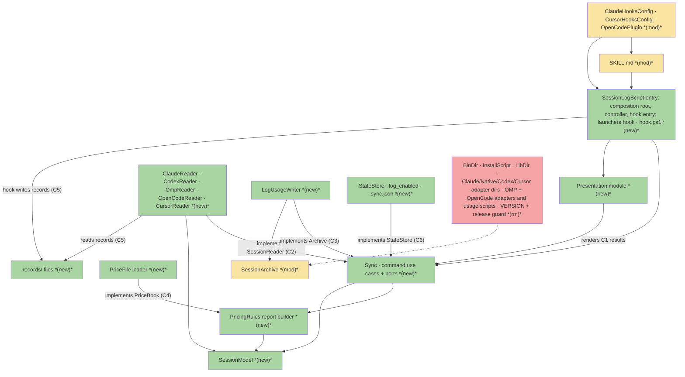
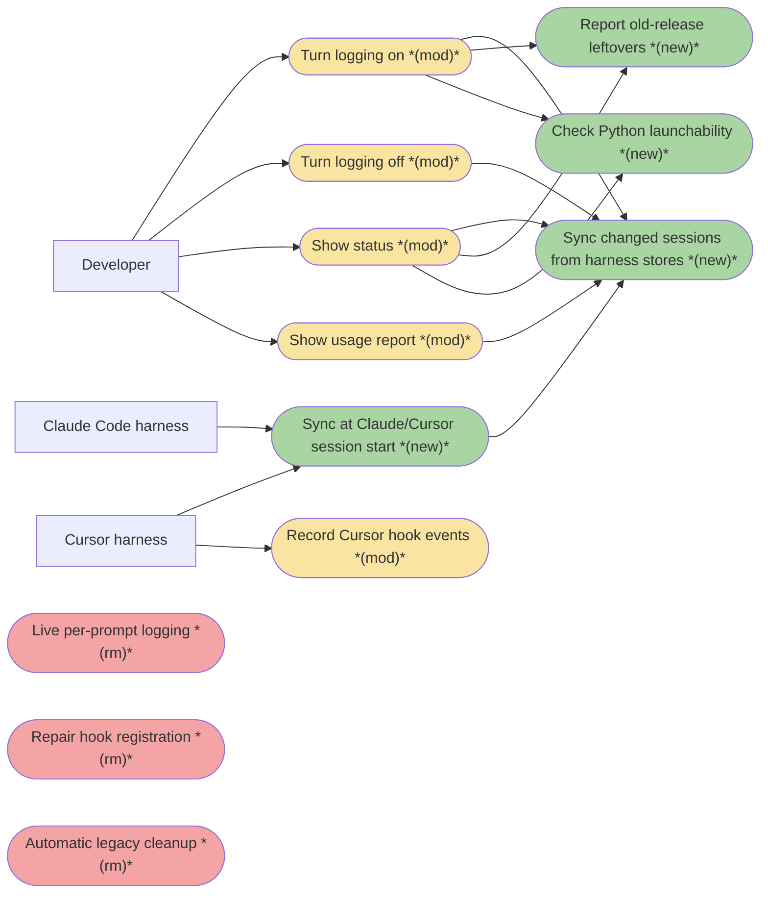
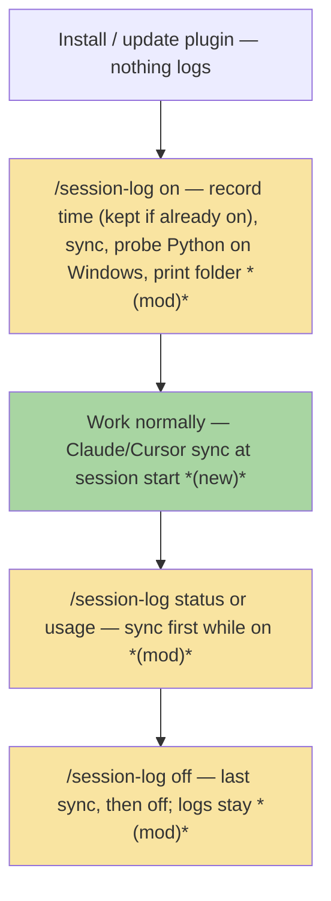
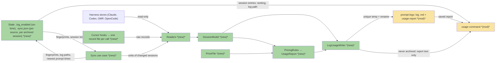

# SLS · Simple Session-log — Team Plan

**How to read this file**
- **Architecture approach:** Clean Architecture (default). **Layers:** Presentation · Use Cases · Interface Adapters · Entities · Frameworks & Drivers.
- The **Frontend, Backend, and Tester** sections are the depth view — each role's scope, grouped by layer.
- **Contracts** are logical TypeSpec core-construct `.tsp` files beside this plan. No HTTP/API seam exists, so no OpenAPI.
- **Role tags** (`#frontend-role`, `#backend-role`, `#tester-role`) mark each role-owned section.
- IDs (`S#`, `C#`, `Q#`) are the traceability thread.
- `/session-log <command>` is shorthand for running the session-log skill with that command. The exact form differs per harness (OMP: `/skill:session-log`, [README.md](README.md) `:100,107`); S30 records each form and README documents it.
- **Tasks** are not in this file — task breakdown is a separate downstream step that consumes this plan.
- **Rule:** change a contract only by team agreement.

---

## Background
Session-log today records every prompt live through per-prompt hooks in five harnesses; almost every bug comes from those hooks, and native Windows does not work. Four harnesses already save the whole conversation with times and tokens on disk. Detail: [session-log-simple-brief.md](./session-log-simple-brief.md) "Problem", "Big picture", F1–F9.

---

## Goal
One stdlib-only Python program reads what each harness saved (Cursor: what its hooks recorded), and rewrites a Markdown log plus a saved usage report per session into the harness's own `prompt-logs` folder, with a whole-session TOTAL that includes sub-agent tokens wherever the harness records them.

---

## Scope

### In Scope
- Commands `on`, `off`, `status`, `usage [--latest | <session-id>]` (no argument = `--latest`). While logging is on, every command syncs first; `off` syncs once, then turns off; `off` while off does nothing. While off, no command syncs. `usage` prints the saved report of an archived session, ranked from `.sync.json`; a session that was never archived (from before `on`, or any session while logging is off) is read from the harness store and gets the same report computed live, never saved.
- Sync: list every source unit of the invoked harness (one reader per run) with a cheap fingerprint; learn a new unit's session once (from its path; Codex from the rollout's first line); read only sessions with a unit whose fingerprint changed and that changed since `on`, plus unreadable and skipped ones; archive every session with activity since `on` (its own or a sub-agent's), whole (incl. prompts before `on`); rewrite its log + usage report whole (unique temp file in the same folder, then `os.replace`; on failure skip, remove the temp, report in `status`); save progress after each session; remove temps a killed sync left behind; after a render-version change (raised with every change to log or report text, incl. `prices.json`), rewrite every archived session once, tracked in each session's entry; never rewrite a session from fewer source units than its last write. A hook-started sync stops starting new sessions after a 20 s budget and the next sync continues.
- One reader per harness (Claude, Codex incl. `.zst`, OMP incl. `.gz`, OpenCode DB read-only, Cursor hook records); PricingRules, which builds the report data for sync; one shared writer.
- Usage report `session_<ts>_<id>.usage.txt` with per-prompt rows, per-sub-agent rows (nested), TOTAL; price rules and new per-model price file `prices.json` (F6, C4).
- Log folder `<basename, only [A-Za-z0-9._-], ≤64>-<sha256(os.path.normcase(recorded cwd))[:12]>`, filename time in UTC; a session keeps its first log path, kept in `.sync.json` and never found by searching the log root; every time inside the log and report is local time with its UTC offset (`12:56:00 UTC+2`).
- State: `prompt-logs/.log_enabled` (on-time) + `prompt-logs/.sync.json` (per source: fingerprint, session, state; per archived session: log path, project, newest prompt time, render version, unit count); one-time `.enabled` → `.log_enabled` conversion, run by every command and hook after the root checks and before the `.log_enabled` check.
- Claude SessionStart exec-form hook (`python3` with a one-line `-c` guard that runs the script only when it exists, no matcher, `async: true`, `timeout` 30); five Cursor hooks incl. `sessionStart` via `hook` + `hook.ps1` launchers, which exit 0 without starting Python while logging is off, each `timeout` 30, one record file per call (temp + rename) under `prompt-logs/.records/<conversation_id>/` (F1). Every id used in a path follows one id rule (C2).
- The script checks Python ≥ 3.14 itself. Python probe on Windows (`on`/`status`). [SKILL.md](skills/session-log/SKILL.md) gives one command line, `python3 "<skill dir>/session_log.py" <harness> <arguments>`, with no shell syntax beyond the double quotes, and the fallback `python3` → `py -3` → `python` on Windows as prose (F2). The skill dir is the harness-announced directory; without one, the golden bash locator prints it on macOS/Linux, and on Windows the skill asks for `SESSION_LOG_HOME`.
- New folders 0700 and every written file 0600 on macOS/Linux, as today's `umask 077`; nothing is written through a symlink or Windows junction, and a symlinked harness root or `prompt-logs` refuses every write, as today; sources that are not regular files are skipped unopened.
- Old-release leftovers reported with a one-line fix (list in C1); nothing deleted. Old-format logs left untouched.
- Release 1: OpenCode `location` → `path` fix (F5) plus removal of the plugin's session-log import, shipped first and on its own from `main` once S27 and S66 pass, with the `VERSION` bump the current release guard requires; SKILL.md's OpenCode lines say session-log does not log in OpenCode until release 2.
- Release 2, one release, built on its own branch and merged into `main` only when every scenario passes except the post-release Windows run (S31 and the S31 parts of S24, S25, S33, S38), because [release.sh](release.sh) `:185` releases `main` whole: clean cutover — remove `adapters/claude`, `adapters/native`, `adapters/codex`, `adapters/cursor`, `bin/`, `lib/`, `install.sh`, `omp/session_log_usage.ts`, `opencode/session_log_usage.sh`, the OMP extension, the OpenCode session-log adapter, their tests; delete `skills/session-log/VERSION` with its release guard; replace the price file; update docs.
- Tests: anonymized text fixtures per harness (binary ones generated at test time), `python3 -m unittest` on macOS (Homebrew `python3` 3.15) + Linux Docker (`python:3.14-slim`), launcher test (fish, pwsh in Docker), one smoke per harness, one written Windows manual checklist.

### Out of Scope
- Live per-prompt writing in Claude Code, Codex, OMP, OpenCode.
- `repair`; automatic deletion of old-release leftovers.
- Cursor sub-agent tokens (F7, F9) — rows show `not recorded by Cursor`.
- Relocated harness roots (`CLAUDE_CONFIG_DIR`, `CODEX_HOME`, `XDG_*`, `OPENCODE_CONFIG_DIR`, `PI_CODING_AGENT_DIR`): they fail with a message, as today ([README.md](README.md) `:174`).
- Plugin rename, release-script fixes and other superseded-brief findings not about session-log working.
- Any new tool, CI or shipped binary.

---

## Acceptance criteria
- The session-log skill's `on`, `off`, `status` and `usage` work in all five harnesses on macOS and Linux with only Python ≥ 3.14 (S29, S30). Native Windows is the target too; it is proven only by the manual checklist after the release (S31, Q1, Q22), and README marks every harness on native Windows "not yet tested" until it passes.
- Each archived session has one Markdown log (header, `## <time>` prompt, `### <time> response`) and a saved usage report beside it.
- TOTAL tokens and price include every sub-agent (Cursor: labelled main-session only, price incomplete); working time is the sum of main per-prompt times; TOTAL price equals the sum of the rows shown.
- Running sync twice gives the same logs and reports; no log, report or hook record is ever seen half-written.
- A hook never blocks a prompt and prints nothing while it runs. The one visible case: when `python3` is missing, Claude Code shows a non-blocking hook error and the session continues; a missing script exits 0 silently, also under Cursor's import of the hook.
- Unknown models show `price: unknown` and totals `≥ $X (incomplete)`; Codex/Cursor prices are labelled API-equivalent.
- OpenCode plugin loads as `active` with `path`.
- Removed components and their tests are gone, no tracked file refers to them outside the files S58 exempts, and docs describe the new behaviour (S58).

---

## What does NOT change
- Harness identity is passed explicitly, never inferred.
- Log roots per harness (`~/.claude/prompt-logs`, `~/.codex/prompt-logs`, `~/.cursor/prompt-logs`, `~/.omp/agent/prompt-logs`, `~/.config/opencode/prompt-logs`); only default harness roots are supported.
- Tool calls are not logged; usage report content matches today's Claude report, minus the Claude "internal helpers" line and the file paths.
- Existing archived logs (incl. old-format ones) stay; `off` keeps logs.

---

## Known limitations / accepted trade-offs
- Logs lag until the next session start (Claude, Cursor) or `/session-log` command. Codex has no hook: its sessions are synced only by a `/session-log` command run in Codex; a rollout compressed to `.jsonl.zst` is read with `compression.zstd`. Compression keeps the file's mtime (codex `rust-v0.162.1` `rollout/src/compression.rs:902`), so a rollout compressed after its last sync is not read again.
- Codex: `input_tokens` contains both `cached_input_tokens` and `cache_write_input_tokens`, so the reader subtracts both (`codex-api` `ResponseCompletedUsage` maps `input_tokens_details.cached_tokens` and `.cache_write_tokens`; its test has input 100 = cached 40 + cache write 60 and `total_tokens` 110 = input + output; no local rollout has a non-zero cache write, so the rule is pinned by synthetic rollouts).
- Claude Code: if Claude Code is not started for `cleanupPeriodDays` (30 by default), the last turns of the last session before the gap can be deleted before the next session-start sync. Whether the cleanup runs before the SessionStart hook is unverified.
- Cursor: only prompts recorded while logging was on appear, because records exist only while on; Q12's whole-session rule applies to the four store-based harnesses. No sub-agent tokens. Hook records are kept (one small file per hook call) because they are Cursor's only source. Whether Cursor waits for the `sessionStart` hook before a chat starts is unverified; its sync is capped at 20 s (S30 records it). With claude-goodies imported, Cursor also runs the Claude SessionStart hook, which syncs the Claude store (S59 records the delay). If `py -3` picks a Python older than 3.14, the Cursor hooks record nothing; `status` then shows no hook records since `on`.
- Cursor under Windows PowerShell 5.1 without pwsh: non-ASCII hook text may arrive as replacement characters (decoded with errors replaced, never lost as a record); install paths with `$`, `` ` ``, braces, parens, `|`, `;`, `,`, `<`, `>` defeat the `.ps1` lookup.
- Claude hook needs a Windows Python that provides `python3` (pymanager, Store, Scoop). On macOS it needs a real Python 3.14+ from python.org or Homebrew: the Command Line Tools' `/usr/bin/python3` is only 3.9.6 and does not qualify, and without the Command Line Tools it is only a stub [INFERENCE]. What the hook does when `python3` resolves to either of them inside an exec-form hook is unverified.
- A Claude SessionStart hook whose `python3` is missing is a non-blocking error that Claude Code may show to the user (brief "Edge Cases"); a missing script exits 0 silently through the hook's `-c` guard, because `python3 <missing script>` exits 2, which Cursor treats as blocking when it runs the imported hook. The hook runs in the background (`async: true`); in one-prompt mode (`claude -p`) Claude Code kills it at teardown (hooks.md "Run hooks in the background"), and the next sync finishes the work. If a Claude Code version ignores `async`, a session start can wait for the sync up to the hook's 30 s `timeout`; S23 checks a real start.
- That a Cursor marketplace install keeps the `hook` file's mode 755 is unverified. S30 checks it on the local install before release 2, the tester repeats the check on the public marketplace install after it, and `status` shows "no hook records since on" when hooks do not run.
- Windows behaviour is proven only by the manual checklist, which the maintainer runs on a real Windows PC after the release (Q1, Q22). Until it passes, README marks every harness on native Windows "not yet tested".
- `off` stops copying but does not hide the earlier prompts of a session that continues.
- A few sessions that span the upgrade appear twice (old-format log + new log).
- On Windows, a log open in another program is skipped until the next sync.
- Two syncs at once can make the next sync read a session again (C6 merge rule); no log is left older than its fingerprint.
- `usage` prints the saved report of an archived session (while off, as of the last sync). A session that was never archived (from before `on`, or any session while logging is off) is read from the harness store, its report computed live and never saved, so its source files must still exist. `--latest` reads the store only when the project has no archived session: every never-archived root session of the store is ranked from its main file, and the one with the newest prompt wins (a file time bounds nothing: a restored file has an old time and the newest prompt). With an older archived session and a newer never-archived one, `--latest` prints the archived one.
- After an update that raises the render version (every change to log or report text, incl. `prices.json`), sync rewrites every archived session once; hook syncs spread that over their 20 s budgets, and each session's entry records its version, so a stopped sync resumes where it left off. A copy with an older version never rewrites a newer one's sessions for their version, but its rewrite after new activity is redone once by the newer copy. A render change shipped without raising the version reaches old logs only when their source changes; only `prices.json` is pinned by a test.
- A session whose source now has fewer units than its last write (a deleted Codex child; Claude sub-agent files, if Claude's cleanup removes them before the main file) is never rewritten, so the archive keeps those rows; its later turns are not logged, and `status` names it "source partly gone".
- A harness format change that keeps valid JSON lines shows as sessions without prompts, not as an unreadable file, because unknown record types are skipped without a report (C2).
- If `.sync.json` is lost or corrupt, a session whose start time or cwd is now read differently gets a second log, because log paths are kept only there.
- A seeded `skills/session-log` copy from an old release that today's cleanup could not remove ([README.md](README.md) `:170`) can shadow the plugin's skill (OpenCode: `:160`); the old code then runs and the leftover report is never seen. README's upgrade note says to move such a copy aside.
- The `.enabled` → `.log_enabled` conversion (one existence check per run) and the C1 leftover list stay until a later release drops upgrades from old releases; both are removed together.
- A command's sync has no time budget. The first command after `on` in a large store can take long (Codex: every rollout's first line is read once to find sub-agents, decoding `.zst`), and a harness tool timeout can kill it; progress is saved after each session, so the next command continues.
- The skill command double-quotes the skill directory, so an install path containing `$`, `` ` `` or `"` breaks it, as such paths already break the `.ps1` lookup (F1).

---

## Approach & architecture

The entry script `session_log.py` (Backend, Frameworks & Drivers) is the composition root and the controller: it checks the Python version, reconfigures stdout and stderr to UTF-8, parses argv, builds every adapter with its own dependencies (roots, records folder), calls one use case per command and hands the result to the presentation module (Frontend), which renders it. The use cases own four ports: Sync (its own C1 contract, called by the command use cases and, with the 20 s budget, by the hook entry) reads through the invoked harness's `SessionReader` (C2) and writes through `Archive` (C3, which owns every path rule) and `StateStore` (C6); PricingRules, a service Sync calls, builds the report data with `PriceBook` (C4). The clock (now and the local time zone), the platform name, the path module, the Python probe runner and the leftover scan are injected as plain values. `usage` ranks sessions from `StateStore` and reads the saved report through `Archive`; a session with no saved report is read through the invoked harness's `SessionReader`, priced by PricingRules and rendered by `Archive.renderReport`, and nothing is written. Hooks are thin Frameworks & Drivers entries into the same script; the Cursor hook writes record files (C5) that only CursorReader reads, and removes its own stale record temps.

### Architecture

_Scope limited to change neighbourhood: the full inventory has 50+ components; the five readers, the hook configs with the OpenCode plugin, the entry with its launchers and the removed parts are grouped; the unchanged harness stores, ReleaseScript and the OMP manifest (both modified, see the table) are omitted. SessionLogScript, as composition root, builds every adapter; those construction edges are omitted. Plain arrows: the source uses the target (HC → SK: the OpenCode plugin registers the skill; PRES → SYN: the presentation module depends on the C1 result types the use cases own). Arrows labelled "implements": the adapter implements a port the use cases own, so the dependency points inward. Readers use only the record files, never the StateStore. The dotted edge is the removed code's former write path into the archive._

| Component | Change | Why |
|-----------|--------|-----|
| SessionLogScript (`session_log.py` + `sessionlog/` package) | new | One stdlib-only entry for commands and hooks; version check; composition root and controller (argv, dispatch, every `session-log:` error text) |
| Presentation module | new | Renders C1 use-case results as stdout text; Frontend's seam |
| Sync + command use cases | new | Re-read changed sessions + whole-file rewrite replace live recording; own the ports |
| PricingRules (report builder) | new | Builds UsageReport (rows, TOTAL, labels) for Sync from the model and PriceBook; the writer only renders |
| Five readers | new | One per harness → shared model; format change breaks one reader only |
| SessionModel | new | Common list of session, prompts, replies, usage, sub-agents; id rule |
| LogUsageWriter | new | One shared writer for log + usage report |
| PriceFile loader | new | Per-model rates, recorded cost first, unknown ≠ $0 (F6) |
| StateStore; record files | new | `.log_enabled`, `.sync.json` (C6); `.records/` (C5), written and cleaned of stale temps by the hook entry, read by CursorReader |
| CursorHookLaunchers | new | One command safe in sh-family and PowerShell, never blocks, starts no Python while logging is off (F1) |
| [SKILL.md](skills/session-log/SKILL.md) | modified | Release 1: OpenCode lines. Release 2: one command line with the skill directory double-quoted, Windows fallbacks in prose; no `repair`; without an announced directory the golden locator (probe `session_log.py`) prints the directory on macOS/Linux, `SESSION_LOG_HOME` on Windows |
| ClaudeHooksConfig | modified | SessionStart only, exec form with a `-c` guard for a missing script, no matcher, `async: true`, `timeout` 30 |
| CursorHooksConfig | modified | Five events incl. `sessionStart`; braced `${CURSOR_PLUGIN_ROOT}` launcher command; `timeout` 30 kept |
| SessionArchive | modified | New path (no PID suffix, kept per session), new header, saved report, local times with UTC offset |
| OpenCodePlugin | modified | Release 1: `path` fix and session-log import removed |
| ReleaseScript ([release.sh](release.sh)) | modified | Release 2: `VERSION` guard removed |
| OMP manifest ([package.json](package.json)) | modified | Release 2: `omp.extensions` dropped |
| [bin/](skills/session-log/bin), [install.sh](skills/session-log/install.sh), [lib/](skills/session-log/lib), [adapters/claude](skills/session-log/adapters/claude), [adapters/native](skills/session-log/adapters/native), [adapters/codex](skills/session-log/adapters/codex), [adapters/cursor](skills/session-log/adapters/cursor), [adapters/omp](skills/session-log/adapters/omp), [adapters/opencode](skills/session-log/adapters/opencode), `VERSION` + release guard | removed | Live recording, locks, markers, process identity disappear; deleting VERSION alone blocks every later release |

**Layer map (and role mapping)**

| Layer | Role | Components |
|-------|------|-----------|
| Presentation | **Frontend** | [SKILL.md](skills/session-log/SKILL.md), presentation module (renders on/off/status/usage results on stdout), user docs |
| Use Cases | Backend | Sync, on/off/status/usage use cases, PricingRules (report builder Sync calls); ports `SessionReader`, `Archive`, `PriceBook`, `StateStore`; clock, platform name, path module, probe runner and leftover scan injected as plain values |
| Interface Adapters | Backend | Five readers, LogUsageWriter (incl. every path rule), PriceFile loader, StateStore implementation, leftover scan (the module holding the C1 leftover list), Python probe runner |
| Entities | Backend | SessionModel (Session, Prompt, RequestUsage, SubAgent), id rule |
| Frameworks & Drivers | Backend | Entry script (composition root, controller, argv, version check, UTF-8 stdout and stderr, every error text, hook entry), hook-records module, harness stores, filesystem/`sqlite3`/`gzip`/subprocess, ClaudeHooksConfig, CursorHooksConfig, launchers, `.records/` files, `.log_enabled` + `.sync.json`, OpenCodePlugin, OMP manifest |

Single-tier local tool: no client/server boundary; Frontend = model-facing skill text, rendering of command results on stdout and user docs. The usage report text is persisted output (C3) and belongs to Backend; `usage` prints it unchanged. Every `session-log: <msg>` error text on stderr (Python version, internal error, argument and runtime errors) belongs to the Backend entry: the first two are printed before any use case runs, and use cases raise runtime errors with their facts.

**What changes**
- [SKILL.md](skills/session-log/SKILL.md) runs the Python script instead of `bash install.sh`; while logging is on every command syncs first.
- Claude hooks: four shell-form events → one exec-form SessionStart without matcher, run in the background (`async: true`).
- Cursor hooks: `sessionStart` runs sync; the other four write raw input + arrival time as one file per call; the hook reads only `conversation_id`, all other parsing moves to sync.
- Codex, OMP, OpenCode: no hooks, no plugin code for session-log.
- One price file replaces [prompt_log_prices.json](skills/session-log/adapters/claude/scripts/prompt_log_prices.json).

**Key decisions (from the brief)**
- Read what the harness saved; copy into an own archive (Claude 30-day cleanup).
- Hooks only where unavoidable (Claude SessionStart, Cursor).
- Python stdlib, 3.14 minimum; Codex `.zst` rollouts read with `compression.zstd`.
- `python3` for the Claude hook; launchers for Cursor.
- Whole-file rewrite, no append, no locks.
- One reader per harness, one shared writer.
- Added in review C1: sync reads only sources whose fingerprint changed, so its cost does not grow with how long logging stays on.

### Actors & Use Cases

_Scope limited to change neighbourhood: Maintainer, model and Codex/OMP/OpenCode actors, and "Read compressed Codex sessions" / "Price usage from price file" / "Register OpenCode plugin skills" are omitted to stay within 15 nodes; they are covered by S9, S18–S19, S27. `status` and `usage` sync only while logging is on._

### Flows

#### User Flow

#### Data Flow

#### Sequence

_Skipped: the multi-component interactions (command → sync → reader → model → pricing → writer → archive; `usage` → state → saved report, or for a session never archived store → reader → model → pricing → rendered report) are fully captured by the data flow above._

### Prior decisions

_No Architecture Decision Records found in this repository._

### Contradictions

| Category | What | Owner |
|----------|------|-------|
| Code vs docs | [README.md](README.md) `:200` and [SKILL.md](skills/session-log/SKILL.md) `:86` say native Windows works for Claude under Git Bash; the brief ("Problem") records CRLF breakage on Windows | doc needs updating |
| Code vs docs | [README.md](README.md) `:201-203` require Bash 4+, jq, sqlite3 and Bun; the new design needs only Python 3.14 | doc needs updating |
| Code vs docs | [README.md](README.md) `:113` and [SKILL.md](skills/session-log/SKILL.md) `:54` say Cursor hooks are not supported on native Windows; the launchers (F1) target it | doc needs updating |
| Code vs docs | [README.md](README.md) `:154,160` say the OpenCode plugin loads; [index.js](.opencode-plugin/index.js) `:34` sends `location`, which disables the whole plugin on OpenCode ≥ 2.0.4 (brief F5, tested) | code is the issue |
| Code vs docs | [sync-manifest.txt](sync-manifest.txt) `:42` lists `skills/session-log/` as a path that lives in `~/.claude` and is captured into the checkout; today's cleanup and the C1 leftover list treat a `~/.claude/skills/session-log` copy as an old seeded copy that shadows the plugin | doc needs updating |
| Brief vs reality | Brief listed only four Cursor events; [.cursor-plugin/hooks.json](.cursor-plugin/hooks.json) also has `sessionStart` today. Resolved by Q9: keep it, running sync; brief corrected | open question |
| Brief vs reality | Brief named OpenCode tables `session, message, part`; v2.0.30 uses `session_v2` + `session_message`. Resolved by Q14: brief corrected, incl. the F8 table | open question |
| Brief vs reality | Brief says Claude syncs at "every session start"; [hooks.json](hooks/hooks.json) SessionStart matches `startup` only. Resolved by Q11: matcher removed | open question |
| Brief vs reality | Brief names [index.test.js](.opencode-plugin/index.test.js) `:75,79,92`; tests at `:78,80,90-130` cover the removed handlers, command, description and marker too. Resolved by Q19: each change named | open question |
| Brief vs reality | Plan assumed `/session-log` in OMP; OMP runs skills as `/skill:<name>`, and `/session-log` came from the extension being removed ([README.md](README.md) `:100,107`). Resolved by S28 and S30 | open question |
| Brief vs reality | Brief F2 gave the skill order `py` → `python3` → `python`, In Scope gave `python3` → `py -3` → `python`. Resolved by Q27: brief corrected | open question |
| Brief vs reality | Brief said regular use archives Codex sessions before compression; Codex syncs only on a command run in Codex. Resolved: brief corrected, Known limitations | open question |
| Brief vs reality | Shipping the `path` fix alone re-enables [index.js](.opencode-plugin/index.js) `:63-70`, which loads the old session-log handlers and starts `bash install.sh … repair` ([index.test.js](.opencode-plugin/index.test.js) `:15-17`). Resolved by Q28: release 1 also removes that import | open question |

---

## Contracts / seams

Boundaries where roles must agree. **Logical, not code.** TypeSpec 1.13.0 core constructs; each compiles clean with `tsp compile <file> --no-emit`. Changing one requires team agreement.

**C1 — Commands, use-case results, hook entry, launchers**  *(Presentation ↔ Use Cases; Frameworks & Drivers ↔ hook entry)*
`skills/session-log/session_log.py <harness> on|off|status|usage [--latest|<id>]` → plain stdout, `session-log: <msg>` on stderr (own text, never argparse's); exit 0 ok, 1 runtime error, 2 bad arguments; Python ≥ 3.14 checked first by an entry file that Python 3.4 parses (S55 runs it there); under an older Python commands print the requirement line and one install-fix line for the running platform (S55), hooks exit 0 silently; stdout and stderr set to UTF-8 by the entry; never a traceback. Every command and hook checks, in order: Python version, relocated root, symlinked harness root or `prompt-logs`, then the `.enabled` migration, then `.log_enabled`. The entry is the Backend's controller and owns every stderr text. While on, every command syncs first (no time budget; progress is saved after each session); `off` syncs, then turns off; `off` while off does nothing; while off no command syncs. `usage` prints the saved report of an archived session: no argument and `--latest` mean the root session of the current project (its cwd, else the nearest parent folder with sessions) with the newest prompt, ranked from `.sync.json`; `<id>` is exact, else a unique prefix, matched over archived and store sessions together. A session with no saved report (before `on`, or while off) is read from the store, priced and rendered by the same code, and printed; nothing is written and nothing is synced while off. `--latest` reads the store only when the project has no archived session (newest source unit first, the first root session with a prompt); no session at all, archived or in the store, exits 1. Use cases return `OnResult`, `OffResult`, `StatusResult`, `UsageResult` (incl. leftovers and the probe) and get four ports (the reader of the invoked harness only) plus an injected clock, platform name, path module, probe runner and leftover scan; the presentation module renders the results. `SyncUseCase` takes an optional budget and returns the report texts it could not save, for `usage`. Hook entry `session_log.py hook claude SessionStart` (exec form `python3` with a `-c` guard that exits 0 when the script is missing, `async: true`, `timeout` 30) / `hook cursor <five events>` (`timeout` 30) takes raw stdin bytes, is checked before argument parsing, always exits 0, never prints; a hook sync has a 20 s budget. Launchers exit 0 without starting Python while neither `.log_enabled` nor `.enabled` exists, else pass argv and stdin unchanged; `hook.ps1` tries `py -3`, `python3`, `python`. — [session-log-simple-c1-cli.tsp](./session-log-simple-c1-cli.tsp)

**C2 — Normalized session model and reader port**  *(Interface Adapters readers → Use Cases port; Entities)*
`Harness` and the id rule (`SafeId`: 1–128 of `[A-Za-z0-9_-]`, no Windows device name, for every id that becomes a path; sub-agent ids are shown only and never dropped) are defined once here. A run builds only the invoked harness's reader, with only its own dependencies by constructor (its root; OpenCode the database path, chosen as today from `OPENCODE_DB`, `OPENCODE_CHANNEL` and the `opencode*.db` files; Cursor its records folder). `scan` lists every source unit with a fingerprint without parsing any session (Codex keys drop `.zst`, and a `.zst` rollout is read with `compression.zstd`; OpenCode includes `time_updated`, because assistant rows are updated in place), plus the unreadable sources it found (non-regular files, never opened; `.records/.invalid/`; a missing, busy or v1 OpenCode database); `sessionOf` names a new unit's session once (from the path, OMP root id = stem after its first `_`; Codex from the rollout's first line, root = `session_meta.session_id`); `read` returns one session whole from all its units, plus an unreadable list. Unknown record types and bad lines are skipped without a report; a unit is unreadable only when nothing in it can be read. Parent cycles (OpenCode, OMP) are unreadable, never followed. Codex uncached input = `input_tokens` − `cached_input_tokens`; Codex requests are the `token_usage_record` lines when present, else the growth of `token_count` `total_token_usage` (a fork's inherited starting total excluded); `last_token_usage` is never summed. `lastActivityAt` includes sub-agent activity. Sub-agents belong to the session, with id, type and start time, nested by parent (Codex: `parent_thread_id`); rows are ordered by start time, then id (Cursor start = arrival − `duration_ms`). Orphan children carry their parent id. The readers' own unit tests assert against it. — [session-log-simple-c2-session-model.tsp](./session-log-simple-c2-session-model.tsp)

**C3 — Archive output (log + usage report)**  *(Use Cases own the `Archive` port and `UsageReport`; the Interface Adapters writer renders and writes)*
Archive owns every path rule: it gives a session without a `.sync.json` entry its log path `<slug>/session_<YYYY-MM-DD_HH-MM-SS UTC>_<id>.md` (slug per Q6, with `root`/`unknown` fallbacks, via the injected path module), which sync keeps in the session's entry; the log root is never searched, so old-format logs are never touched; Archive writes and reads the report `session_<ts>_<id>.usage.txt` beside the log; all times in local time with its UTC offset: header and log entries `YYYY-MM-DD HH:MM:SS UTC+2` (`UTC-5`, `UTC+5:30`, plain `UTC` at offset 0), report rows `HH:MM:SS` under the offset in the report header, a row whose offset differs (daylight-saving change inside the session) adding its own; the zone is an injected value, so tests pass a fixed one; the log is rendered straight from the C2 `Session`; report layout as today without file paths and the helpers line. Rows priced in whole cents (half-up): `$X.XX`, `≥ $X.XX (incomplete)` when some of the row's requests have no rate, `unknown` when none has; TOTAL = sum of shown rows; Cursor label, API-equivalent. Write: log and report, each a unique temp in the same folder, then `os.replace`; on failure skip and report; stale temps (> 1 hour) removed; on POSIX new folders 0700 and every written file 0600; never through a symlink or Windows junction; `readReport` serves `usage`; the printed `usage` text is the same rendering. — [session-log-simple-c3-archive-output.tsp](./session-log-simple-c3-archive-output.tsp)

**C4 — PriceBook port + price file**  *(Use Cases own `PriceBook` and its `Rates` type; the Interface Adapters loader implements it, and the file format reuses `Rates`)*
`skills/session-log/prices.json`: `{"models": [...]}`, each with `prefixes`, `in`, `out`, `cache_read`, `cache_write_5m`, `cache_write_1h`, optional `fast` (the same five rates), `source`, `as_of`. Recorded harness cost wins; the model name is matched from its first `claude-` on (so `us.claude-opus-5-5-medium` matches, as today); longest matching prefix wins; a duplicate prefix makes the file invalid; no match, or a fast request without `fast` rates, = no rate; cache writes without a 5m/1h split use `cache_write_5m`; a missing or invalid file leaves every model without a rate and `status` names the problem. — [session-log-simple-c4-price-file.tsp](./session-log-simple-c4-price-file.tsp)

**C5 — Cursor hook record**  *(file format: Frameworks & Drivers hook entry writes, Interface Adapters CursorReader reads; no port)*
One file per hook call, `prompt-logs/.records/<conversation_id>/<arrival_ns>-<event>-<pid>.json`, written to an exclusive temp, then renamed; event, arrival time, raw input (UTF-8 with errors replaced, BOM stripped). The hook parses only `conversation_id`; bad JSON or a missing or unsafe id goes to `.records/.invalid/`, which CursorReader's scan reports as one unreadable item; nothing is written through a symlinked or junctioned folder. Records are kept; the hook-records module that writes temps also removes them: the Cursor `sessionStart` hook removes record temps older than 1 hour before its sync. Joins: `generation_id` (usage from `stop` only), sub-agents per `child_conversation_id` (start = arrival − `duration_ms`); duplicates count once; orphan prompts and stops have fixed rules. — [session-log-simple-c5-cursor-hook-record.tsp](./session-log-simple-c5-cursor-hook-record.tsp)

**C6 — On flag + sync state**  *(Interface Adapters StateStore implements the Use Cases port; read by hooks, status and usage)*
`prompt-logs/.log_enabled` holds the on-time (sync cutoff), created exclusively, so `on` while on keeps it; unparsable content falls back to the file time. Every command and hook runs the `.enabled` → `.log_enabled` migration after the root checks (exclusive `.log_enabled` create, then `.enabled` removal that tolerates it being gone; reading `.log_enabled` writes nothing), then checks `.log_enabled`. `prompt-logs/.sync.json`, written only by sync: last sync time; one entry per source unit (fingerprint, session key, state read/inactive/unreadable, reason); one per archived session, created by its first successful write (log path, write state, project, newest prompt time, last activity, orphan flag, render version, unit count). A session whose render version is lower than the program's `RENDER_VERSION` is rewritten once, tracked per entry, so a hook sync that stops at its budget resumes; a higher one is left alone; a rewrite from fewer units than the entry's unit count is not published. Unreadable units and skipped sessions are retried every sync. Saved after each session, merged by key before each write; a unit entry another run changed meanwhile loses its fingerprint, so the next sync reads it again; a log path is never replaced; empty or corrupt = rebuilt and reported; archived count = number of session entries. — [session-log-simple-c6-state.tsp](./session-log-simple-c6-state.tsp)

External harness contracts (hook registration files, harness stores, OpenCode skill `path`) are fixed by the harnesses and the brief; they are covered by S16–S23, S27–S28, S39 and S57, not by a `.tsp`.

---

## Data

_This project owns no database — Data section skipped. OpenCode `opencode.db` is a harness-owned store opened read-only; project-owned persisted formats (C3, C4, C5, C6) are defined under Contracts. No database migrations; the one-time `.enabled` → `.log_enabled` state conversion is part of C6._

---

## Scenarios #tester-role

Behavioural only. Happy, unhappy, edge, non-functional.

| id | Scenario (Given / When / Then) |
|----|--------------------------------|
| **S1** | **Given** logging off on macOS or Linux · **When** `/session-log on` · **Then** the on-time is recorded, sync runs, the log folder is printed (the Python probe runs only on Windows, S24) |
| **S2** | **Given** logging on · **When** `/session-log off` · **Then** sync runs once, `.log_enabled` is deleted and existing logs stay; afterwards Claude/Cursor hooks exit 0 without writing a record or log, and no command syncs until `on` |
| **S3** | **Given** archived sessions and one unreadable file · **When** `status` · **Then** it prints on/off, log folder, last sync time, archived count, each unreadable or skipped file with reason, a price-file problem and a sync-state reset when present; Cursor also says whether hooks recorded anything since `on` and lists `.records/.invalid/` with its call count |
| **S4** | **Given** several archived sessions · **When** `usage`, `usage --latest`, `usage <id>` · **Then** sync runs while on, and the printed text equals the saved `.usage.txt`; no argument behaves exactly like `--latest` |
| **S5** | **Given** an unsupported or missing harness identity · **When** any command runs · **Then** it fails with `session-log:` on stderr, exit 2, and writes nothing |
| **S6** | **Given** a Claude session with sub-agents (nested, workflow) · **When** sync · **Then** the log has header (harness, id, project, start), `## <time>` prompts, `### <time> response` final replies, no tool calls; usage has a row per prompt and per sub-agent with type from meta, and no "internal helpers" line |
| **S7** | **Given** a Codex rollout with injected context in `response_item` and `token_count` events with `cached_input_tokens` and `cache_write_input_tokens` · **When** sync · **Then** prompts come only from `UserMessage` items (or old `user_message` events), cut at the first `## My request for Codex:` line when an IDE context precedes it; input is `input_tokens` − `cached_input_tokens` − `cache_write_input_tokens`, cache read is `cached_input_tokens` and cache write is `cache_write_input_tokens`, so no token is counted twice |
| **S8** | **Given** Codex threads with `parent_thread_id`, incl. a grandchild whose `parent_thread_id` names a child while its `session_meta.session_id` names the root (as in local rollouts) · **When** sync · **Then** they appear as sub-agents of the root session, each nested under its parent thread, not as separate logs, and are in TOTAL |
| **S9** | **Given** a `.jsonl.zst` rollout, and a corrupt one · **When** sync · **Then** the first is read like a plain `.jsonl` rollout; the corrupt one is listed unreadable in `status` and the other rollouts are unaffected |
| **S10** | **Given** OMP sessions in `sessions/` and gzipped in `archive/sessions/` · **When** sync · **Then** both are archived, child sessions are sub-agents, recorded cost is used, `custom_message` with `attribution=="user"` or `customType=="skill-prompt"` counts as a prompt and other `custom_message` types are skipped |
| **S11** | **Given** the OpenCode DB, incl. two sessions whose `parent_id`s point at each other · **When** sync · **Then** it is opened read-only, `parent_id` sub-agents are walked recursively, recorded cost is used (0 = free); the two cyclic sessions are listed unreadable "parent cycle", not archived, and sync ends (ports [session-log.test.js](skills/session-log/adapters/opencode/session-log.test.js) `:337`) |
| **S12** | **Given** Cursor record files for prompts, replies, `stop`, `subagentStop` · **When** sync · **Then** records join by `generation_id` (usage from `stop` only), sub-agents attach per `child_conversation_id`; log and usage are built; sub-agents show type + time and `not recorded by Cursor`; TOTAL reads `tokens: main session only — Cursor does not record sub-agent tokens` with price marked incomplete |
| **S13** | **Given** sessions before `on`, after `on`, one started before `on` but active after, and one active after `on` whose Claude sub-agent file (and, in Codex, child rollout) is older than `on` · **When** sync runs twice, the first time with no `.sync.json` · **Then** only sessions with activity since `on` are archived, the last two whole, incl. the old sub-agent file and child, into `<slug>/session_<UTC ts>_<id>.md`; the second run yields identical logs and reports |
| **S14** | **Given** archived sessions whose source then changes: a Claude file gets one more turn, an OpenCode session gets a new row, an OpenCode assistant row is updated in place (finish, tokens, `time.completed`), a Cursor conversation gets a new record · **When** sync runs again · **Then** each of them is read again and its log and report contain the change |
| **S15** | **Given** an archived session whose harness source was deleted; an archived session whose Codex child rollout (and, in Claude, a sub-agent file) was deleted while the root remains, which then gets a new turn; and old-format logs of the same session ids from earlier releases (`session_<id>.md`, OpenCode `session_<ts>_<id>.md`, Claude `session_<ts>_<id>_<pid>.md`) · **When** sync, and again after a render-version raise · **Then** the archived files and every old-format log stay byte-identical; the partly deleted session is not rewritten and `status` lists it as "source partly gone (N of M units)"; a still-active session gets its new log as a separate file |
| **S16** | **Given** harness files with record types the reader does not use (Claude `custom-title`, `agent-name`, `atis-latch`, `queue-operation`, `last-prompt`), a corrupt line, and one file in which no line parses · **When** sync runs twice · **Then** the unknown types and the corrupt line are skipped without a report; only the unparsable file is listed in `status`, with harness, file and reason; the other files and other harnesses are unaffected |
| **S17** | **Given** two syncs at once (Claude SessionStart + a command) · **When** both write · **Then** every file is complete, never half-written (deterministic temp-name test: S48) |
| **S18** | **Given** an unknown model · **When** usage · **Then** its tokens show with `price: unknown` and TOTAL reads `≥ $X (incomplete)`; never $0 |
| **S19** | **Given** known models with cache-read, 5m/1h cache-write and fast mode · **When** usage · **Then** price uses that model's own rates (fast requests its `fast` rates); effort is shown but does not change the rate; Codex/Cursor prices are labelled API-equivalent |
| **S20** | **Given** prompts with nested sub-agents, two of them with the same start time · **When** usage · **Then** TOTAL tokens/price = main + every sub-agent; TOTAL working time = sum of main per-prompt times only; sub-agent rows at each level are ordered by start time, then id |
| **S21** | **Given** the Cursor `hook` launcher under sh, zsh, fish and `hook.ps1` under pwsh (fish and pwsh in Docker), with install path containing spaces and an apostrophe · **When** script or Python is missing · **Then** it exits 0 silently |
| **S22** | **Given** Cursor hook input with a UTF-8 BOM and non-ASCII text · **When** the Python hook runs · **Then** it decodes correctly, creates one new record file under `.records/<conversation_id>/` through temp + rename, prints nothing, exits 0 |
| **S23** | **Given** the updated Claude plugin · **When** a session starts, resumes, clears or compacts (e2e: `hook claude SessionStart` in a sandbox `HOME`; manual: real Claude Code with a large backlog) · **Then** the exec-form `python3` hook (no matcher, `async: true`) syncs and prints nothing; in real Claude Code the session is usable before the sync ends (if it is not, the wait is recorded and stays under the 30 s `timeout`); with the script missing the hook's `-c` guard exits 0 silently; if `python3` is missing, the session continues (Claude may show a non-blocking hook error) |
| **S24** | **Given** Windows without a working Python ≥ 3.14 as `python3` · **When** `on` or `status` · **Then** the probe `python3 -c` (checks version ≥ 3.14) fails and the exact fix is printed |
| **S25** | **Given** [SKILL.md](skills/session-log/SKILL.md) · **When** static checks run, and on Windows its `python3` call fails · **Then** exactly one line runs `session_log.py`: `python3 "<skill dir>/session_log.py" <harness> <arguments>`, with no other shell syntax; the Windows fallback is prose, `py -3`, then `python`; on Windows with no harness-announced skill directory it tells the user to set `SESSION_LOG_HOME` |
| **S26** | **Given** each leftover kind of the C1 leftover list for the current harness (old hook entries in `~/.claude/settings.json`, `~/.codex/hooks.json`, `~/.cursor/hooks.json`; `~/.claude/scripts/prompt_log_*`; seeded `skills/session-log` copies; OpenCode `plugins/session-log.js`, `plugins/session-log-omp.js`, `scripts/session_log_usage.sh`, `commands/session-log.md`, `commands/session-log-omp.md`; OMP `extensions/session-log.js`, `extensions/session-log-omp.js`, `skills/session-log-omp`; the old state folder `<harness root>/session-log/`; `~/.claude/session-maps/`) plus one unrelated entry and the inert `.enabled.lock` and OMP `.*.dedupe` files in the log root, in a sandbox `HOME` · **When** the `on` and `status` use cases run with the real leftover scan · **Then** each leftover path is reported with its one-line fix, the unrelated entry and the inert files are not, and nothing is deleted |
| **S27** | **Given** OpenCode ≥ 2.0.4 and the release-1 or later plugin · **When** the plugin loads · **Then** status is `active`, all skills plus the agent load, and no session-log handler, plugin command or background `bash install.sh … repair` starts |
| **S28** | **Given** the updated OMP package · **When** OMP starts · **Then** no session-log extension loads, and `/skill:session-log status` runs the new script |
| **S29** | **Given** Python 3.14 with stdlib only · **When** the unit suite (`python3 -m unittest discover -s skills/session-log/tests -t skills/session-log`, with a `tests/__init__.py`; without `-t` the `sessionlog` import fails) and a sync run on macOS under Homebrew `python3` (3.15), and in Linux Docker (`python:3.14-slim`), with `PATH` reduced to the Python interpreter · **Then** all pass, so no bash, jq, sqlite3 CLI, Git Bash, Node or `zstd` command is called; the launcher tests (S21, S56) run separately with their shells on `PATH`, and the git checks (S57's file mode, S58's `git grep`) run separately in the macOS checkout with `git` on `PATH` |
| **S30** | **Given** each harness on the Mac, installed before release 2 from the local checkout under the `user538295` marketplace name ([CLAUDE.md](CLAUDE.md)) · **When** one real prompt (one-prompt mode; Cursor via the app) then `usage` · **Then** log and report appear with correct content; recorded per harness: the install route, the exact skill invocation form (incl. how OpenCode reaches the skill now that the plugin command is gone); for Cursor, that the installed `hook` file is executable, whether the chat waits for the `sessionStart` sync, and that a sub-agent writes no record folder under its own conversation id |
| **S31** | **Given** a real Windows PC, after the release, run by the maintainer with `skills/session-log/tests/windows-checklist.md` · **When** the checklist runs `on`, one prompt, `status`, `usage` per harness, incl. Cursor under PowerShell 5.1 without pwsh; then with no `python3` (S24), with the Store `python3` stand-in first on `PATH` (S24, Q2), each also for a Claude session start; with `python3` missing but `py -3` present and then with no `py` (S25 chain); Cursor under 5.1 with no `py`, `python3` or `python`; with no announced skill directory (S25); with Cursor installed under a path with spaces and an apostrophe (`hook.ps1`); with a session recorded in `C:\` (S38); with a log open in a program that locks it (S33); with a slug folder replaced by a junction; and the skill command under PowerShell · **Then** each step behaves as on macOS (5.1 replacement characters accepted), the fallback picks `py -3`, then `python`, the Claude session starts with at most a non-blocking hook error, the Cursor chat starts and `status` shows no hook records since `on`, the junctioned folder is skipped and named in `status`, the `C:\` session lands in `root-<hash>`, `≥` and `ő` print correctly, the OpenCode database is found, and Claude's no-shell hook starts the `python3` app alias (Q3) |
| **S32** | **Given** an old `prompt-logs/.enabled` and no `.log_enabled` · **When** any command or hook runs first, and separately two hooks start at once · **Then** `.log_enabled` is written (on-time = now) before the on-check, `.enabled` is removed, that same run proceeds as on, and old hooks see logging off; with two at once exactly one `.log_enabled` is created, its on-time is not overwritten, and neither run fails because `.enabled` is already gone |
| **S33** | **Given** Windows and an archived log or report open in another program · **When** sync · **Then** that file is skipped, its temp file removed, `status` names path and reason, `usage` prints the same report text it could not save; the next sync writes it |
| **S34** | **Given** the updated Cursor plugin · **When** a new chat starts · **Then** the `sessionStart` hook runs sync, writes no record, prints nothing |
| **S35** | **Given** `skills/session-log/VERSION` and its release guard deleted · **When** [release.sh](release.sh) `--dry-run` runs in a /tmp fixture repo with `assert_on_main`, `assert_clean_tree` and `find_last_valid_tag` stubbed · **Then** it prints the release plan and exits 0, nothing is pushed and no update command runs |
| **S36** | **Given** the entry script · **When** it gets bad arguments / a runtime error (unwritable log root) / a malformed `hook` argv, unknown hook harness or event · **Then** exit 2 with `session-log: <msg>` and no argparse `usage:` line / exit 1 with `session-log: <msg>` / exit 0 with nothing written or printed |
| **S37** | **Given** archived sessions of several projects with root sessions and sub-agents, incl. a session still streaming after an older prompt, a session with no prompt, an orphan sub-agent log, a project reached through a symlink, and ids `abc`, `abcd`, `abce` · **When** `usage` (no argument or `--latest`), also from a subfolder of a project, `usage <id>`, `usage abc`, `usage ab`, `usage <unknown id>`, `usage` in a project without sessions, and, while off, `usage` for a session archived before `off` · **Then** ranking among archived sessions reads only `.sync.json`, so it is the same in every harness: the session with the newest prompt wins, sessions without prompts rank below, if none has a prompt the newest activity wins, sub-agents and orphans never win, the symlinked cwd matches, and the subfolder finds its project's sessions; `<id>` gives the same text as `--latest` for that session; `abc` picks `abc` exactly and `ab` is ambiguous; while off the report saved at the last sync prints; unknown id, ambiguous prefix and a project with no session, archived or in the store, exit 1 with a message (ports [test_prompt_log_usage.sh](skills/session-log/tests/test_prompt_log_usage.sh) `:423-503,524-527`, Codex `--latest` [test_python_adapters.py](skills/session-log/tests/test_python_adapters.py) `:229-250`, Cursor subfolder `:6119-6125`, OMP id targets [session_log_usage.test.ts](skills/session-log/adapters/omp/session_log_usage.test.ts) `:31-46`) |
| **S38** | **Given** recorded cwds `/a/My Proj!`, `/a/my.app`, `/a/.claude`, `/`, `C:\`, an all-non-ASCII name, a 100-character name, a session whose cwd changes mid-way, a Cursor session with only `workspace_roots`, and a session with no cwd · **When** sync · **Then** the slug replaces each character outside `[A-Za-z0-9._-]` with `-` (the dot stays, as in the old native hook's key, so `my.app-<hash>` and `.claude-<hash>` match the old folders), cuts to 64, uses `root` for an empty basename (`/` and `C:\` give `root-<hash>`) and `unknown` with no cwd, takes the first recorded cwd (Cursor: `workspace_roots[0]` of the first record), and folds case only on Windows (`os.path.normcase`); the `C:\` and case-folding cases run with `ntpath` injected as the path module, because the suite runs on POSIX, and S31 repeats `C:\` on Windows |
| **S39** | **Given** OpenCode with no DB / a DB busy while OpenCode writes / a v1-only DB without `session_v2` / `XDG_DATA_HOME` set to a non-default path / `OPENCODE_DB` set to a relative name, `OPENCODE_CHANNEL=beta`, `OPENCODE_CHANNEL=nightly`, `OPENCODE_DB=:memory:`, and no `opencode.db` but two `opencode-*.db` · **When** sync or a command · **Then** "no OpenCode database" is listed without error / OpenCode is listed unreadable with reason and retried next sync / listed unreadable "unsupported OpenCode database" / the command exits 1 naming the relocated root / the database is chosen as today: the relative name inside the data folder, `opencode.db`, `opencode-nightly.db`, exit 1 for `:memory:`, the newest `opencode-*.db` (ports [test_python_adapters.py](skills/session-log/tests/test_python_adapters.py) `:6186`); with a normal DB the reply is the last `finish='stop'` assistant row before the next user row, in `seq` order (Q14) |
| **S40** | **Given** a Claude transcript with `typed`, `queued`, `sdk`, `suggestion_accepted` prompts, a Remote Control (`bridge-session`) prompt, a `queued_command` attachment, a slash-command entry followed by a reply, a zero-usage `/clear`, an `sdk` `<task-notification>`, `isMeta` and `tool_result` entries, a `<synthetic>` assistant entry and a Haiku turn without effort · **When** sync · **Then** exactly the real prompts open rows (slash-command head with tags stripped), the others do not, `<synthetic>` is skipped and the Haiku effort shows as not recorded (Q16; ports `:277-358`) |
| **S41** | **Given** a Claude transcript with streamed copies of one message id (growing `output_tokens`), an interrupted turn (`stop_reason` null), a fast and a standard request in one turn, legacy `cache_creation_input_tokens`, missing usage fields, an assistant entry without usage, a corrupt line, a truncated line before a complete one, a trailing meta command after a reply, and a prompt without reply · **When** usage · **Then** each message counts once with its last copy, the interrupted turn is counted, fast uses the fast rates, the legacy field counts as 5m, missing fields are 0, the no-usage entry is skipped, both bad lines are skipped without losing the next record, working time ends at the last assistant output, and the unanswered prompt shows zero tokens and 00:00:00 (ports `:109-160,246-275,360-369`) |
| **S42** | **Given** OMP sessions with `stopReason`, `completedAt` and `thinking_level_change` entries, root files named `<ts>_<uuid>.jsonl`, children in `X/` and `X/Name/`, a child whose parent was moved to `archive/sessions/` as `.jsonl.gz`, a child whose parent is gone, and two sessions whose `parentSession`s point at each other · **When** sync · **Then** the session id is the root stem after its first `_`, equal to the `session` header id; the reply is the last `stopReason=="stop"` assistant message, its time `completedAt`, effort the last `thinkingLevel` carried forward; children link to their parent by the parent's file stem in either folder; the orphan child is archived alone, labelled `sub-agent of <id> (parent not found)`; the cyclic pair is listed unreadable "parent cycle" and not archived (Q15, Q16; ports [session_log_usage.ts](skills/session-log/adapters/omp/session_log_usage.ts) `:399`) |
| **S43** | **Given** Codex with a parent in `archived_sessions/`, a child active since `on` whose parent is not, a child older than `on` (plain and `.zst`) of a parent active since `on`, a child whose root rollout was deleted, a child whose parent is an unreadable `.zst`, and fixture rollouts cut from real ones: one with `token_usage_record` lines incl. a compaction call, one older one with only `token_count` events (repeated events, null `info`), and a forked child whose first `token_count`, before `task_started`, carries its parent's total · **When** sync · **Then** the parent in `archived_sessions/` is found; the active child makes its parent archived whole; the old child is linked from its first line (`session_meta.session_id`), the `.zst` one too; the orphan child is archived alone and labelled; parent and child both appear unreadable when the parent cannot be read; tokens are the `token_usage_record` usages where present (the compaction call included), else the growth of `total_token_usage` after the starting total, so no event is counted twice and the forked child adds only its own tokens; the prompt rows add up to TOTAL |
| **S44** | **Given** Cursor records with a prompt without `stop` (cancelled), a `stop` without prompt, the same event recorded twice, two sub-agents with the same start (arrival − `duration_ms`), a fresh and an old `*.tmp`, and files in `.records/.invalid/` · **When** sync · **Then** the cancelled prompt shows no reply and zero tokens, the lone stop counts in TOTAL under `(prompt not recorded)`, duplicates count once, sub-agent rows are ordered by start, then id, both `*.tmp` files are ignored, and `status` lists `.records/.invalid/` once with its call count |
| **S45** | **Given** a Cursor hook call with empty stdin / invalid JSON / no `conversation_id` / `conversation_id` `../x`, `a/b`, `.` or `CON` / ANSI-encoded bytes from PowerShell 5.1, and separately a `sessionStart` call with a record temp older than 1 hour and a fresh one under `.records/` · **When** the Python hook runs · **Then** the first four write their record under `.records/.invalid/` and nothing outside `.records`; the ANSI input is kept with replacement characters; the `sessionStart` call removes the old record temp and keeps the fresh one; every call prints nothing and exits 0 |
| **S46** | **Given** a harness session (or an orphan sub-agent archived alone) whose id fails the C2 id rule (contains `..`, `/`, or is a Windows device name), and a sub-agent with such an id inside a valid session · **When** sync · **Then** that session is not archived, nothing is written outside the log root, and `status` lists it with reason "unsafe id"; the sub-agent keeps its row and its tokens stay in TOTAL |
| **S47** | **Given** 200 archived sessions unchanged since the last sync, one changed session, Codex rollouts compressed since the last sync and OMP files moved by `omp gc` without new turns · **When** sync, then a hook-started sync over a large backlog · **Then** only the changed session is read and rewritten; no unit's session is learned twice (the second sync asks `sessionOf` for no known unit and opens no `.zst` file for it, counted in the test by wrapping `compression.zstd.open`); a compressed rollout keeps its key and fingerprint and is not read; each moved OMP file is read at most once, found inactive and not read again; the hook sync stops starting new sessions after its 20 s budget, saves its progress after each session, and the next sync finishes the rest |
| **S48** | **Given** two syncs with injected process ids writing the same session, a temp file older than 1 hour and a fresh one from another run, and a `.sync.json` that cannot be replaced · **When** sync · **Then** the two syncs use different temp names in the target folder and each publishes a complete file; the old temp is removed and the fresh one kept; `.sync.json` keeps the entries of both runs; when the older of two reads of one session publishes its log last, the later save drops that unit's fingerprint and the next sync rewrites the log from the newer source; a failed `.sync.json` replace leaves the old file and no temp, and the next sync redoes the lost work |
| **S49** | **Given** an empty or corrupt `.sync.json`, an unparsable `.log_enabled`, both `.enabled` and `.log_enabled`, logging already on, and logging off · **When** `on`, `off`, `status`, `usage` and sync run · **Then** the state is rebuilt and `status` reports the reset; `.log_enabled`'s file time is used and reported; `.log_enabled` wins and `.enabled` is removed; `on` keeps the existing on-time and syncs; while off no command syncs, and `off` while off says logging is already off and exits 0 |
| **S50** | **Given** macOS or Linux with umask 022 and an existing log with mode 0644 · **When** sync and a Cursor hook create or rewrite folders and files · **Then** new folders are 0700, existing folders keep their mode, and every written log, report, record and state file is 0600, the rewritten log too |
| **S51** | **Given** `prices.json` missing / malformed / with a duplicate prefix, overlapping prefixes (`claude-sonnet-5` and `claude-sonnet-5-5`), model names `us.claude-opus-5-5-medium` and `us.anthropic.claude-opus-5-v1:0`, a fast request of a model without `fast` rates, and Codex/Cursor cache-write tokens · **When** usage · **Then** every price is unknown and `status` names the file problem, commands still exit 0; the longest prefix wins; the provider forms are matched from their first `claude-` on and get the Opus 5.5 and Opus 5 rates; the fast request is unknown; unsplit cache writes use `cache_write_5m`; and the shipped `prices.json` is valid with `source` and `as_of` on every entry (ports [test_python_adapters.py](skills/session-log/tests/test_python_adapters.py) `:5916`) |
| **S52** | **Given** rows whose exact prices have fractions of a cent, one unknown row, and one row mixing a known and an unknown model · **When** usage · **Then** each row is rounded half-up to cents; the mixed row shows `≥ $X.XX (incomplete)` with its known part; TOTAL equals the sum of the shown rows, the unknown row adds 0, and both mark TOTAL incomplete (ports `:505-511`) |
| **S53** | **Given** prompts with newlines, tabs, more than 60 characters and multi-byte characters near the cut · **When** usage · **Then** newlines and tabs become one space, the head is the first 60 characters, no character is split, and each row stays on its two lines (ports `:116,139,385-389`) |
| **S54** | **Given** a subprocess whose stdout and locale encoding are forced to cp1252 · **When** sync and `usage` run with a report containing `≥` and `ő` · **Then** stdout shows them correctly (UTF-8) and every written file is UTF-8 with LF line ends |
| **S55** | **Given** Python 3.4 (the oldest image, so the entry file must parse there), and separately an unexpected exception inside a command and inside a hook · **When** a command or hook runs · **Then** on 3.4 commands print `session-log: Python 3.14+ required (found 3.4)` and a second line `session-log: fix: <hint>` for the running platform (macOS: `brew install python@3.14` or python.org/downloads, then make `python3` resolve to it; Windows: the Python install manager from python.org/downloads/windows; other: the package manager, pyenv or uv, then make `python3` resolve to it) and exit 1, so `on` creates no `.log_enabled`; hooks exit 0 silently; the exception gives `session-log: internal error: …` and exit 1 for commands, exit 0 and no output for hooks; never a traceback |
| **S56** | **Given** `hook` under sh, zsh, fish and `hook.ps1` under pwsh with a stub interpreter that echoes its argv and a hash of stdin, install path with spaces and an apostrophe, and stub `py`, `python3`, `python` on `PATH` · **When** a hook call runs with `.log_enabled` present, with `.enabled` only, and with neither; then with a stub `py` that reports Python 3.8; then the SKILL.md command line, with `<skill dir>` replaced by that install path, under sh and pwsh · **Then** with either flag the script gets `hook cursor <event>` and the exact stdin bytes, and with neither no interpreter starts; `hook.ps1` picks `py -3` first, then `python3`, then `python`, and once `py -3` is found it never starts `python3` or `python`, whatever `py -3` returns; the SKILL.md line reaches the stub with the harness and arguments unchanged |
| **S57** | **Given** the shipped config files · **When** static checks run · **Then** [hooks.json](hooks/hooks.json) has one SessionStart, exec form `python3` with the `-c` guard args before the script path, no matcher, `async: true`, `timeout` 30; [.cursor-plugin/hooks.json](.cursor-plugin/hooks.json) has five events, each exactly `"${CURSOR_PLUGIN_ROOT}/skills/session-log/hook" cursor <event>` with nothing after it and `timeout` 30; [package.json](package.json) has no `omp.extensions`; `hook` is git mode 100755 (checked in the macOS checkout run, S29) |
| **S58** | **Given** release 2 · **When** `git grep` runs over tracked files for `install.sh`, `bin/session-log`, `adapters/`, `install_hooks.py`, `omp.extensions` and `skills/session-log/VERSION` (in the macOS checkout run, S29), and the tester reads the docs · **Then** it lists only the exempt files: the leftover scan module and its tests (they must name old paths, S26), [test_locator.sh](skills/session-log/tests/test_locator.sh) (its seeded and neutralized fixtures must contain `install.sh`, S60), [skills/commit/SKILL.md](skills/commit/SKILL.md) (its example commit messages describe history) and the `session-log-simple-*` plan files if they are committed; every file in Documentation update describes the new behaviour, with no session-log `repair` and no `VERSION` guard |
| **S59** | **Given** Cursor with the claude-goodies plugin imported (Cursor runs its SessionStart hook, [README.md](README.md) `:113`) and logging on in Claude Code · **When** a new chat starts, and again with the plugin's `session_log.py` moved away · **Then** the chat starts normally both times, nothing is printed, no Python waits on input, and the result records whether Cursor honours exec form and, if it runs the hook, that it syncs the Claude store and how long the chat start waits for it |
| **S60** | **Given** fixture layouts for every harness root, plugin cache and override, an old seeded copy (SKILL.md + `install.sh`, no `session_log.py`) and a neutralized copy (`install.sh` only) at user-level roots beside a plugin-cache copy, and the not-found case · **When** the SKILL.md locator block runs (the golden loop, probe `session_log.py`) · **Then** it prints the newest copy holding `session_log.py`, skipping the seeded and neutralized copies in favour of the plugin cache, and when nothing is found prints the not-found error with the `SESSION_LOG_HOME` hint (Q26) |
| **S61** | **Given** an archived session whose start time or cwd is later read differently (reader fix, cwd change), and sync runs under `TZ` values with offsets `+2`, `-5` and `+5:30`, and across a daylight-saving change inside one session · **When** sync · **Then** the existing log path is reused (no duplicate log) and the file name stays UTC; every time shows the same instant with its offset (`UTC+2`, `UTC-5`, `UTC+5:30`, plain `UTC` at offset 0), the offset valid at that instant; a report row after the change appends its own offset; a `TZ` change alone rewrites nothing, so a file keeps the zone of its last write |
| **S62** | **Given** a FIFO where a source file is expected (a `.jsonl` in the Claude, Codex or OMP store, a Cursor record), a symlinked harness root (`~/.claude`, as with dotfiles), and a symlinked `prompt-logs`, slug folder, log file, `.records` or conversation folder, each also with an old `.enabled` · **When** sync and a Cursor or Claude hook run · **Then** the FIFO is listed unreadable ("not a regular file") without being opened, so sync never hangs; nothing is written through a symlink: a symlinked harness root or `prompt-logs` fails the command with exit 1 and the hook exits 0 writing nothing, not even the `.enabled` conversion, as today; a symlinked slug folder, log file, `.records` or conversation folder is skipped and named in `status` (ports [test_python_adapters.py](skills/session-log/tests/test_python_adapters.py) `:2810,5927`, [session_log_usage.test.ts](skills/session-log/adapters/omp/session_log_usage.test.ts) `:99`) |
| **S63** | **Given** a Claude fixture session with a main file and four sub-agent files (nested and workflow), fast and standard requests, several models and efforts · **When** sync writes its report · **Then** the report equals a golden file byte for byte (`session:` header, prompt and sub-agent rows, `TOTAL (N requests, M sub-agents)`, models sorted, unique and joined with `+`, `:fast` marks, joined efforts), and the TOTAL line equals the sum of every row (ports [test_prompt_log_usage.sh](skills/session-log/tests/test_prompt_log_usage.sh) `:236-245,371-422`, with the new prices) |
| **S64** | **Given** the current harness's root moved by `CLAUDE_CONFIG_DIR`, `CODEX_HOME`, `OPENCODE_CONFIG_DIR`, `XDG_CONFIG_HOME`, `XDG_DATA_HOME` or `PI_CODING_AGENT_DIR` set to a non-default path, with an old `.enabled` in the default log root, and separately each variable set to its default root spelled out (e.g. `CLAUDE_CONFIG_DIR=~/.claude`, `XDG_CONFIG_HOME=~/.config`) · **When** a command, and a Claude or Cursor hook, run · **Then** a moved root makes the command exit 1 naming the variable and the default root it needs, and the hook exit 0, printing and writing nothing, with `.enabled` left unconverted; a spelled-out default root works as unset (ports [test_universal_session_log.sh](skills/session-log/tests/test_universal_session_log.sh) `:334`) |
| **S65** | **Given** archived sessions written with render version N, then a program with version N+1, and separately the shipped `prices.json` changed · **When** a hook sync whose 20 s budget ends halfway runs, then a second sync, then a sync by a copy with version N, then a third sync · **Then** the first sync rewrites sessions until its budget, each entry marked N+1; the second rewrites only the rest; the copy with version N rewrites none of them for their version; the third rewrites none; and the unit test pinning the sha256 of `prices.json` to `RENDER_VERSION` fails until the version is raised |
| **S66** | **Given** release 1 · **When** the tester reads SKILL.md's OpenCode lines (`:64`) and README's (`:154,160`) before release 1 ships · **Then** they say session-log does not log in OpenCode until the next release and tell the model not to run it there |
| **S67** | **Given** an `OnResult`, `OffResult`, `StatusResult` and `UsageResult` with each optional field set and unset (already on, already off, a failing probe with its fix, leftovers, `.log_enabled` read from its file time, unreadable items, Cursor hooks silent since `on`, a price-file problem, a sync-state reset) · **When** the presentation module renders them · **Then** each set field appears with its fixed wording, each unset field does not, and the `UsageResult` text is printed unchanged |
| **S68** | **Given** sessions that were never archived (from before `on`, or any session while logging is off), one archived session, a never-archived session whose id prefix is shared with the archived one, and a project that has only never-archived sessions · **When** `usage <id>`, `usage <prefix>` and `usage --latest` run in that project, with logging on and off · **Then** the printed text equals the report a sync would save for that session; nothing is written (no log, report, temp file or `.sync.json` change) and no sync runs while off; `<id>` and prefixes match archived and store sessions together (an exact id wins, a prefix shared by several is ambiguous, exit 1); `--latest` reads the store only when the project has no archived session, and takes the root session with the newest prompt (the newest source unit breaks a tie, not the file time alone); an unreadable source exits 1 with a message; a symlinked harness root still fails the command |

---

## Frontend — Presentation #frontend-role

**Scope:** [SKILL.md](skills/session-log/SKILL.md), the presentation module that renders C1 results on stdout, and the user docs. Writes unit and integration tests for its tasks.
**Owns layer:** Presentation.

**Done when**
- [ ] [SKILL.md](skills/session-log/SKILL.md): frontmatter description without `repair`, no ownership marker; exactly one line that runs the script, `python3 "<skill dir>/session_log.py" <harness> <arguments>`, with the directory double-quoted (an apostrophe needs no escape in sh or PowerShell) and no other shell syntax; the Windows fallback (`py -3`, then `python`) is a written instruction, not shell code; the skill dir is the harness-announced directory, else the path printed by the golden locator from [skill-paths.md](.claude/rules/skill-paths.md) (probe `session_log.py`, as in [clean-code-review SKILL.md](skills/clean-code-review/SKILL.md) Step 0) on macOS/Linux, else the `SESSION_LOG_HOME` request on Windows — S25, S60
- [ ] Release 1: SKILL.md's OpenCode lines (`:64`) say session-log does not log in OpenCode until the next release and tell the model not to run it there; README's OpenCode lines (`:154,160`) say the same — the tester's manual S66 checks them before release 1 ships
- [ ] [test_locator.sh](skills/session-log/tests/test_locator.sh) rewritten: `mkpackage` (`:31-35`) builds SKILL.md plus a stub `session_log.py`; the golden-loop guard (`:64-66`) swaps the probe to `session_log.py`; the neutralized and override cases (`:70-79,92-97`) use copies without `session_log.py`, plus an old seeded copy (SKILL.md + `install.sh`) that is skipped in favour of the plugin cache; the whole-block cases (`:142-159`) check the printed path and the not-found error; the incomplete-package case goes (the probe makes it unreachable) and so does the unsupported-identity case (S5 covers it in the script) — S60
- [ ] The presentation module renders `OnResult` (folder, already-on note, probe on Windows, leftovers), `OffResult` (incl. already off) and every `StatusResult` field, and prints `UsageResult` text unchanged — S67 (the tester's e2e S1–S4 check it end to end)
- [ ] Docs per Documentation update, incl. the skill invocation form per harness from S30, "not yet tested" on native Windows for all five harnesses, the upgrade note on old seeded copies, and that `usage` computes a live, unsaved report for a session that was never archived; the tester's S58 read-through checks them

---

## Backend — Entities · Use Cases · Adapters · Frameworks #backend-role

**Scope:** entry script and `sessionlog/` package (except the presentation module), session model, sync and command use cases, five readers, pricing, writer, state, launchers, hook configs, the OpenCode release-1 fix and the release-2 cutover. Writes both unit and integration tests for its tasks.
**Owns layers:** Entities, Use Cases, Interface Adapters, Frameworks & Drivers.

**Done when**
- [ ] Release 1, on its own from `main`, shipped once S27 and S66 pass: [index.js](.opencode-plugin/index.js) `:34` sends `path`, the session-log import `:63-70` is removed and the header comment `:1-3` updated; `skills/session-log/VERSION` bumped, because [release.sh](release.sh) `:16,198` still guards `.opencode-plugin/index.js`; [index.test.js](.opencode-plugin/index.test.js): `:75` name, `:79` and `:92` `.location` → `.path`, `:90-96` expects no plugin command, `:98-101` and `:110-130` deleted, the no-op `bash` (`:14-20,24`, incl. its comment) becomes a recording stub that must stay unused — S27
- [ ] Package per Q4 with ports owned by the use cases and every adapter built in the composition root; no scenario proves the structure: the use-case tests build every use case with fakes for its ports and injected values
- [ ] SessionModel, id rule and readers per C2, each reader built with only its own dependencies (OpenCode: the database path chosen as today); scan reports unreadable sources; unknown record types skipped without a report; Codex root from `session_meta.session_id`, nesting by `parent_thread_id` and the token rule; OMP root id from the stem; parent cycles listed unreadable; OMP skill-prompt rule (Q25); Claude prompt rules (Q16); non-regular sources never opened — S6–S12, S16, S40–S44, S46, S62
- [ ] Codex `.zst` rollouts read with `compression.zstd`; compression keeps the key and fingerprint — S9, S47
- [ ] Sync per C1/C2/C3/C6: one reader per run; `scan`, `sessionOf` once per unit, whole sessions from all their units, fingerprints with activity by record times, unreadable units and skipped sessions retried every sync, the render-version rewrite tracked per session entry, never publishing a rewrite built from fewer units than the entry's unit count, log paths only from Archive and kept only in the session entries, entries created by the first successful write, unique temps, stale-temp cleanup in log folders, progress saved after each session under the C6 merge rule, 20 s hook budget, the report texts it could not save handed back for `usage`; never touches a log whose source is gone or an old-format log; skips and reports when `os.replace` fails — S13–S15, S17, S33, S38, S47, S48, S61, S65
- [ ] PricingRules builds `UsageReport` per C3/C4 (recorded cost first, cents, partial and unknown rows, TOTAL = sum of rows, sub-agent order, labels); the writer only renders; `.usage.txt` without the helpers line and file paths — S6, S18–S20, S51–S53, S63
- [ ] Writer per C3: every path rule (Q6 slug with its fallbacks through the injected path module, report beside the log), local times with UTC offset, UTF-8 + LF, new folders 0700 and every written file 0600 on POSIX, never through a symlink or Windows junction — S50, S62
- [ ] State per C6: `.log_enabled` created exclusively, `.sync.json` with unit and session entries (render version, unit count), the `.enabled` migration (separate from reading `.log_enabled`) after the root checks and before the `.log_enabled` check in commands and hooks; on/off semantics; corrupt-state rules — S32, S49 (the tester's e2e S1–S3 check them end to end)
- [ ] Entry per C1: the entry file parses on Python 3.4 and checks ≥ 3.14 before importing the package, printing the requirement line and the per-platform fix line (S55); stdout and stderr reconfigured to UTF-8; checks in order: version, relocated root, symlinked harness root or `prompt-logs`, migration, `.log_enabled`; argv and exit codes; every `session-log:` stderr text (version, internal error, argument and runtime errors); no traceback; `usage` ranking from `.sync.json` (cwd, else nearest parent folder with sessions) and the saved report, or the live report of a session never archived; relocated roots fail, spelled-out default roots work — S5, S36, S37, S54, S55, S64, S68
- [ ] Hooks per C1/C5: Claude SessionStart exec form with the `-c` guard for a missing script, no matcher, `async: true`, `timeout` 30; Cursor five hooks, each `timeout` 30; `hook` (sh, git mode 100755) + `hook.ps1` (`py -3`, `python3`, `python`), both exiting 0 without starting Python while neither `.log_enabled` nor `.enabled` exists; `sessionStart` removes stale record temps, then syncs; the Python hook decodes UTF-8 with errors replaced + BOM, reads only `conversation_id`, writes one record via temp + rename, never through a symlinked or junctioned folder — S22, S45, S57 (the tester's e2e S21, S23, S34, S56 check the rest)
- [ ] OpenCode reader failure modes, database choice and default-root rule — S11, S39
- [ ] Leftover scan (the Interface Adapters module holding the C1 leftover list) and Python probe, report only — S24, S26
- [ ] Release 2, one release, built on its own branch and merged into `main` only when every scenario passes except the post-release Windows run (S31 and the S31 parts of other scenarios, listed in In Scope): removed directories (incl. [adapters/codex](skills/session-log/adapters/codex), [adapters/cursor](skills/session-log/adapters/cursor), OMP/OpenCode usage scripts and adapters); `omp.extensions` dropped from [package.json](package.json); `VERSION` + guard in [release.sh](release.sh) (`:14-24,61-73,141-165,198`) deleted; [test_release.sh](test_release.sh) `:124-234` deleted and its `main` test `:236-245` rewritten as the S35 dry run; `.codex-plugin/hooks.json` kept; price file replaced; [index.test.js](.opencode-plugin/index.test.js) `:78` expects the new description and the `:80` marker assertion is removed — S28, S35, S58
- [ ] Tests: delete every test of removed code (`test_python_adapters.py`, `test_universal_session_log.sh`, `test_prompt_log_hooks.sh`, both restart-status tests, `test_portability.py`, fixture blobs, OMP/OpenCode adapter tests) after porting what still applies: every regression of [test_prompt_log_usage.sh](skills/session-log/tests/test_prompt_log_usage.sh) (S37, S40, S41, S52, S53, S63; the helpers line, `--check` and Stop-hook modes go with their features), Codex `--latest`, Cursor `usage` from a subfolder and OMP id targets (S37), FIFO, symlinked-path and symlinked-harness-root cases (S62), model names like `us.claude-opus-5-5-medium` (S51), OpenCode database choice (S39), parent cycles (S11, S42) and the spelled-out default root (S64); the Windows junction case ([test_portability.py](skills/session-log/tests/test_portability.py) `:78`) moves to the S31 checklist, because the suite runs on POSIX
- [ ] Fixtures: text only, cut from real stores by the implementing dev, prompt/reply text, paths and IDs replaced with placeholders; `.gz`, `.zst` and SQLite fixtures generated from text at test time (no binary blobs, no SQLite free pages); no real conversation content
- [ ] Stdlib only, Python 3.14, `pathlib` paths, LF output, no shell-parsed output (the tester's e2e S29 checks it)

---

## Tester #tester-role

**Scope:** the tester owns **e2e and manual** tests plus the project close-out. **Unit and integration** tests belong to the implementing dev. In the Frontend and Backend Done-when lists, each cited unit or integration scenario is a test that role writes, and no scenario is cited by both; a cited e2e or manual scenario is the tester's. E2e reuses the sandbox-`HOME` + piped-hook-input pattern; the Linux suite runs in `python:3.14-slim`, S55 in `python:3.4-slim` (the oldest image, verified to exist on Docker Hub), fish and pwsh launcher runs in Docker images built from public base images at test time; nothing is shipped. Real-config smoke runs back up and restore harness config per [CLAUDE.md](CLAUDE.md).

**Done when**
- [ ] E2e suite for S1–S4, S21, S23, S29, S34, S55, S56 passes on macOS and in Docker; the Docker run commands live with the tests
- [ ] Smoke S30 done on the Mac for every harness before release 2; the install routes, invocation forms and the Cursor `hook` mode are recorded and handed to Frontend for README; commands and output kept as close-out evidence; after release 2, the Cursor `hook` mode is checked again on the public marketplace install
- [ ] `skills/session-log/tests/windows-checklist.md` written before release 2, covering every S31 step; run after the release (Q22) and README updated by its result
- [ ] Manual S23 (real Claude Code: start, resume, clear, compact), S27, S28, S59 done; S66 done before release 1; S58 docs read-through done

**Allocation** — each scenario at the cheapest level that proves it *(unit + integration are dev-written; e2e + manual are the tester's tasks)*

| Scenario | Cheapest level |
|----------|----------------|
| S1 | e2e |
| S2 | e2e |
| S3 | e2e |
| S4 | e2e |
| S5 | unit |
| S6 | unit |
| S7 | unit |
| S8 | unit |
| S9 | integration |
| S10 | unit |
| S11 | unit |
| S12 | integration |
| S13 | integration |
| S14 | integration |
| S15 | integration |
| S16 | unit |
| S17 | integration |
| S18 | unit |
| S19 | unit |
| S20 | unit |
| S21 | e2e |
| S22 | integration |
| S23 | e2e (`hook claude SessionStart` in a sandbox `HOME`) + manual (real Claude Code) |
| S24 | unit (injected runner and platform) + manual (S31) |
| S25 | unit (static SKILL.md text) + manual (S31) |
| S26 | integration |
| S27 | unit (`bun test`) + manual (isolated `opencode serve`) |
| S28 | unit (static, S57) + manual |
| S29 | e2e |
| S30 | manual |
| S31 | manual |
| S32 | integration |
| S33 | unit (`os.replace` raising) + manual (S31) |
| S34 | e2e |
| S35 | integration |
| S36 | unit |
| S37 | integration |
| S38 | unit (`ntpath` injected for the Windows cases) + manual (S31) |
| S39 | integration |
| S40 | unit |
| S41 | unit |
| S42 | unit |
| S43 | unit |
| S44 | integration |
| S45 | integration |
| S46 | unit |
| S47 | integration |
| S48 | integration |
| S49 | integration |
| S50 | integration |
| S51 | unit |
| S52 | unit |
| S53 | unit |
| S54 | integration |
| S55 | unit (injected version, raised exception) + e2e (`python:3.4-slim`) |
| S56 | e2e |
| S57 | unit |
| S58 | unit (repo scan) + manual (docs read-through) |
| S59 | manual |
| S60 | integration ([test_locator.sh](skills/session-log/tests/test_locator.sh)) |
| S61 | integration |
| S62 | integration |
| S63 | integration (golden file) |
| S64 | integration |
| S65 | integration |
| S66 | manual |
| S67 | unit |
| S68 | integration |

---

## Documentation update

Docs the feature touches. Each file carries a reason. Owner: Frontend (S58).

- [ ] [session-log-simple-brief.md](./session-log-simple-brief.md) — *new feature* — the source brief, updated for Q5, Q6, Q8, Q9, Q14, Q19, Q23, Q27 and reviews C1–C3
- [ ] [session-log-simple-team-plan.md](./session-log-simple-team-plan.md) — *new feature* (this file)
- [ ] [README.md](README.md) — *contradiction with code* — Windows/Git Bash (`:200`), Bash/jq/sqlite3/Bun requirements (`:201-203`), Cursor on Windows (`:113`) and OpenCode (`:154,160`, in release 1) claims; `:113` also says the imported claude-goodies session-start hook only runs the legacy cleanup and logs nothing, which release 2 makes false (it syncs); plus new commands, skill invocation per harness (S30), requirements, no live logging, `usage` computes a live, unsaved report for a session that was never archived, and an upgrade note to move aside an old seeded `skills/session-log` copy (`:160,170`); mark every harness on native Windows "not yet tested" until S31 passes (Q1)
- [ ] [SKILL.md](skills/session-log/SKILL.md) — *contradiction with code* — Windows/Git Bash claim (`:86`), Cursor on Windows (`:54`); rewrite for Python entry, no `repair`
- [ ] [skill-session-log.html](handout/skill-session-log.html) — *new feature* — append → rewrite, common report, no `repair`, dependencies
- [ ] [skill-session-log-hu.html](handout/skill-session-log-hu.html) — *new feature* — Hungarian twin
- [ ] [index.html](handout/index.html) — *new feature* — `:334` says every prompt is "quietly saved"; now saved at session start or command, only while on
- [ ] [index-hu.html](handout/index-hu.html) — *new feature* — Hungarian twin of `:334`
- [ ] [CLAUDE.md](CLAUDE.md) — *new feature* — `:5` cites `install_hooks.py`, which the cutover removes; add the brief's Key Decisions in short (Q24)
- [ ] [skill-paths.md](.claude/rules/skill-paths.md) — *contradiction with code* — `:6` says session-log's SKILL.md runs a bundled script through `install.sh`, which the cutover removes
- [ ] [release-guide.md](release-guide.md) — *new feature* — delete the VERSION paragraph at `:87` (Q18); `:39` says the imported claude-goodies session-start hook only runs the legacy cleanup and logs nothing, which release 2 makes false
- [ ] [sync-manifest.txt](sync-manifest.txt) — *contradiction with code* — `:42` lists `skills/session-log/` as a path that lives in `~/.claude`; a copy there is an old seeded copy that the C1 leftover list reports, so the line goes
- [ ] [skills/commit/SKILL.md](skills/commit/SKILL.md) — *no change needed* — its example commit messages name `install.sh` and session-log paths as history; S58 exempts it

**Consulted (read-only):** [AGENTS.md](AGENTS.md) (repo conventions; no session-log text), [clean-code-review SKILL.md](skills/clean-code-review/SKILL.md) (the golden locator block that Q26 copies).

---

## Open questions

No question is open.

Resolved in this revision:
- **Q29** — The C1–C3 review decisions are confirmed by the user, with three changes: the on flag file is `prompt-logs/.log_enabled` (was `.on`); times inside logs and reports are local time with the UTC offset, the filename time stays UTC (Q6); `usage` computes a live report for a session never archived instead of exiting 1 (S68). Q1 and Q3 stand: Windows ships untested, the maintainer tests after the release (Q22), and the shell-form fallback of Q3 goes back to the user only if S31 fails.
- `usage` target forms: only `--latest` or `<session-id>`; no argument means the same as `--latest` (brief Core Flow 5).
- Codex sub-agents are detected by `parent_thread_id` (brief F3).
- A per-model `fast` rate set replaces the global one (brief Price rules; C4).
- Both handouts are in scope ("session-log handouts").
- Smoke runs back up and restore harness config ([CLAUDE.md](CLAUDE.md) `:7`).
- **Q4** — Entry `skills/session-log/session_log.py` (version check, argv, composition root) plus the stdlib package `skills/session-log/sessionlog/` with one module per part (model, use cases + ports, pricing, one reader per harness, writer, price file loader, state, hook records, leftover scan, Python probe runner, presentation); `prices.json`, `hook`, `hook.ps1` beside the entry; `session_log.py <harness> on|off|status|usage [--latest|<id>]`; hooks `session_log.py hook <harness> <event>`, checked before argparse; exit 0 ok, 1 error, 2 bad arguments (commands only); 75 goes. Changed in review C1 from one file (see below).
- **Q5** — `prompt-logs/.log_enabled` holds the on-time (`on` writes it when absent, `off` deletes it) plus `.sync.json`, written only by sync; every command and hook, after the root checks, converts `.enabled` to `.log_enabled` (on-time = now) and removes `.enabled`, silencing old hooks.
- **Q6** — Folder `<basename, only [A-Za-z0-9._-], ≤64>-<sha256(os.path.normcase(cwd as the harness recorded it))[:12]>`; filename time in UTC (user decision). Review C1 adds: other characters become `-`, empty basename `root`, no cwd `unknown`, first recorded cwd, kept log path; times inside files are local time with the UTC offset (user decision, Q29; the filename stays UTC). The dot is kept like the old native hook's key (second-wave fix), so `my.app` and `.claude` stay beside their old logs.
- **Q7** — Report `session_<ts>_<id>.usage.txt`, today's plain-text layout without file paths, printed as is; the Claude "internal helpers" line is dropped; layout in C3. Second-wave restorations: Cursor shows the transcript paths its hooks name (`session: <path>`, per sub-agent `jsonl: <path>`, never read), OMP and OpenCode rows and TOTAL show `reasoning: N` after `output` (information only, inside `output`), and a log response carries `switched: model a → b, effort c → d` when the model or effort changed.
- **Q8** — One file per Cursor hook call, `prompt-logs/.records/<conversation_id>/<arrival_ns>-<event>-<pid>.json`, written as an `O_EXCL` temp, then renamed (Windows append can lose lines, bugs.python.org/issue42606); join by `generation_id`, sub-agents per `child_conversation_id`; no rotation, records kept as Cursor's only source.
- **Q9** — Keep Cursor's `sessionStart` hook, running sync.
- **Q11** — Claude SessionStart without matcher; the hook prints nothing.
- **Q12** — Archive the whole session even if it started before `on`; document that `off` does not hide earlier prompts of a continuing session (user decision). Cursor can show only what was recorded while on.
- **Q13** — Leave old-format logs untouched; sessions spanning the upgrade may appear twice.
- **Q17** — When `os.replace` fails, skip the file, remove the temp file, record path + reason for `status`; `usage` prints the same rendered report text.
- **Q18** — Delete `skills/session-log/VERSION` with the guard in [release.sh](release.sh) (`:14-24,61-73,141-165,198`), [test_release.sh](test_release.sh) cases (`:124-234`; the `main` test `:236-245` is rewritten as S35) and [release-guide.md](release-guide.md) `:87`; keep `.codex-plugin/hooks.json` (codex `rust-v0.162.1` `core-plugins/src/loader.rs:70,1231-1241`). Release 1 still bumps `VERSION`, because the guard exists until release 2.
- **Q19** — Delete tests of removed code; rewrite [test_locator.sh](skills/session-log/tests/test_locator.sh) (`:31-35,64-66,70-79,92-97,142-159`) for probe `session_log.py` (Q26, S60, Frontend); port every regression of [test_prompt_log_usage.sh](skills/session-log/tests/test_prompt_log_usage.sh) as unittests with new prices, then delete it; change [index.test.js](.opencode-plugin/index.test.js) as listed under Backend; delete `adapters/codex`, `adapters/cursor`, OMP/OpenCode usage scripts in release 2 (only caller `bin/session-log:61-67`).
- **Q20** — fish and pwsh run from Docker images (Docker already runs the Linux suite); Linux floor pinned to `python:3.14-slim`; S55 uses `python:3.4-slim` (changed in review C3 from 3.8, so the run also proves the entry file parses on old Python).
- **Q21** — The implementing developer cuts fixtures and replaces prompt/reply text, paths and IDs with placeholders; no real conversation content; binary fixtures are generated from text at test time.
- **Q23** — The superseded earlier brief, plan, tasks and contracts were moved to the Trash; links removed.
- **Q25** — OMP counts `custom_message` with `attribution=="user"` or `customType=="skill-prompt"` as prompts; other types skipped.
- **Q26** — SKILL.md uses the directory the harness announces first. If none is announced, on macOS/Linux it runs the golden bash locator required by [skill-paths.md](.claude/rules/skill-paths.md) (probe `session_log.py`), which only prints the directory for the one command line, and on Windows tells the user to set `SESSION_LOG_HOME`, because the locator is bash.
- **Q10** — Cursor accepts empty stdout from all five hooks. Empty output parses as `{}`, and only `continue===false`, exit code 2, or `failClosed` (off by default) blocks (Cursor 3.23.12 `workbench.desktop.main.js:18761,8751`; cursor.com/docs/hooks).
- **Q14** — OpenCode v2.0.30:
  - Sessions are in `session_v2` (`parent_id` marks sub-agents) and messages in `session_message`, read by `seq`. Prompt: `type='user'` `data.text`. Reply: the last assistant row with `finish='stop'` before the next user row, text in `content[].type=='text'`. Tokens, cost, model and `time.completed` are on assistant `data`.
  - Effort is not recorded; `model.variant` is always `"default"` here.
  - `session`, `message` and `part` are leftover v1 tables (upstream `packages/core/src/session/sql.ts:22-23,79-80`). The brief is corrected, incl. its F8 table.
- **Q15** — OMP: a child's `session` header has `parentSession`, the parent's `.jsonl` path. Children live in folder `X/` beside the root `X.jsonl`, and grandchildren in `X/Name/` (omp v18.11.1 `task/executor.ts:4009,4322`, `session-manager.ts:379-389`). Read `*.jsonl` under `sessions/` and `*.jsonl.gz` under `archive/sessions/`; link a child to its parent by the parent's file stem from `parentSession`, so a parent moved by `omp gc` is still found; a child whose parent is gone is archived alone.
- **Q16** — Where each reader takes prompt, reply, time and effort:
  - *Claude:* the prompt is a user entry with `promptSource` set to `typed`, `queued`, `sdk` or `suggestion_accepted`, and no `isMeta`. Also count plain user entries without `promptSource` in Remote Control (`bridge-session`) sessions, which today's code misses, `attachment.type=="queued_command"` with `commandMode=="prompt"` (65 local prompts exist only there), and slash/skill command entries (`<command-name>` tags, `promptSource` null) when an assistant reply follows them, head tag-stripped. An `sdk` entry that starts with `<task-notification>` is never a prompt ([test_prompt_log_usage.sh](skills/session-log/tests/test_prompt_log_usage.sh) `:277-358`). The reply is the text blocks of the turn's last non-`<synthetic>` assistant message. The reply time is that entry's `timestamp`. Effort is the assistant's top-level `effort`, missing on Haiku.
  - *OMP:* the prompt is `message.role=="user"` text (plus Q25). The reply is the last assistant message with `stopReason=="stop"`. The time is `completedAt`. Effort is `thinking_level_change.thinkingLevel`, carried forward.
  - *OpenCode:* see Q14.
- **Q24** — No ADRs. Record the brief's Key Decisions in short in [CLAUDE.md](CLAUDE.md) (user decision).
- **Q1** — Release without waiting for Windows; README marks native Windows "not yet tested" until S31 passes (user decision; extended in review C1 from Cursor to all five harnesses).
- **Q2** — Closed by design: the probe treats any failure of `python3 -c` (which also checks the version is ≥ 3.14) as "Python not usable" and prints the fix, so the stand-in's exact exit code doesn't matter.
- **Q3** — Keep Claude's no-shell (exec-form) hook; S31 checks it starts the `python3` app alias; switch that hook to shell form only if it can't (user decision). Review note: a shell-form hook on Windows runs in Git Bash, or in PowerShell when Git Bash is missing or `shell: "powershell"` is set (hooks.md "Command hook fields"); if S31 fails, which of the two to use goes back to the user.
- **Q22** — The maintainer runs the manual checklist (S31) on a real Windows PC (Intel/AMD) after the release (user decision).
- **Q27** — Interpreter order: the skill command tries `python3`, then `py -3`, then `python` (brief In Scope, S25); `hook.ps1` tries `py -3`, then `python3`, then `python` (brief F1/F2, avoids the Store stand-in first). The script itself rejects Python < 3.14: a command then prints the S55 message; a Cursor hook exits 0 and records nothing, because `hook.ps1` does not try the next interpreter, and `status` shows no hook records since `on` (Known limitations).
- **Q28** — The OpenCode `path` fix ships in release 1 together with removing the plugin's session-log import, so the old handlers and their background `install.sh … repair` do not come back; session-log does not work in OpenCode between release 1 and release 2, as today (the whole plugin is disabled now).

Decided in review (C1, C2, C3), confirmed by the user (Q29):
- Hooks and commands convert `.enabled` → `.log_enabled` with an exclusive create that tolerates a gone `.enabled`, after the root checks and before the `.log_enabled` check, so upgraded users keep logging and a refused root is never written; the conversion and the C1 leftover list are removed together in a later release (C1-I-1; C2-I-33, C2-B-6; C3: C3-I-11).
- Every regression of `test_prompt_log_usage.sh` is ported (S37, S40, S41, S52, S53) and the file is then deleted; the helpers line, `--check` and the Stop-hook modes go with their features. Q16 gains slash-command prompts and the `<task-notification>` exclusion from that file (C1-T-1, C1-T-21).
- Releases: release 1 = `path` fix + session-log import removed + `VERSION` bump + named `index.test.js` changes + SKILL.md's and README's OpenCode lines, shipped from `main` once S27 and the tester's S66 read-through pass; release 2 = everything else in one release, built on its own branch and merged into `main` only when every scenario passes except the post-release Windows run (S31 and the S31 parts of S24, S25, S33, S38), because `release.sh` releases `main` whole; S30 uses local installs per [CLAUDE.md](CLAUDE.md) (Q28; C1-A-1, C1-A-2, C1-A-3, C1-I-4, C1-I-5, C1-I-36, C1-A-20; C2-T-4, C2-A-11, C2-A-10, C2-I-20, C2-T-10; C3: C3-A-4, C3-A-14, C3-T-14, C3-T-15).
- Sync: per-unit fingerprints in `.sync.json` bound it (mtime only pre-filters, activity is decided by record times, `lastSyncAt` is for display); readers list every unit, a new unit's session is learned once and kept (Codex: from the rollout's first line, `.zst` read with `compression.zstd`), a session is read whole from all its units and sub-agent activity counts; a Codex key drops `.zst` and its fingerprint is mtime only (codex `rollout/src/compression.rs:902`); OpenCode's fingerprint adds `time_updated`; unreadable units and skipped sessions are retried every sync; progress is saved after each session, and a unit another sync changed meanwhile loses its fingerprint; hook-started syncs have a 20 s budget below the 30 s hook timeouts; a run reads only the invoked harness. After a render change each archived session is rewritten once, tracked by the render version in its own entry (raised for every change to log or report text; a test pins `prices.json` to it), so a budget-stopped hook sync resumes and an older installed copy never undoes a newer one; this replaces C2's global program hash (C1-B-3, C1-A-7, C1-I-2, C1-I-3, C1-T-13; C2-A-1, C2-I-2, C2-I-3, C2-I-11, C2-I-25, C2-I-5, C2-T-21, C2-I-9, C2-I-10, C2-I-12, C2-I-6; C3: C3-B-1, C3-I-1, C3-B-2, C3-I-2, C3-A-9, C3-T-19).
- (C3) A session whose source now has fewer units than its last write is never rewritten, so rows the archive holds are not dropped; `status` names it "source partly gone" (C3-I-3).
- Log paths and `.sync.json`: a session keeps its first log path, which comes only from its `.sync.json` entry; the log root is never searched, so old-format logs can never match; losing `.sync.json` can give a session a second log; every time inside logs and reports is local time with its UTC offset (user decision, Q29), while the filename time stays UTC (Q6); a timezone change alone rewrites nothing, so a file keeps the zone of its last write. `.sync.json` keeps one entry per source unit (fingerprint, session key, state) and one per archived session (log path, write state, project, newest prompt time, last activity, orphan flag, render version, unit count), created by its first successful write; Archive owns every path rule (C1-I-19, C1-I-21; C2-I-1, C2-T-1, C2-B-4, C2-I-7, C2-A-5; C3: C3-A-6).
- Cursor records keep "no rotation" (Q8): they are Cursor's only source; cost stays flat because a conversation is read only when its folder changed; growth is a documented limitation (C1-B-6, C1-I-30).
- Unique temp names in the target folder, stale log temps (> 1 hour) removed by the next sync and stale record temps by the Cursor `sessionStart` hook, `.sync.json` merged by key before each write, a failed `.sync.json` replace keeps the old file; the archived count is the number of session entries, so a session whose rewrite failed still counts (C1-A-5, C1-T-12, C1-I-17, C1-I-18, C1-B-4, C1-I-49; C3: C3-A-2, C3-I-10).
- One id rule (C2 `SafeId`, stricter than today's `SAFE_ID`, which allows `..`); the Cursor hook parses only `conversation_id`; bad input goes to `.records/.invalid/` (C1-A-6, C1-I-14, C1-I-15, C1-T-4).
- The C1 leftover list names every path today's cleanup handles ([legacy_cleanup.sh](skills/session-log/lib/legacy_cleanup.sh) `:23-24,61,81,147,205-217,265-285,509-514`), plus `<harness root>/session-log/` and `~/.claude/session-maps/`; `.enabled.lock` and `.dedupe` files stay untouched and unreported, like old-format logs; a shadowing old seeded copy is handled by README's upgrade note, because the new code never runs then; the list lives in one Interface Adapters module, the leftover scan, and S26 is its integration test with a fixed expected result (C1-A-4, C1-I-8, C1-T-33; C2-I-8, C2-I-18; C3: C3-A-8, C3-T-16).
- Brief "every command syncs first" now reads "while logging is on"; `off` syncs once, then turns off; `off` while off does nothing; `on` while on keeps the on-time (C1-I-10, C1-T-7, C1-I-11; C2-I-26).
- Price file keys are snake_case as in the brief, with `prefixes`; `fast` is a full second rate set; the model name is matched from its first `claude-` on, as today, then the longest prefix wins; unsplit cache writes use `cache_write_5m`; missing/invalid file = all unknown; rows rounded half-up to cents and TOTAL = sum of rows; a row with known and unknown models shows `≥ $X.XX (incomplete)` with its known part (C1-A-13, C1-I-22, C1-A-14, C1-I-12, C1-I-23, C1-I-24, C1-T-28, C1-T-29; C2-I-14; C3: C3-T-5).
- Sub-agents stay at session level, as in today's report; they get id and start time and a fixed order; the Cursor join uses `child_conversation_id`, not time; sub-agent ids never become paths, so a sub-agent always keeps its row (C1-B-2, C1-I-50, C1-B-7; C2-I-24).
- Codex: input tokens are `input_tokens` − `cached_input_tokens` − `cache_write_input_tokens`, cached tokens count as cache read only and written tokens as cache write only (codex `protocol.rs` `non_cached_input`, `codex-api` `ResponseCompletedUsage`); requests are the `token_usage_record` lines when a rollout has them, else the growth of `token_count` `total_token_usage`, with a fork's inherited starting total excluded and `last_token_usage` never summed (checked on the 709 local rollouts); the root session is `session_meta.session_id` and sub-agents nest by `parent_thread_id` (C2-I-4; C3: C3-I-4, C3-I-5).
- (C3) Reader records: types a reader does not use and bad lines are skipped without a report; a unit is unreadable only when nothing in it can be read. OMP's root id is the root file stem after its first `_` (the header id). Parent cycles in OpenCode and OMP are listed unreadable. The OpenCode database is chosen as today (`OPENCODE_DB`, `OPENCODE_CHANNEL`, newest `opencode-*.db`) (C3-I-6, C3-I-12, C3-T-6, C3-T-7).
- Q4 changes from one file to an entry script plus a small package with ports owned by the use cases; PricingRules builds `UsageReport`, the writer only renders; readers get their dependencies by constructor. Ports trimmed: no `CursorHookRecords` port and no shared `ReaderDeps`; `PriceBook` owns `Rates`; `Archive` and `UsageReport` belong to the use cases; reading `.log_enabled` no longer migrates. Clock, platform name, path module, probe runner and leftover scan are plain injected values; `scan` returns unreadable sources with the units; Sync has its own contract with an optional budget and hands back the reports it could not save (C1-A-11, C1-B-5, C1-A-12, C1-A-15, C1-B-1; C2-B-2, C2-B-3, C2-A-3, C2-A-2, C2-A-8, C2-A-9, C2-B-5, C2-A-19, C2-A-22, C2-B-8, C2-A-18; C3: C3-A-1, C3-A-5, C3-A-15).
- Ownership: Frontend owns SKILL.md, the presentation module (unit-tested by S67) and the docs; Backend owns the report text (C3), the S5/S36/S55 tests, every `session-log:` stderr text and the UTF-8 setup of stdout and stderr in the entry; C1 carries the use-case results; a unit or integration scenario is cited by one role only, and a cited e2e or manual scenario is marked as the tester's (C1-A-8, C1-A-9, C1-B-8, C1-T-37, C1-A-10, C1-I-47, C1-T-19; C2-A-6, C2-T-7, C2-A-7, C2-T-6, C2-A-21; C3: C3-T-3, C3-T-16, C3-T-17, C3-A-7).
- Hooks: never block, print nothing while running. The Claude SessionStart hook is exec form with a one-line `-c` guard that exits 0 when the script is missing (a bare `python3 <missing script>` exits 2, which blocks under Cursor's import), adds `async: true` (hooks.md "Run hooks in the background") and keeps `timeout` 30 in case a version ignores `async`; only a missing `python3` is Claude's non-blocking error; Cursor keeps `timeout` 30 (S57); Cursor's handling of the imported exec-form hook is checked by S59, incl. a missing script (C1-I-9, C1-I-34, C1-I-33; C2-A-14, C2-I-13, C2-I-21, C2-I-30, C2-T-22; C3: C3-I-8).
- `/session-log` is shorthand; OMP uses `/skill:session-log`; OpenCode's skill invocation is recorded by S30, not assumed (C1-I-6, C1-I-7).
- File writes: new folders 0700 and every written file 0600 on POSIX, also a rewritten one, as today's `umask 077`; nothing is written through a symlink or Windows junction, a symlinked harness root or `prompt-logs` refuses every write as today, and non-regular sources are never opened (S62, S31). Reading a harness file through a symlink stays allowed, so the OMP symlink-swap read test (`session_log_usage.test.ts:82`) is not ported: the harness store is the user's own (C1-I-13; C2-I-16, C2-T-3; C3: C3-T-9, C3-T-10).
- Q1 "not yet tested" extends to all five harnesses on native Windows; Q3's shell-form fallback goes back to the user if needed (C1-T-18, C1-I-38, C1-I-39).
- SKILL.md gives one command line with the skill directory double-quoted and prose fallbacks, so it runs under sh and PowerShell without bash and an apostrophe works; `$`, `` ` `` and `"` in the path are a known limitation; S56 runs that line from a path with a space and an apostrophe; the locator block only prints the directory, as the golden clean-code-review block does (C1-A-22; C2-A-13, C2-I-15, C2-T-8; C3: C3-T-18).
- Launchers, hook harness and events are contracted in C1; `Harness` is defined once in C2; the launchers exit 0 without starting Python while neither `.log_enabled` nor `.enabled` exists, as today's hook commands do (C1-A-18, C1-B-9; C3: C3-I-7).
- Q27 interpreter orders; the script checks Python ≥ 3.14 from an entry file that Python 3.4 parses, proven by S55 on `python:3.4-slim`; once `hook.ps1` finds `py -3` it never tries another interpreter (S56) (C1-A-19, C1-I-32, C1-T-25, C1-I-31; C3: C3-T-12, C3-T-13).
- Codex/Cursor/Claude limitations and OMP `.gz` rule as in Known limitations and Q15; Cursor `hook` mode checked in S30; report without file paths, with price, model, effort and Cursor rows per C3 (C1-I-26, C1-I-28, C1-I-29, C1-I-42, C1-I-43, C1-I-40).
- OpenCode relocated roots fail as today ([README.md](README.md) `:174`), and a relocation variable set to its default root is accepted, as today (S64); orphan Codex/OMP children are archived alone and labelled; corrupt state is rebuilt and reported (C1-T-34, C1-I-27, C1-T-32, C1-T-27; C3: C3-T-8).
- Binary fixtures are generated from text at test time (C1-T-30); the Windows checklist is a tester-owned file and covers hooks with no working interpreter and a junctioned folder (C1-A-21, C1-T-17; C3: C3-T-11).
- `usage` prints saved reports and, for a session never archived, a report computed live from the store and never saved (user decision, Q29, S68): ranking of archived sessions reads `.sync.json`, the current project is the cwd or else its nearest parent folder with sessions (as today's Cursor `usage`), `<id>` is exact or a unique prefix (as today's OMP rule) over archived and store sessions, and while off an archived session's report is as of the last sync; a project or id with no session at all exits 1. This keeps today's `usage` of unarchived sessions, with the `--latest` limits in Known limitations (C2-I-7, C2-A-5, C2-I-22, C2-T-19, C2-T-13; C3: C3-T-4).
- S58 scans tracked files with `git grep`, in the macOS checkout run with `git` on `PATH` (as are S57's mode check), and exempts the leftover scan module and its tests, `test_locator.sh` (its fixtures must contain `install.sh`), [skills/commit/SKILL.md](skills/commit/SKILL.md) and the plan files (C2-A-4, C2-T-2, C2-I-19; C3: C3-I-9, C3-A-3, C3-T-1, C3-T-2).

---

## References

- **Brief:** [session-log-simple-brief.md](./session-log-simple-brief.md)
- **Tasks:** [session-log-simple-tasks.md](./session-log-simple-tasks.md)
