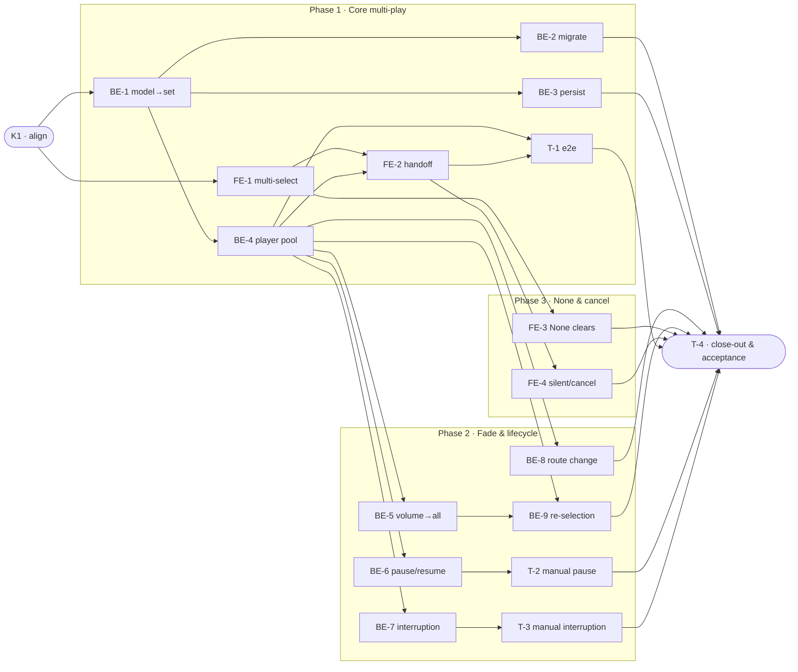

# MSP · Multi-Sound Simultaneous Playback — Task Breakdown

Corresponds to `references/example-team-plan.md` in the `plan-maker-for-team` skill (same feature, same IDs — `S#`/`C#` are defined there).

---

## References

- **Plan:** [multi_sound_playback-team-plan.md](./multi_sound_playback-team-plan.md) — the full team plan (contracts, scenarios, architecture, allocation). **Always read the plan before you start planning the next task** — it holds the context this file only cites (`S#`/`C#`/`Q#`).
- **Brief:** [multi_sound_playback-brief.md](./multi_sound_playback-brief.md) — the source feature brief behind the plan.

---

## Task Breakdown

The integrated, checkable view. Single-role tasks in execution order, grouped into **vertical slices**.

### Dependency graph

### Phase 0 · Kickoff *(prerequisite; the one cross-cutting step)*
- [ ] **K1** — Agree the Contracts and Scenarios with the team #team
    - — · 1.0h
    - completes C1, C2
    - Tests

### Phase 1 · Core multi-play *(the walking skeleton: multiple sounds play and persist, end-to-end)*
- [ ] **BE-1** — Change `MusicPreference` to hold a set (`selectedTracks`); empty = None #backend-role
    - Entity · 8.0h
    - needs K1 · completes C1
    - Tests
        - #unit_test — `test_newPreference_hasEmptySelection` — a fresh preference starts with no tracks
        - #unit_test — `test_emptySet_representsNone` — an empty set is treated as "None"
        - #unit_test — `test_toggle_addsThenRemovesTrack` — toggling a track adds it, then removes it
- [ ] **BE-2** — Migrate old single-track storage to a one-item set on first load #backend-role
    - Use Case · 4.0h
    - needs BE-1 · completes S10
    - Tests
        - #unit_test — `test_migration_wrapsSingleTrackInSet` — a saved single track becomes a one-item set
        - #unit_test — `test_migration_noOldData_yieldsEmptySet` — no prior track yields an empty set
        - #unit_test — `test_migration_runsOnlyOnce` — migration does not re-run on later loads
        - #integration_test — `test_oldSingleTrackMigratesToSet` — stored single-track data loads as a one-item set and plays
- [ ] **BE-3** — Save and restore the selected set #backend-role
    - Use Case · 2.0h
    - needs BE-1 · completes S9
    - Tests
        - #unit_test — `test_saveThenRestore_returnsSameSet` — a saved set restores identically
        - #unit_test — `test_restore_emptyWhenNothingSaved` — restores empty when nothing was saved
        - #integration_test — `test_selectionPersistsAcrossRelaunch` — a chosen set is restored after relaunch
- [ ] **BE-4** — `AudioService` plays a pool, one player per selected sound; start fans out #backend-role
    - Interface Adapter · 12.0h
    - needs BE-1 · completes S1, S2, S4
    - Tests
        - #unit_test — `test_start_createsOnePlayerPerSelectedSound` — N sounds yields N players
        - #unit_test — `test_start_singleSound_stillPlays` — one selected sound still plays (parity)
        - #unit_test — `test_start_emptySet_createsNoPlayers` — an empty set starts silent
        - #unit_test — `test_stop_stopsEveryPlayer` — stop tears down the whole pool
        - #integration_test — `test_poolPlaysAllSelectedSounds` — after start, every selected sound is playing and looping
        - #integration_test — `test_singleSelection_stillPlays` — one selected sound plays as before
- [ ] **FE-1** — `TrackListView` toggle multi-select with selected marks; keep the "None" row #frontend-role
    - Presentation · 6.0h
    - needs K1 · completes S2
    - Tests
        - #unit_test — `test_tapRow_togglesSelection` — tapping a row selects it, tapping again deselects
        - #unit_test — `test_multipleRows_selectableTogether` — more than one row can be selected at once
        - #unit_test — `test_selectedRow_isMarked` — a selected row shows its mark
- [ ] **FE-2** — `MusicSetupView` hands the selected set to the start use case on confirm #frontend-role
    - Presentation · 2.0h
    - needs FE-1, BE-4 · completes S1
    - Tests
        - #unit_test — `test_confirm_passesWholeSetToStart` — confirm hands the full set to the audio layer
        - #unit_test — `test_confirm_emptySet_passesEmpty` — an empty selection is passed through as empty
- [ ] **T-1** — e2e: select multiple → play → fade → stop #tester-role
    - — · 6.0h
    - needs FE-2, BE-4 · completes S1
    - Tests
        - #e2e_test — `test_e2e_selectMultiplePlayFadeStop` — select several sounds, start, confirm all play and fade together, then stop silences all

### Phase 2 · Fade & lifecycle fan-out *(every control fans out to all players)*
- [ ] **BE-5** — Apply one volume to every active player each tick (reuse `1.0 - darknessOpacity`) #backend-role
    - Use Case · 4.0h
    - needs BE-4 · completes S8
    - Tests
        - #unit_test — `test_volume_equalsOneMinusDarkness` — the value is `1.0 - darknessOpacity`
        - #unit_test — `test_tick_appliesSameVolumeToAllPlayers` — every active player receives the value
        - #unit_test — `test_volume_staysWithinZeroToOne` — the value is clamped to a valid range
        - #integration_test — `test_tickVolumeReachesAllPlayers` — a volume tick reaches every real player in the pool
- [ ] **BE-6** — Pause and resume fan out to all players #backend-role
    - Use Case · 2.0h
    - needs BE-4 · completes S5
    - Tests
        - #unit_test — `test_pause_pausesAllPlayers` — pause stops every player
        - #unit_test — `test_resume_resumesAllPlayers` — resume restarts every player
- [ ] **BE-7** — Interruption handling fans out: pause all, resume all on end #backend-role
    - Use Case · 4.0h
    - needs BE-4 · completes S6
    - Tests
        - #unit_test — `test_interruptionBegan_pausesAllPlayers` — an interruption pauses all players
        - #unit_test — `test_interruptionEnded_resumesAllPlayers` — ending it resumes all players
- [ ] **BE-8** — Route change stops all players #backend-role
    - Use Case · 2.0h
    - needs BE-4 · completes S7
    - Tests
        - #unit_test — `test_routeChange_stopsAllPlayers` — a route change stops every player
        - #unit_test — `test_routeChange_noPlayers_isNoOp` — no players playing is a safe no-op
        - #integration_test — `test_routeChangeStopsAllPlayers` — unplugging headphones stops every real player
- [ ] **BE-9** — Mid-session re-selection: stop current players, start the new set at the current fade volume #backend-role
    - Use Case · 6.0h
    - needs BE-4, BE-5 · completes S12
    - Tests
        - #unit_test — `test_reselect_stopsCurrentThenStartsNew` — the current pool stops and the new set starts
        - #unit_test — `test_reselect_newPlayersStartAtCurrentVolume` — new players begin at the current fade volume
        - #integration_test — `test_reselectionSwapsAtCurrentVolume` — confirming a new set mid-session stops the old and starts the new at the current volume
- [ ] **T-2** — Manual: pausing the timer pauses all sounds; resuming resumes all #tester-role
    - — · 2.0h
    - needs BE-6 · completes S5
    - Tests
        - #manual_test — Pause and resume — pausing the timer pauses all sounds; resuming resumes them all (non-automatable: timer pause is a UI interaction with no e2e harness hook in this setup)
- [ ] **T-3** — Manual: a call/alert pauses all sounds and ending it resumes all #tester-role
    - — · 2.0h
    - needs BE-7 · completes S6
    - Tests
        - #manual_test — Call interruption — an incoming call pauses all sounds; ending it resumes them all (non-automatable: OS-level phone interruption cannot be triggered in the e2e harness)

### Phase 3 · Empty / None & cancel edges
- [ ] **FE-3** — "None" / clear-all empties the selection; tapping it when empty is a no-op #frontend-role
    - Presentation · 3.0h
    - needs FE-1 · completes S11
    - Tests
        - #unit_test — `test_none_clearsAllSelections` — tapping "None" empties the set
        - #unit_test — `test_none_whenEmpty_isNoOp` — tapping "None" with nothing selected does nothing
        - #integration_test — `test_noneClearsSelection` — tapping "None" empties the selection end-to-end
- [ ] **FE-4** — Starting with an empty set runs silent; cancelling the overlay leaves the selection unchanged #frontend-role
    - Presentation · 3.0h
    - needs FE-2 · completes S3, S13
    - Tests
        - #unit_test — `test_emptySet_startsSilent` — starting with an empty set plays no audio
        - #unit_test — `test_cancel_leavesSelectionUnchanged` — cancelling discards the working copy
        - #integration_test — `test_emptyStartIsSilent` — starting with an empty set produces no audio end-to-end
        - #integration_test — `test_cancelLeavesSelectionUnchanged` — cancelling the overlay leaves the prior selection intact

### Phase 4 · Close-out
- [ ] **T-4** — Project close-out & acceptance fact-check #tester-role
    - — · 4.0h
    - needs all prior tasks · completes (acceptance gate)
    - Tests
    - Duties
        - Update all documentation per [multi_sound_playback-team-plan.md](./multi_sound_playback-team-plan.md)'s "Documentation update" section — project docs, user manuals, architecture docs, `CLAUDE.md`, `AGENTS.md`, etc.
        - Fix all build / compiler warnings, if any.
        - Run the full test suite; fix every failing test, including any unrelated to this feature.
        - Validate every Acceptance criterion one-by-one with a fact check — no assumptions; confirm each is genuinely done.

**Critical path:** K1 → BE-1 → BE-4 → BE-5 → BE-9 → T-4. Frontend work and the tester's e2e/manual tasks run alongside their backend dependencies.
