# Plan-maker-for-team — Diagram output fixtures

Nine hand-authored golden-output fixtures for manual verification of the diagram phase. Each fixture shows the expected `## Approach & architecture` section output for a described input scenario. Use these to confirm that a generated plan matches the expected structure, diagram types, colour/label conventions, and skip/deferral notes.

---

## Fixture 1 — All diagrams active

**Feature:** Push notification for timer completion. Adds a `NotificationService` component and a `NotificationPermissionView`, updates `TimerUseCase` to trigger a notification on completion, and updates `AppDelegate` to register for push permissions. A new actor (the OS notification system) and two new use cases (grant permission, receive notification) are added. A data edge to APNs is new. Three components interact over ≥3 ordered steps at timer completion.

**Expected `## Approach & architecture` output:**

---

## Approach & architecture

The feature extends the timer completion path with a push-notification side effect, adding a new Interface Adapter and a Presentation entry-point for permission granting.

### Architecture

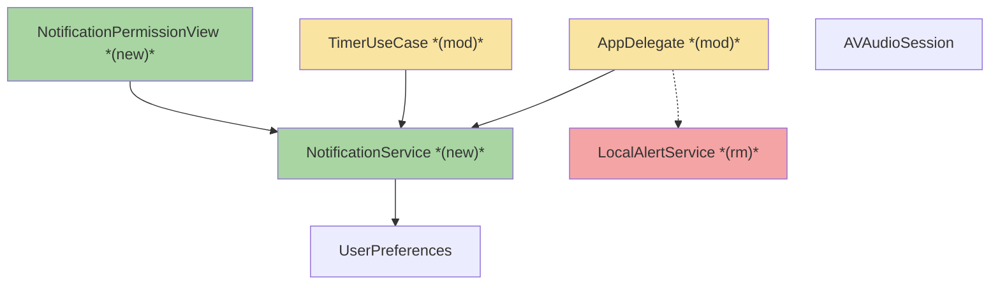

| Component | Change | Why |
|-----------|--------|-----|
| `NotificationPermissionView` | new | Entry point for requesting push permission before the first timer run |
| `NotificationService` | new | Wraps `UNUserNotificationCenter`; schedules and cancels timer-completion alerts |
| `LocalAlertService` | removed | Replaced by `NotificationService`; previously handled basic in-app alerts without push capability |
| `TimerUseCase` | modified | Calls `NotificationService.schedule()` when the timer fires |
| `AppDelegate` | modified | Registers for remote push on launch and forwards the device token to `NotificationService` |

**Layer map (and role mapping)**

| Layer | Role | Components |
|-------|------|-----------|
| Presentation | **Frontend** | `NotificationPermissionView` |
| Use Cases | Backend | `TimerUseCase` |
| Interface Adapters | Backend | `NotificationService` |
| Entities | Backend | `UserPreferences` |
| Frameworks & Drivers | Backend | `AppDelegate`, `AVAudioSession` |

**What changes**
- `TimerUseCase` calls `NotificationService.schedule()` on completion.
- `NotificationService` wraps `UNUserNotificationCenter` to schedule, cancel, and deliver alerts.
- `AppDelegate` registers for push permissions on launch.
- `NotificationPermissionView` prompts the user before the first run.

**Key decisions**
- Notifications are local (`UNUserNotificationCenter`), not remote APNs — no server required.
- Permission is requested once; `UserPreferences` records the outcome.

### Actors & Use Cases

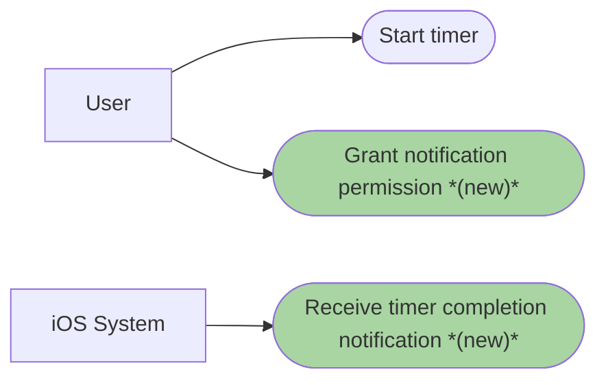

### Flows

#### User Flow

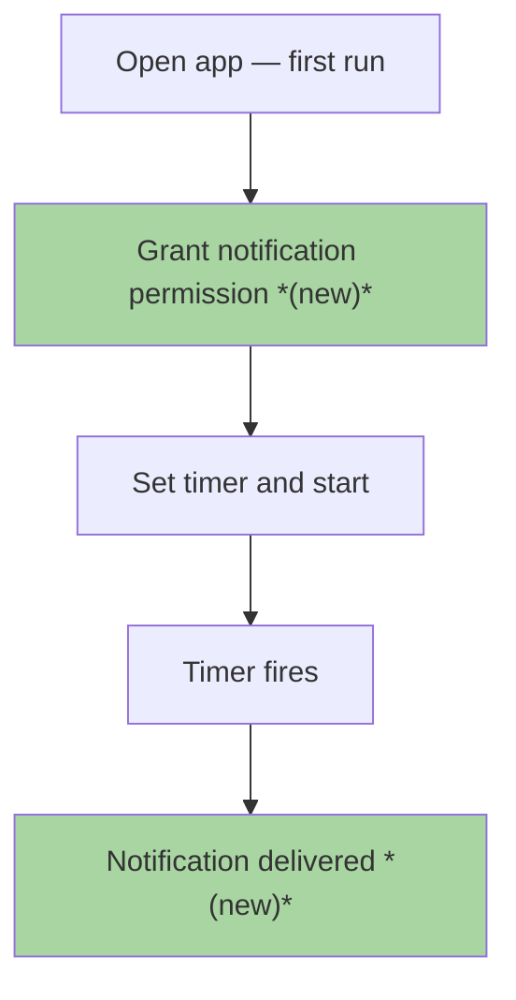

#### Data Flow

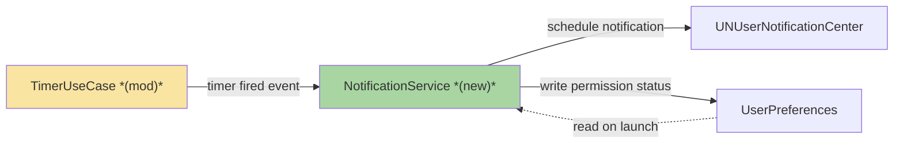

#### Sequence

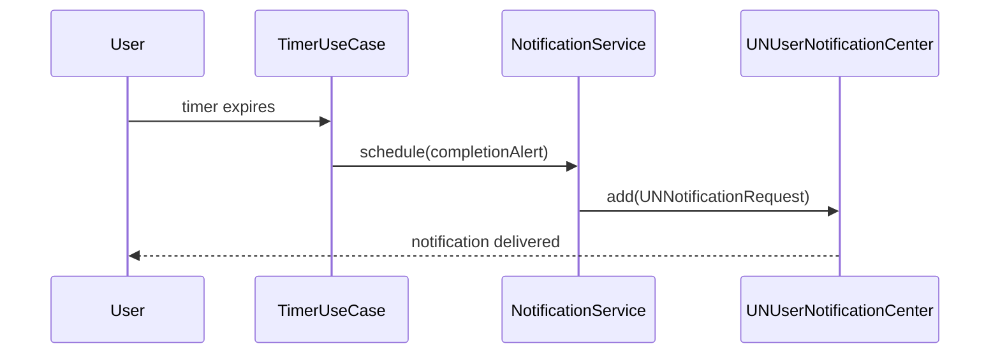

---

## Fixture 2 — All conditional diagrams skipped, architecture deferred

**Feature:** Update minimum iOS deployment target from iOS 15 to iOS 16. A build-config-only change: no source files change, no components are added, modified, or removed, no user-facing steps change, no data edges change, and no actors or use cases change. The structured-output agent returns an empty `COMPONENTS` section and a missing `DEPENDENCIES` section.

**Expected `## Approach & architecture` output:**

---

## Approach & architecture

The deployment target change requires no source modifications; only the Xcode project file and CI configuration are updated.

### Architecture

architecture diagram deferred — component set unconfirmed

### Actors & Use Cases

_Skipped: no actor or use case is new, changed, or removed in this feature._

### Flows

#### User Flow

_Skipped: no user-facing step changes in this feature._

#### Data Flow

_Skipped: no data edge changes in this feature._

#### Sequence

_Skipped: no multi-step inter-component interaction in this feature._

---

## Fixture 3 — Boundary: 16-node full scope triggers bounded-context scoping

**Feature:** Payment gateway integration for an e-commerce checkout flow. The feature adds `PaymentGatewayService` (new) and modifies `CheckoutUseCase` (modified). The full component area has 16 nodes. After bounded-context scoping (changed nodes + 1-hop neighbours), the diagram contains exactly 15 nodes.

**Input DEPENDENCIES edge set (used to determine the 1-hop neighbourhood):**

Edges from `PaymentGatewayService` (7 edges):
- PaymentGatewayService → PaymentGatewayProtocol
- PaymentGatewayService → OrderRepository
- PaymentGatewayService → CurrencyConverter
- PaymentGatewayService → PaymentTokenizer
- PaymentGatewayService → TransactionLogger
- PaymentGatewayService → PaymentConfig
- PaymentGatewayService → RetryPolicy

Edges from `CheckoutUseCase` (7 edges):
- CheckoutUseCase → PaymentGatewayProtocol  *(shared target with PaymentGatewayService)*
- CheckoutUseCase → CartEntity
- CheckoutUseCase → UserEntity
- CheckoutUseCase → OrderEntity
- CheckoutUseCase → InventoryUseCase
- CheckoutUseCase → DiscountUseCase
- CheckoutUseCase → NotificationService

Total edges incident to changed components: 14. Shared target: `PaymentGatewayProtocol`. Distinct 1-hop neighbours: 13 (PaymentGatewayProtocol, OrderRepository, CurrencyConverter, PaymentTokenizer, TransactionLogger, PaymentConfig, RetryPolicy, CartEntity, UserEntity, OrderEntity, InventoryUseCase, DiscountUseCase, NotificationService).

Full-scope node count: 16 (the 2 changed nodes + 13 1-hop neighbours + `AuditLogService`, which is in the payment area but only reachable via `TransactionLogger` — not a direct 1-hop neighbour of either changed node).

After bounded-context scoping: 15 nodes (changed + 1-hop; `AuditLogService` excluded). The boundary decision: `AuditLogService` is excluded because it is only a 2-hop neighbour of the changed components.

Actor change: `Cashier` role is added as a new actor who can initiate refunds from the admin panel.

**Expected `## Approach & architecture` output:**

---

## Approach & architecture

The payment gateway integration inserts a new Interface Adapter (`PaymentGatewayService`) and updates the existing checkout use case to route payments through the new gateway protocol.

### Architecture

```mermaid
flowchart TD
  classDef newNode fill:#a8d5a2;
  classDef modNode fill:#f9e4a1;
  classDef rmNode fill:#f4a4a4;

  PGS["PaymentGatewayService *(new)*"]
  CUC["CheckoutUseCase *(mod)*"]
  PGP["PaymentGatewayProtocol"]
  OR["OrderRepository"]
  CC["CurrencyConverter"]
  PT["PaymentTokenizer"]
  TL["TransactionLogger"]
  PC["PaymentConfig"]
  RP["RetryPolicy"]
  CE["CartEntity"]
  UE["UserEntity"]
  OE["OrderEntity"]
  IU["InventoryUseCase"]
  DU["DiscountUseCase"]
  NS["NotificationService"]

  PGS --> PGP
  PGS --> OR
  PGS --> CC
  PGS --> PT
  PGS --> TL
  PGS --> PC
  PGS --> RP
  CUC --> PGP
  CUC --> CE
  CUC --> UE
  CUC --> OE
  CUC --> IU
  CUC --> DU
  CUC --> NS

  class PGS newNode;
  class CUC modNode;
```

_Scope limited to change neighbourhood: full-scope diagram contains 16 nodes (2 changed + 13 direct neighbours + AuditLogService). AuditLogService excluded: it is a 2-hop neighbour only (reachable via TransactionLogger, not directly from either changed component)._

| Component | Change | Why |
|-----------|--------|-----|
| `PaymentGatewayService` | new | Implements `PaymentGatewayProtocol` to route payments through the external gateway API |
| `CheckoutUseCase` | modified | Delegates payment execution to `PaymentGatewayService` via the protocol |

**Layer map (and role mapping)**

| Layer | Role | Components |
|-------|------|-----------|
| Presentation | **Frontend** | checkout views (unchanged) |
| Use Cases | Backend | `CheckoutUseCase`, `InventoryUseCase`, `DiscountUseCase` |
| Interface Adapters | Backend | `PaymentGatewayService`, `PaymentGatewayProtocol`, `OrderRepository` |
| Entities | Backend | `CartEntity`, `UserEntity`, `OrderEntity` |
| Frameworks & Drivers | Backend | `CurrencyConverter`, `PaymentTokenizer`, `TransactionLogger`, `PaymentConfig`, `RetryPolicy`, `NotificationService` |

**What changes**
- `CheckoutUseCase` delegates payment execution to the new `PaymentGatewayService`.
- `PaymentGatewayService` implements `PaymentGatewayProtocol` and calls the external gateway.

**Key decisions**
- Protocol-first: `PaymentGatewayProtocol` decouples the use case from the concrete gateway adapter.
- Retry and tokenisation are encapsulated in the adapter layer; the use case has no gateway-specific knowledge.

### Actors & Use Cases

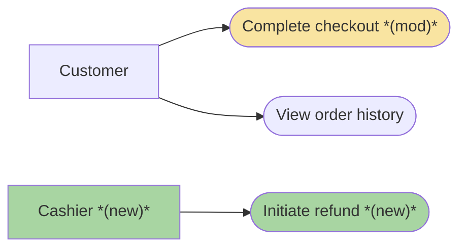

### Flows

#### User Flow

_Skipped: no user-facing step changes in this feature — the checkout UI flow is unchanged; only the backend payment path changes._

#### Data Flow

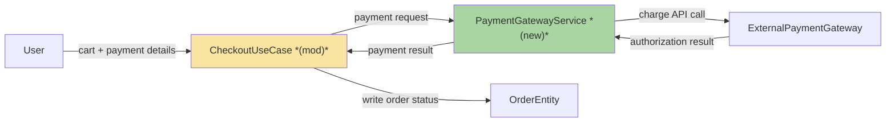

#### Sequence

_Skipped: the payment routing interaction is fully captured in the data flow diagram above; no additional ordered message sequence is needed._

---

## Fixture 4 — Parse-failure: non-conforming investigation output

**Feature:** Auto-save draft messages. The structured-output agent returned a `COMPONENTS` section but omitted `DEPENDENCIES` entirely. It also returned an `ACTORS_AND_USE_CASES` section, but the entries were malformed (missing `type:` fields on every entry).

**Expected `## Approach & architecture` output:**

---

## Approach & architecture

Auto-save persists a draft of the message being composed so it survives app backgrounding and interruptions.

### Architecture

architecture diagram deferred — component set unconfirmed

### Actors & Use Cases

_Diagram omitted: investigation output did not conform to the required structured format._

### Flows

#### User Flow

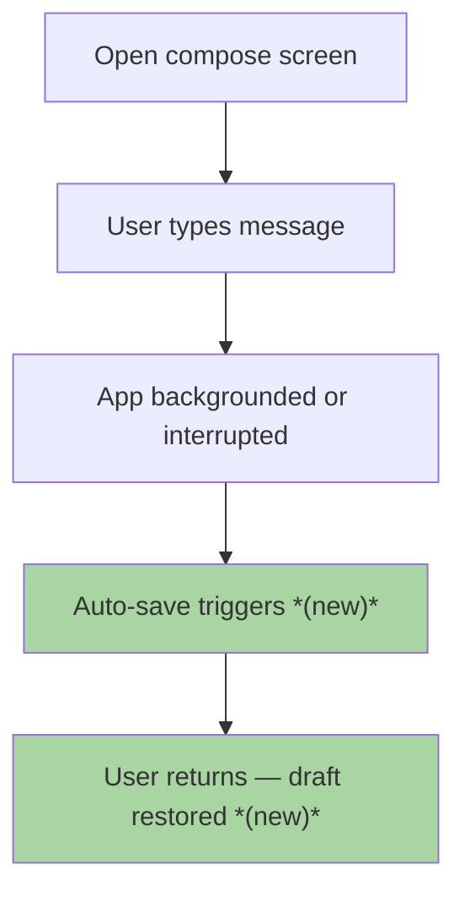

#### Data Flow

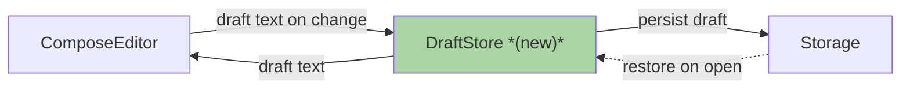

#### Sequence

_Skipped: no multi-step inter-component interaction in this feature beyond what the data flow captures._

---

## Fixture 5 — Sequence diagram scoped to primary user-facing flow (> 8 participants)

**Feature:** Multi-platform order sync. The full interaction graph involves 12 components (UI, API Gateway, OrderService, InventoryService, PaymentService, ShippingService, NotificationService, AnalyticsService, CRMService, WarehouseManagement, FulfillmentService, AuditLog). Scoped to the 5 components directly involved in the primary user-facing flow: placing an order.

**Expected `#### Sequence` section:**

---

#### Sequence

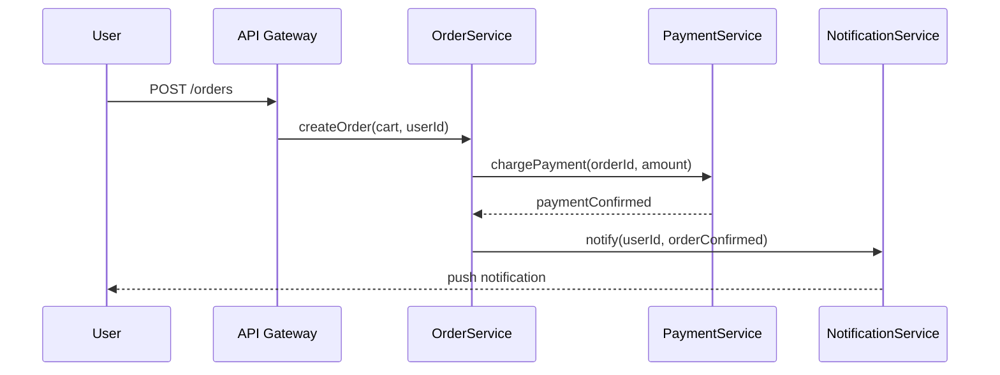

_Scope limited to the primary user-facing flow: 12 components participate in the full sync graph, scoped to the 5 directly involved in the order-placement path (UI → API Gateway → OrderService → PaymentService → NotificationService). InventoryService, ShippingService, and others act after order confirmation and are excluded._

---

## Fixture 6 — Sole changed component: caption line, no companion table

**Feature:** Add error boundary component. Exactly one new component (`ErrorBoundary`) is added to the Presentation layer. No other components are added, modified, or removed.

**Expected `### Architecture` section:**

---

### Architecture

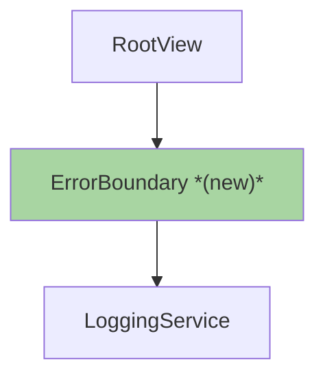

_New: ErrorBoundary — wraps the root view tree to intercept uncaught render errors and display a fallback UI; forwards error details to LoggingService._

---

## Fixture 7 — Populated `## Data` section with ER diagram

**Feature:** User authentication (login, registration, password reset). The feature adds a `sessions` table, modifies the `users` table to add `password_hash` and `email_verified_at` columns, and adds a `password_reset_tokens` table. The full schema has 4 entities — all within the 15-node limit, so no scoping is needed. The `users` table already exists; `sessions` and `password_reset_tokens` are new. A relationship between `sessions` and `users` (and between `password_reset_tokens` and `users`) is new.

**Expected `## Data` section:**

---

## Data

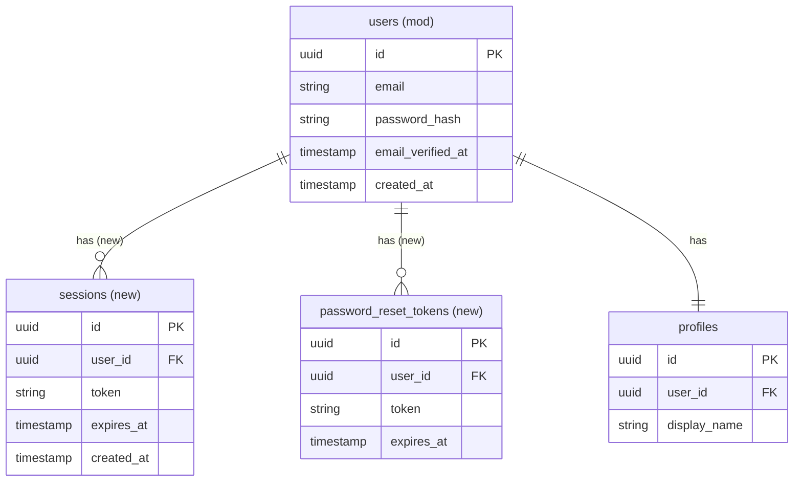

**Migration notes**
- Add `password_hash VARCHAR(255) NOT NULL` and `email_verified_at TIMESTAMP NULL` to `users` — non-destructive, existing rows receive `NULL` for `email_verified_at` and require a backfill for `password_hash`.
- Create `sessions` table with FK → `users.id` (ON DELETE CASCADE).
- Create `password_reset_tokens` table with FK → `users.id` (ON DELETE CASCADE); add unique index on `token`.

**Entity model changes**
- `User` entity gains `passwordHash: String` and `emailVerifiedAt: Date?` fields.
- `Session` entity is new — `id`, `userId`, `token`, `expiresAt`, `createdAt`.
- `PasswordResetToken` entity is new — `id`, `userId`, `token`, `expiresAt`.

---

## Fixture 8 — Populated `### Prior decisions` table

**Feature:** Same user-auth feature as Fixture 7. The ADR agent found three ADRs: one active with a constraint, one superseded with a constraint, and one active with no constraint.

**ADR agent raw output:**

```
decision: Use UUIDs as primary keys across all tables
rationale: Avoids sequential ID enumeration attacks and allows distributed ID generation without coordination
status: accepted
constraint: sessions and password_reset_tokens must use UUID PKs — do not use serial/auto-increment

decision: Store passwords using bcrypt with cost factor 12
rationale: bcrypt provides adaptive hashing; cost factor 12 balances security with login latency on current hardware
status: active
constraint: none

decision: Use JWT for session tokens
rationale: Stateless tokens eliminate a DB lookup per request
status: deprecated
constraint: JWT is superseded — use opaque tokens stored in the sessions table; the sessions table created in this feature is the replacement
```

**Expected `### Prior decisions` subsection:**

---

### Prior decisions

| Decision | Rationale | Constraint |
|---|---|---|
| Use UUIDs as primary keys across all tables | Avoids sequential ID enumeration attacks and allows distributed ID generation without coordination | `sessions` and `password_reset_tokens` must use UUID PKs — do not use serial/auto-increment |
| Use JWT for session tokens *(superseded)* | Stateless tokens eliminate a DB lookup per request | JWT is superseded — use opaque tokens stored in the `sessions` table; the `sessions` table created in this feature is the replacement |

---

## Fixture 9 — Populated `### Contradictions` block

**Feature:** Same user-auth feature as Fixtures 7 and 8. The docs agent found two discrepancies: a README states "no authentication required for API endpoints" while the code has auth middleware on all routes; and the brief assumes a `users` table exists with an `email` column, but the data schema agent found a `members` table with a `contact_email` column instead.

**Expected `### Contradictions` subsection:**

---

### Contradictions

**Code vs. docs**

| Contradiction | Code says | Doc says | Owner |
|---|---|---|---|
| API authentication requirement | Auth middleware (`AuthMiddleware`) applied to all routes in `src/middleware/auth.ts` | `README.md` (line 42): "no authentication required for API endpoints" | doc needs updating |

*Action:* `README.md` must be updated — the "no authentication required" claim is factually wrong. Added to Documentation update with reason *contradiction with code*.

**Brief vs. reality**

| Contradiction | Brief assumes | Reality | Owner |
|---|---|---|---|
| User table name and email column | `users` table with `email` column | Only `members` table exists (`contact_email` column); no `users` table in schema | open question |

*Action:* Clarify before implementation — either the feature creates a new `users` table (and the `members` table is unrelated) or the brief should reference `members.contact_email`. Cannot be resolved without product input.
