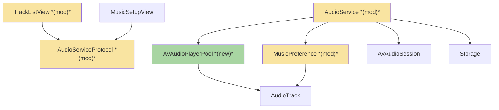
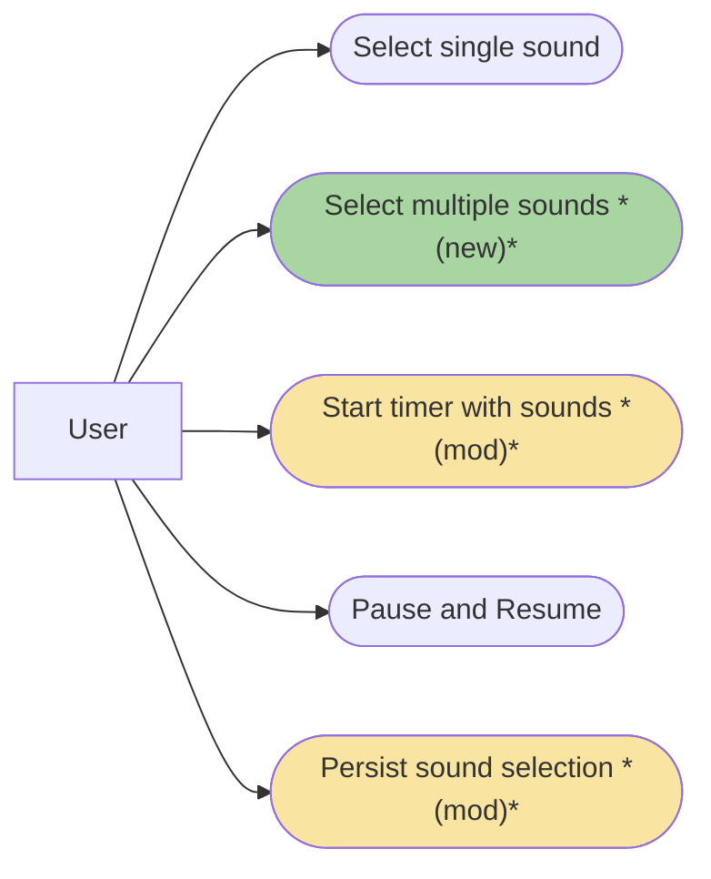
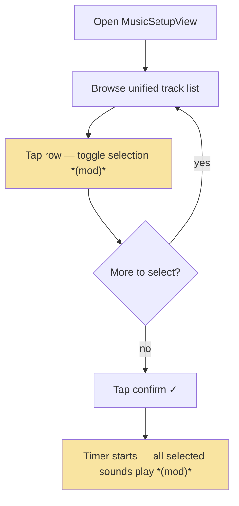
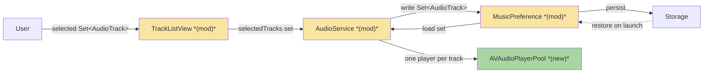

# MSP · Multi-Sound Simultaneous Playback — Team Plan

**How to read this file**
- **Architecture approach:** Clean Architecture — the default fallback; no override skill was requested. **Layers:** Presentation · Use Cases · Interface Adapters · Entities · Frameworks & Drivers.
- The **Frontend, Backend, and Tester** sections are the **depth view** — each role's scope, grouped by layer.
- **Contracts** are logical here, in the **built-in fallback** form — this feature has no client↔server API, so TypeSpec is not applicable. When a feature does have an API boundary and TypeSpec is available, each contract is authored as a linked `.tsp` file instead.
- **Role tags** (`#frontend-role`, `#backend-role`, `#tester-role`) mark each role-owned section — filter a tag (e.g. in Obsidian) to see one role's whole scope.
- IDs (`S#` scenarios, `C#` contracts, `Q#` questions) are the traceability thread; search the file for an ID to find where it's defined.
- **Tasks** are not in this file — task breakdown is a separate downstream step that consumes this plan.
- **Rule:** change a contract only by team agreement.

---

## Background

The current audio system plays exactly one Audio Track, looping infinitely and fading volume with darkness.

---

## Goal

After this feature ships: a user opens the sound overlay, taps one or more rows, confirms, starts the timer, and hears all selected sounds play simultaneously at full volume, fading together as the screen darkens. Pause stops all. Resume restarts all. Timer stop silences all. Selection persists across launches.

---

## Scope

### In Scope
- Play multiple Audio Tracks; all lifecycle calls fan out to all players
- Migrate old single-track format on first load
- "None" clears all; track rows toggle
- Update all audio lifecycle methods and the music setup flow
- 5 bundled ambient sound files added to the app bundle (Rain, White Noise, Ocean Waves, Forest, Wind)

### Out of Scope
- Per-sound volume control (v2)
- Music vs. sounds category separation (v2)
- Sound preview on tap (v2)
- User-imported audio (v2)
- Crossfade or smart mixing (v2)
- Any cap on number of selected tracks

---

## Acceptance criteria
- User can select zero, one, or multiple tracks in the sound overlay
- "None" row clears all selections; tapping it when nothing is selected is a no-op
- All selected sounds play simultaneously when the timer starts
- All selected sounds fade volume in sync with screen darkness (same formula: `1.0 - darknessOpacity`)
- Pause stops all players; resume restarts all players
- Timer stop silences all players
- Confirming a new selection while the timer is running: stops current players, starts new selection at current fade volume
- Cancelling the overlay leaves selection unchanged
- Selection persists across app launches
- Old single-track UserDefaults data migrates to `[AudioTrack]` on first load without data loss
- 5 bundled ambient sound files are present and playable
- All tests pass with zero warnings

---

## What does NOT change
- Volume formula: `Float(1.0 - darknessOpacity)` on every timer tick
- `setVolume(_:)` call site in `updatePublishedState()` — still one call, now fans out to all players
- `AVAudioSession` category configuration (`.playback`, background audio)
- Interruption and route-change handling logic (extended to fan out, not rewritten)
- `availableTracks: [AudioTrack]` computed from bundle filenames — unchanged
- `cancelMusicSetup()` logic — discards working copy, no audio change

---

## Known limitations / accepted trade-offs
- All selected sounds play at the same volume level — intentional; per-sound volume is v2
- No artificial cap on simultaneous tracks — device handles 2–6 loops trivially
- "None" is kept as an explicit row (deselect-all affordance)

---

## Approach & architecture

The feature is structured with **Clean Architecture** so dependencies point inward (UI → use cases → entities) and the seams fall on layer boundaries.

### Architecture

| Component | Change | Why |
|-----------|--------|-----|
| `AVAudioPlayerPool` | new | Encapsulates one `AVAudioPlayer` per selected track and fan-out of play/stop/pause/resume/volume calls |
| `TrackListView` | modified | Toggle multi-select replaces single-select row UI |
| `AudioServiceProtocol` | modified | Interface updated to accept `Set<AudioTrack>` rather than a single optional track |
| `AudioService` | modified | Creates and manages the player pool; all lifecycle calls fan out to all active players |
| `MusicPreference` | modified | `selectedTracks` changes from `AudioTrack?` to `Set<AudioTrack>`; adds one-time migration from single-track UserDefaults format |

**Layer map (and role mapping)**

| Layer | Role | Components |
|-------|------|-----------|
| Presentation | **Frontend** (SwiftUI) | `TrackListView`, `MusicSetupView` |
| Use Cases | Backend (Swift) | start soundscape · sync volume · handle interruption/route · persist & restore |
| Interface Adapters | Backend (Swift) | `AudioService` conforming to `AudioServiceProtocol` |
| Entities | Backend (Swift) | `AudioTrack`, `MusicPreference` (now a set) |
| Frameworks & Drivers | Backend (Swift) | `AVAudioPlayerPool`, `AVAudioSession`, Storage |

**What changes**
- The track list moves from **single-select to toggle multi-select** (Presentation).
- The audio service owns a **pool — one `AVAudioPlayer` per selected sound** (Adapter); start/stop/pause/resume act on all.
- On each timer tick the **same volume is applied to every active player** (Use Case; today's darkness→volume formula reused).
- Persistence changes from one track to a **set**, with a one-time migration (Entity + persistence).

**Key decisions (from the brief, fixed for v1)**
- One unified list (music + ambient sounds together).
- Flat volume — no per-sound sliders.
- Free layering — music and sounds can play together, no mutual exclusion.
- Multiple `AVAudioPlayer` instances — no new dependencies.

### Actors & Use Cases

### Flows

#### User Flow

#### Data Flow

#### Sequence

_Skipped: the timer-start interaction is fully captured in the data flow diagram above; the feature brief does not define an explicit ordered sequence of inter-component message exchanges beyond what the data flow represents._

### Prior decisions

_No Architecture Decision Records found in this repository._

### Contradictions

_No contradictions detected between code, documentation, and brief assumptions._

---

## Contracts / seams

Boundaries where roles must agree. **Logical, not code** (built-in fallback form; no API → TypeSpec not used here). Changing one requires team agreement.

**C1 — Selected-sound persistence**  *(Entity ↔ Adapter)*
`MusicPreference` holds a **set** of selected tracks (`selectedTracks`), not one. On upgrade, a single previously-saved track becomes a one-item set. Empty set = "None".

**C2 — Audio control**  *(Presentation ↔ Use Case / Adapter)*
The start use case receives the **whole selected set**; the audio service then owns play / stop / pause / resume / volume for the entire pool, exposed through `AudioServiceProtocol`. "None" = start with an empty set (silent). Volume is one value applied to all.

---

## Data

_This project has no database — all audio state is held in memory during a session and persisted to `UserDefaults` via `MusicPreference`; no relational schema or migration tooling is in use._

---

## Scenarios #tester-role

What the app must do and what the tester verifies end-to-end. Behavioural only — step-level detail is produced by the tasks below.

| id | Scenario (Given / When / Then) |
|----|--------------------------------|
| **S1** | **Given** several sounds selected and not expired · **When** the timer starts · **Then** all play together, looping, fading in volume as the screen darkens |
| **S2** | **Given** exactly one sound selected · **When** the timer starts · **Then** it plays as before (single-select still works) |
| **S3** | **Given** "None" / nothing selected · **When** the timer starts · **Then** the session runs with no audio |
| **S4** | **Given** many sounds selected (2–6) · **When** the timer starts · **Then** all play, with no artificial cap |
| **S5** | **Given** sounds playing · **When** the timer is paused then resumed · **Then** all players pause together and resume together |
| **S6** | **Given** sounds playing · **When** a call/notification interrupts · **Then** all players pause, and all resume when it ends |
| **S7** | **Given** sounds playing · **When** headphones are unplugged (route change) · **Then** all players stop |
| **S8** | **Given** sounds playing · **When** each timer tick fires · **Then** every active player receives the same volume |
| **S9** | **Given** a selected set · **When** the app is closed and reopened · **Then** the same set is restored |
| **S10** | **Given** a build that saved a single track before · **When** the user upgrades · **Then** that track appears selected and plays |
| **S11** | **Given** sounds selected · **When** the user taps "None" / clear-all · **Then** the selection is emptied |
| **S12** | **Given** sounds playing · **When** the user confirms a new selection mid-session · **Then** current players stop and the new set starts at the current fade volume |
| **S13** | **Given** a selection · **When** the user opens the overlay and cancels · **Then** the selection is unchanged |

---

## Frontend — Presentation (SwiftUI) #frontend-role

**Scope:** the SwiftUI surface only — selection UI and handing the chosen set to the audio layer on start.
**Owns layer:** Presentation.

**Done when**
- [ ] Single-select behaves exactly as before — S2
- [ ] Multi-select feels as light as single-select and marks each choice clearly — S1, S11
- [ ] "None" / clear-all empties the selection and starts silent — S3, S11
- [ ] Cancelling the overlay leaves the selection unchanged — S13

---

## Backend — Entities · Use Cases · Adapters · Frameworks (Swift) #backend-role

**Scope:** everything non-UI — the domain model, application logic, the audio service, and framework usage. Writes both unit and integration tests for its tasks.
**Owns layers:** Entities, Use Cases, Interface Adapters, Frameworks & Drivers.

**Done when**
- [ ] 2–6 sounds play together, looping — S1, S4
- [ ] One volume value is applied to every active player each tick — S8
- [ ] Pause/resume, interruption, and route change act on all players — S5, S6, S7
- [ ] Mid-session re-selection restarts cleanly at the current fade volume — S12
- [ ] Selection persists across launches and migrates from a single saved track — S9, S10

---

## Tester #tester-role

**Scope:** the tester owns **e2e and manual** tests plus the project close-out. **Unit and integration** tests belong to the implementing dev, in each implementation task's `Tests` block.

**Allocation** — each scenario at the cheapest level that proves it *(unit + integration are dev-written; e2e + manual are the tester's tasks)*

| Scenario | Cheapest level |
|----------|----------------|
| S8 | unit + integration |
| S1 | integration + e2e |
| S2, S4, S7, S9, S10, S12 | integration |
| S3, S11, S13 | integration |
| S5, S6 | manual |

---

## Documentation update

Docs the feature touches — the tasks file's close-out task works through this list.

- [ ] [multi_sound_playback-brief.md](./multi_sound_playback-brief.md) — *no change needed* (source brief)
- [ ] [multi_sound_playback-team-plan.md](./multi_sound_playback-team-plan.md) — *new feature* (this file)
- [ ] [audio.md](./Documentation/Architecture/audio.md) — *new feature* — update for the player-pool change (if present)
- [ ] [CLAUDE.md](./CLAUDE.md) / [AGENTS.md](./AGENTS.md) — *new feature* — note the multi-sound playback capability (if present)

**Consulted (read-only)**
- *(no documentation consulted — this is a new-feature addition to an area with no existing design docs)*

---

## Open questions

Resolve before committing (status moves `draft → planned`).

| id | Area | Question |
|----|------|----------|
| **Q3** | tests | Can interruption (S6) be automated in our harness, or must it stay a manual test? (Route change S7 is covered by a backend integration test.) |

*Resolved in this revision: Q1 (5 files named in Scope), Q2 ("None" no-op when empty, in Acceptance), Q4 (migration runs on first load, in Acceptance).*

---

## References

- **Brief:** [multi_sound_playback-brief.md](./multi_sound_playback-brief.md)
